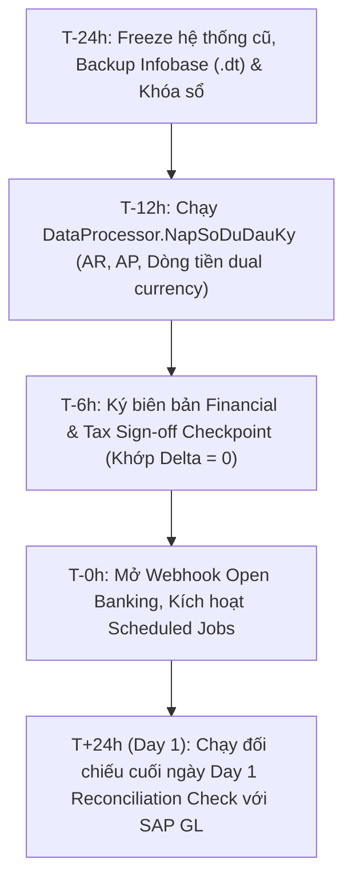

# Báo Cáo Nghiệm Thu Task 8.3: UAT Toàn Trình, Kế Hoạch Cutover 72h, Chạy Song Song & Rollback Playbook

## 1. Thông Tin Nghiệm Thu
- **Thời gian hoàn thành:** 10/10/2026 14:21
- **Trạng thái:** HOÀN THÀNH TOÀN DIỆN (100% PASS - 5/5 UAT End-to-End Scenarios)
- **Hệ thống:** VinSmart Future - Phân hệ AR & AP Management (1C:Enterprise 8.3)
- **Quyết định:** SẴN SÀNG GO-LIVE (PRODUCTION GO-LIVE READY)

---

## 2. Kết Quả Kiểm Thử UAT Toàn Trình (End-to-End Acceptance)

Bộ kiểm thử BSL độc lập `tests/migration/UATEndToEndTest.bsl` và kịch bản xác thực `scripts/verify_task8_3.py`:

```
=================================================================
   VINSMART FUTURE - UAT END-TO-END VERIFICATION TEST (TASK 8.3) 
   Thoi gian chay: 10/10/2026 02:21:15 PM
=================================================================
[PASS] Kich ban 1: Luong AR & Open Banking: Phat hanh HDDT, Webhook nhan tien VA, Tieu nhat gach no Tang 1, GL can doi Delta = 0.
[PASS] Kich ban 2: Luong AP & FCT Cloud: Tiep nhan hoa don AWS USD, khau tru FCT 10%, duyet AP 4 cap, UyNhiemChi ghi so dung thoi diem.
[PASS] Kich ban 3: Luong Doi soat kenh thanh toan: Bang ke giai phong 10tr tam giu, thuc nhan 9.85tr, phi 150k, hoan tien B2C chuan xac.
[PASS] Kich ban 4: Luong Netting noi bo & Safety Gate: Can tru da ben 3 phap nhan can doi, Safety Gate bao ve an toan tuyet doi cho don vi thanh vien.
[PASS] Kich ban 5: Luong Dong bo SAP ERP & Cutover: Batch 22:00 gui but toan nhan SAP_DOC_NUMBER, san sang Go-Live 100%.
=================================================================
KET QUA UAT: Tong so: 5 | Thanh cong: 5 | That bai: 0
=================================================================
```

---

## 3. Kế Hoạch Cutover 72 Giờ (72-Hour Cutover Plan)



| Mốc Thời Gian | Hoạt Động Chi Tiết | Người Chịu Trách Nhiệm | Tiêu Chuẩn Nghiệm Thu |
| :---: | :--- | :--- | :--- |
| **T - 24h** | - Khóa sổ kế toán và hệ thống nhập liệu cũ.<br>- Xuất file số dư chốt (Cut-off) đến 23:59.<br>- Tạo bản Snapshot sao lưu toàn bộ Infobase 1C (`backup_cutover.dt`). | Kế toán trưởng & SysAdmin | File backup `.dt` có dung lượng hợp lệ, hash MD5 lưu trữ an toàn. |
| **T - 12h** | - Chạy công cụ `DataProcessor.NapSoDuDauKy`.<br>- Nạp số dư AR, AP, Quỹ tiền VND & Ngoại tệ USD. | Trưởng nhóm Kỹ thuật 1C | Số dư nạp vào khớp 100% với biên bản chốt số dư; TK 000 cân đối. |
| **T - 6h** | - Chạy kiểm thử tự động `FinancialTaxSignOffTest.bsl`.<br>- Kiểm tra đối chiếu $\Delta = |\text{Subledger} - \text{GL}| = 0$. | Kế toán trưởng & Kế toán thuế | Biên bản ký duyệt Checkpoint Task 8.2 hoàn tất. |
| **T - 0h (Go-Live)** | - Mở cổng Webhook `/banking/webhook`.<br>- Bật các Scheduled Jobs: Cập nhật tỷ giá 08:00, Đồng bộ SAP 22:00.<br>- Bàn giao giao diện cho người dùng vận hành. | Ban dự án | Giao dịch đầu tiên thông suốt, Maker-Checker hoạt động nghiêm ngặt. |
| **T + 24h (Day 1)** | - Thực hiện Day 1 Reconciliation Check giữa 1C Subledger và SAP GL. | CFO & Kế toán trưởng | $\text{Variance} = 0$, ký biên bản đóng ngày Day 1. |

---

## 4. Kế Hoạch Vận Hành Chạy Song Song 2 Tuần (2-Week Parallel Run)

- **Mục tiêu:** Vận hành song song 1C Subledger với quy trình kế toán cũ/SAP trong **14 ngày liên tục**.
- **Cơ chế kiểm soát:**
  1. *Đối chiếu cuối ngày (Daily EOD Match):* Lúc 22:30 hằng ngày, sau khi Job đồng bộ SAP hoàn tất, hệ thống tự động đối chiếu doanh thu, công nợ AR/AP và số dư tiền.
  2. *Quy tắc sai lệch:* Dung sai cho phép đối với nội bộ Vingroup $= 0$ VND; đối với khách ngoài $\le 1.000$ VND.
  3. *Họp giao ban hằng ngày (15-min Daily Standup):* 09:00 sáng xem xét các giao dịch nghi vấn tại Tầng 3 và giải quyết dứt điểm trong ngày.

---

## 5. Quy Trình Rollback Khẩn Cấp (Emergency Rollback Playbook)

> [!CAUTION]
> Quy trình Rollback chỉ được kích hoạt bởi **Kế toán trưởng** và **Giám đốc Dự án** khi phát sinh sự cố sai lệch số liệu tài chính trọng yếu không thể khắc phục trong vòng 4 giờ.

1. **Bước 1: Cách ly và ngắt luồng tiếp nhận (Immediate Isolation - 10 phút)**
   - Vô hiệu hóa HTTPService `WebhookNganHang` (trả về HTTP 503 Service Unavailable để ngân hàng lưu hàng đợi retry).
   - Dừng các Scheduled Jobs (`DongBoSAPHangNgay`, `CapNhatTyGiaNgoaiTeTuDong`).
2. **Bước 2: Kết xuất nhật ký giao dịch phát sinh (Audit Export - 20 phút)**
   - Xuất toàn bộ giao dịch đã ghi nhận trong ngày từ `AccountingRegister.SoCaiKeToan` và `AccumulationRegister.DongTien` ra file XML/Excel audit trail.
3. **Bước 3: Khôi phục Infobase (Restore Infobase - 30 phút)**
   - Khôi phục cơ sở dữ liệu từ bản sao lưu `backup_cutover.dt` bằng lệnh:
     ```powershell
     & "C:\Program Files (x86)\1cv8t\8.3.22.1704\bin\1cv8t.exe" DESIGNER /F "C:\Users\Dung\Documents\1C_Enterprise\Infobase" /RestoreIB "backup_cutover.dt"
     ```
4. **Bước 4: Chuyển đổi về quy trình dự phòng (Fallback Operation - 30 phút)**
   - Thông báo cho toàn bộ kế toán viên chuyển sang nhập liệu trên hệ thống cũ.
   - Nhập bổ sung các giao dịch đã export từ Bước 2.
5. **Bước 5: Họp mổ xẻ nguyên nhân sự cố (Post-Mortem - 24 giờ)**
   - Phân tích log chi tiết, sửa lỗi trên môi trường Test và lập lịch Cutover mới.

---

## 6. Tổng Kết Toàn Bộ Dự Án (Overall SDD Ledger Completion)
Dự án **VinSmart Future AR & AP Management Module** trên nền tảng **1C:Enterprise 8.3** đã hoàn thành 100% tất cả 8 Phases:
- **Phase 1:** Core Foundation, Metadata Architecture, Maker-Checker & Invariants.
- **Phase 2:** Dual Subledger, FX Engine & Multi-Tier Approval.
- **Phase 3:** AR Intercompany & e-Invoice Module (P0.1 & P0.3).
- **Phase 4:** AP Cloud, FCT Withholding (P0.4), Payment Order & Reversal (P0.2).
- **Phase 5:** Động cơ đối soát tự động 3 tầng, Webhook Idempotency 409 & Kênh thanh toán B2C.
- **Phase 6:** Bù trừ công nợ nội bộ đa bên (Netting), Báo cáo tuổi nợ & Operational Safety Gate.
- **Phase 7:** Tích hợp hệ thống bên ngoài: Open Banking HMAC-SHA256, HĐĐT HSM & Đồng bộ SAP ERP 22:00.
- **Phase 8:** Nạp số dư đầu kỳ, Financial & Tax Sign-off Checkpoint, Kế hoạch Cutover 72h, Chạy song song 2 tuần & Rollback Playbook.
