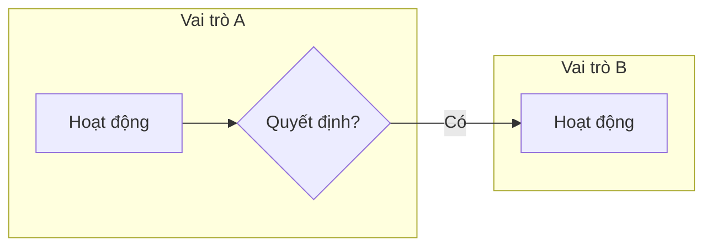

# Tài liệu gộp: phan-tich-erp

Gồm các mục: § quy-trinh-phan-tich, § mau-phan-tich, § vi-du-phan-tich, § case-doanh-nghiep, § khung-khao-sat

---

# § quy-trinh-phan-tich

# Phân tích nghiệp vụ ERP → cấu trúc phần mềm trên 1C:Enterprise

> **Khi nào đọc file này:** người học cần phân tích một bài toán doanh nghiệp rồi chuyển thành thiết kế trên nền tảng (chọn object, thiết kế register và posting, báo cáo, phân quyền), hoặc nhờ nhận xét bản phân tích / thiết kế. Khung trống: `mau-phan-tich.md`. Ví dụ đã làm sẵn ở ngành khác: `vi-du-phan-tich.md`.
>
> - Lộ trình **M**: file chính vẫn là `mis/tu-xay-dung-he-thong.md` (6 bước, câu hỏi gợi mở, catalog phương án). File này bổ sung nguyên tắc thiết kế (mục 3), ma trận posting, kịch bản kiểm thử và truy vết.
> - Lộ trình **J**: phân tích theo kiểu "đối chiếu với chuẩn" trên Jet (mục 2b), theo đề `btl/de-bai-btl.md`.
> - Lộ trình **D**: phân tích một yêu cầu thay đổi trên cấu hình có sẵn (mục 2c).

> Công cụ thu thập thông tin (bảng câu hỏi "7 + 2", ma trận fit-gap) và case doanh nghiệp thật đã ẩn danh theo ngành: `erp-cases/khung-khao-sat.md`, `erp-cases/case-doanh-nghiep.md`.

## 1. Tám bước — khung chung

Thứ tự từ nghiệp vụ tới phần mềm. Được quay lại bước trước khi phát hiện mâu thuẫn; ghi lại quyết định và lý do vào **nhật ký quyết định**.

| Bước | Câu hỏi trọng tâm | Sản phẩm (khung trong `mau-phan-tich.md`) | Liên hệ 1C |
|---|---|---|---|
| 1. Hồ sơ doanh nghiệp & phạm vi | Bán gì, cho ai, quy mô, mấy kho, chính sách giá và thanh toán; cái gì ngoài phạm vi | Hồ sơ + bảng phạm vi | Constants, Functional options (ví dụ "dùng nhiều kho") |
| 2. Danh sách quy trình | Quy trình nào trong phạm vi; mỗi quy trình bắt đầu bằng sự kiện gì, kết thúc ở đâu, ai tham gia | Bảng SIPOC rút gọn | Mỗi nhóm quy trình → một Subsystem |
| 3. Mô tả quy trình | Ai làm gì, khi nào, với giấy tờ gì; ngoại lệ | Swimlane / sơ đồ luồng chứng từ + bảng bước | Chuỗi chứng từ → **Generation** (tạo dựa trên) |
| 4. Phân loại dữ liệu | Đâu là dữ liệu chủ, đâu là sự kiện, đâu là số liệu cần theo dõi, đâu là thiết lập | Danh sách dữ liệu + ma trận ai tạo / ai xem / ai sửa | Dữ liệu chủ → Catalog / Enumeration; sự kiện → Document; số liệu → Register; thiết lập → Constant / Information register |
| 5. Quy tắc nghiệp vụ & kiểm soát | Quy tắc nào bắt buộc (không xuất âm, hạn mức công nợ, giá theo ngày, bắt buộc nhập) | Bảng quy tắc, mỗi quy tắc ghi **nơi kiểm tra** | Form / `FillCheckProcessing` / `Posting` (mục 3.6) |
| 6. Câu hỏi quản lý | Người quản lý cần biết gì, theo chiều nào (kho, hàng, khách), tại một thời điểm hay trong một kỳ | Danh sách câu hỏi → báo cáo | **Câu hỏi quyết định register** (mục 3.3) |
| 7. Thiết kế object & posting | Object nào, loại gì, attribute / tabular section gì, vì sao; chứng từ nào ghi register nào, chiều nào | Bảng thiết kế object, ma trận posting, ma trận phân quyền | Bài 3–4, 11–13, 20 |
| 8. Kiểm thử & truy vết | Nhập kịch bản nào thì số dư / báo cáo phải ra bao nhiêu; yêu cầu nào chưa có object hay báo cáo đáp ứng | Kịch bản kiểm thử + bảng truy vết | Register records, Query console, báo cáo DCS |

Bước 1–3 nói ngôn ngữ nghiệp vụ, **chưa nhắc tới 1C** — với người trái ngành đây là phần dễ bắt đầu nhất ("nghiệp vụ trước, thuật ngữ sau").

## 2. Biến thể theo lộ trình

### 2a. Lộ trình M — tự xây từ cấu hình trống

Theo `mis/tu-xay-dung-he-thong.md`: bước 1–3 ở đây ứng với bước 1–2 của file MIS; bước 4 ↔ bước 3–4; bước 5–7 ↔ bước 5–6; bước 8 là phần bổ sung (kiểm thử, truy vết). Với mọi quyết định lớn, đưa 2–3 phương án kèm đánh đổi (mục 5 của file MIS) và để nhóm chọn. Không dùng Jet làm mẫu.

### 2b. Lộ trình J — đối chiếu với chuẩn trên Jet

Cách các dự án ERP thật làm với phần mềm đóng gói: chạy quy trình chuẩn của phần mềm trên dữ liệu thật, rồi đánh dấu chỗ khớp và chỗ thiếu, thay vì thiết kế lại từ đầu.

1. Chạy quy trình của phân hệ nhóm phụ trách trên Jet với dữ liệu mẫu theo đề (phương pháp **khai báo → nhập liệu → quan sát**, `btl/jet-cho-nguoi-trai-nganh.md`).
2. Với từng yêu cầu của đề, ghi: **Khớp** / **Khớp một phần** / **Thiếu** — kèm bằng chứng quan sát (chứng từ nào, báo cáo nào).
3. Với chỗ thiếu: đề xuất cách bổ sung theo mức M1 (đặc tả) → M2 (khai báo trong Designer) → M3 (code).
4. Xếp mức ưu tiên: bắt buộc / nên có / bỏ qua — không phải thiếu sót nào cũng cần làm.

Phần phân tích khoảng trống là phần được chấm: coach, không viết thay (`chinh-sach-code.md` mục 5).

### 2c. Lộ trình D — yêu cầu thay đổi trên cấu hình có sẵn

1. Viết lại yêu cầu bằng một câu nghiệp vụ và một câu kiểm thử ("khi … thì hệ thống phải …").
2. Tìm object, register, form, báo cáo bị ảnh hưởng.
3. Chọn cách làm và nói đánh đổi: sửa trực tiếp cấu hình / Extension (Patch, Customization, Add-on) / Event subscription / external report hoặc data processor. Tiêu chí: mức độ cần thay đổi, khả năng cập nhật cấu hình gốc, bảo trì (Bài 16, bài Extensions; khóa tùy biến AccountingSuite trong `tai-nguyen.md`).
4. Thiết kế → code → kịch bản kiểm thử.

## 3. Nguyên tắc thiết kế 1C

### 3.1. Không phải bước nghiệp vụ nào cũng thành Document
Chỉ sự kiện có thời điểm, cần lưu lại, cần tra cứu / in / làm căn cứ, hoặc làm thay đổi số liệu cần theo dõi mới thành Document. "Duyệt đơn" thường chỉ là một attribute trạng thái (hoặc information register lưu lịch sử trạng thái).

### 3.2. Không phải Document nào cũng post
Đơn đặt hàng có thể không post; hoặc chỉ post vào một register "đơn còn mở" nếu có câu hỏi quản lý cần nó.

### 3.3. Câu hỏi quản lý quyết định register
- "Bây giờ / tại ngày X còn bao nhiêu?" (tồn kho, công nợ, tiền trong quỹ) → Accumulation register **Balances**, đọc virtual table `.Balance`.
- "Trong kỳ phát sinh bao nhiêu?" (doanh số tháng, lượng mua theo nhà cung cấp) → **Turnovers**, đọc `.Turnovers`.
- Cần cả đầu kỳ, phát sinh, cuối kỳ → Balances với `.BalanceAndTurnovers`.
- Một con số không ai hỏi tới → chưa cần register.

### 3.4. Chọn dimension
Dimension là chiều mà **cả hai chiều tăng và giảm đều điền được** và người quản lý cần cắt số liệu theo nó (kho, mặt hàng, khách). Thông tin chỉ có ở một chiều (nhà cung cấp chỉ có khi nhập) → để làm attribute của register hoặc lấy từ chứng từ, không làm dimension (Practical Developer's Guide, Lesson 12).

### 3.5. Information register hay attribute của Catalog
- Giá trị thay đổi theo thời gian và cần biết giá trị tại một ngày (giá bán, tỷ giá, hạn mức) → Information register **periodic**, đọc bằng `SliceLast` (Bài 12).
- Giá trị gần như cố định (đơn vị tính chính) → attribute của Catalog.
- Giá do một chứng từ thiết lập (phiếu điều chỉnh giá) → Information register **subordinate to recorder**.

### 3.6. Kiểm soát đặt ở đâu
| Loại quy tắc | Nơi kiểm tra | Bài |
|---|---|---|
| Bắt buộc nhập, giá trị hợp lệ chỉ dựa vào chính chứng từ | Property Fill checking hoặc `FillCheckProcessing` | 12 |
| Phụ thuộc số dư thật (tồn âm, vượt hạn mức công nợ) | `Posting`, sau khi ghi movements, có khóa dữ liệu | 11 |
| Tiện ích nhập liệu (tự điền giá, tự tính tiền) | Form | 9 |

Không bao giờ chỉ kiểm tra ở form: dữ liệu còn có thể vào bằng xử lý hàng loạt, import, hay form khác.

### 3.7. Các object khác
- Catalog: hierarchy cho nhóm hàng; Owner cho dữ liệu phụ thuộc (hợp đồng thuộc đối tác, lô thuộc mặt hàng); Predefined cho phần tử code cần gọi tới (Bài 4).
- Chart of characteristic types khi người dùng tự định nghĩa thuộc tính (màu, cỡ) (Bài 13).
- Chart of accounts + Accounting register chỉ khi đề tài có hạch toán kép (Bài 24).
- Business process / Task: chỉ khi thật sự cần luồng phê duyệt nhiều người — thường ngoài phạm vi bài tập lớn.
- Roles và Functional options thiết kế từ ma trận ai tạo / ai xem / ai sửa ở bước 4, không để tới cuối (Bài 15, 20).

### 3.8. Ma trận posting là cầu nối giữa phân tích và code
Mỗi ô của ma trận (chứng từ × register) ghi: chiều (tăng / giảm hoặc phát sinh), các dimension lấy từ đâu (header hay tabular section), resource tính thế nào, điều kiện ghi. Khi ma trận đầy đủ, code posting gần như viết theo ma trận — đó là lúc chuyển sang `chinh-sach-code.md` và `code-patterns.md`.

## 4. Cách tutor dẫn dắt

- Hỏi bước nhóm đang làm; mỗi lượt trả lời chỉ một lượt câu hỏi gợi mở (2–4 câu) cho bước đó.
- Nhận xét bản nháp theo thứ tự: **đầy đủ** (thiếu quy trình, ngoại lệ, vai trò?) → **nhất quán** (thiết kế có khớp hồ sơ doanh nghiệp không?) → **truy vết được** (mỗi object trả lời được "dòng nào trong nghiệp vụ cần tôi?", mỗi câu hỏi quản lý có register + báo cáo đáp ứng?). Nêu điểm mạnh trước, tối đa 3–5 vấn đề, mỗi vấn đề kèm câu hỏi.
- Minh họa bằng ví dụ ở **ngành khác** ngành của nhóm (`vi-du-phan-tich.md`), nói rõ là minh họa cách lập luận.
- Lộ trình J trái ngành: dùng từ đời thường ("sổ theo dõi tồn kho" trước, "Accumulation register" trong ngoặc sau).
- Khi thiết kế đã chốt và nhóm cần code: theo `chinh-sach-code.md`.

---

# § mau-phan-tich

# Khung trống cho bản phân tích và thiết kế

> **Khi nào đọc file này:** người học xin "mẫu", "khung", "nên trình bày thế nào". Đưa **khung trống** (cột, câu hỏi cần trả lời) — không điền nội dung cho doanh nghiệp của nhóm. Thứ tự các khung theo 8 bước trong `quy-trinh-phan-tich.md`. Lộ trình J: khung nộp bài chính thức theo `btl/de-bai-btl.md`; các khung dưới đây chỉ dùng thêm khi hữu ích.

## K1. Hồ sơ doanh nghiệp

| Mục | Nội dung |
|---|---|
| Ngành, sản phẩm / dịch vụ, đặc điểm hàng (hạn dùng, serial, cỡ màu…) | |
| Quy mô (số mặt hàng, khách, nhà cung cấp, chứng từ / tháng) | |
| Kho, cửa hàng, chi nhánh | |
| Khách hàng, chính sách bán (tiền ngay / bán chịu / trả trước) | |
| Nhà cung cấp, cách mua | |
| Giá và chiết khấu | |
| Thu chi (quỹ, ngân hàng) | |
| Vai trò người dùng | |
| **Trong phạm vi / ngoài phạm vi / giả định đơn giản hóa** | |

## K2. Danh sách quy trình (SIPOC rút gọn)

| Quy trình | Sự kiện bắt đầu | Kết thúc | Bên cung cấp đầu vào | Đầu vào | Đầu ra | Bên nhận | Vai trò tham gia |
|---|---|---|---|---|---|---|---|

## K3. Mô tả quy trình

Sơ đồ (swimlane, mỗi lane một vai trò) — có thể viết bằng mermaid:

| STT | Sự kiện kích hoạt | Hoạt động | Vai trò | Giấy tờ vào / ra | Ngoại lệ |
|---|---|---|---|---|---|

Luồng chứng từ: `Chứng từ 1 → (tạo dựa trên) → Chứng từ 2 → …`

## K4. Phân loại dữ liệu và ma trận truy cập

| Thông tin | Loại (dữ liệu chủ / sự kiện / số liệu theo dõi / thiết lập) | Ai tạo | Ai xem | Ai sửa | Ai xóa |
|---|---|---|---|---|---|

## K5. Quy tắc nghiệp vụ

| Mã | Quy tắc | Khi nào áp dụng | Vi phạm thì sao (chặn / cảnh báo) | Kiểm tra ở đâu (form / FillCheckProcessing / Posting) | Lý do |
|---|---|---|---|---|---|

## K6. Câu hỏi quản lý → báo cáo

| Mã | Câu hỏi (cụ thể, kiểm chứng được) | Tại thời điểm hay trong kỳ | Theo các chiều | Ai hỏi, bao lâu một lần | Đáp ứng bởi register / báo cáo |
|---|---|---|---|---|---|

## K7. Bảng thiết kế object

| Object | Loại metadata | Attribute chính | Tabular section | Hierarchy / Owner / Predefined | Dòng nghiệp vụ nào cần nó | Vì sao chọn loại này | Phương án đã loại |
|---|---|---|---|---|---|---|---|

## K8. Thiết kế register

| Register | Loại (Accumulation Balances / Turnovers, Information periodic / không) | Dimension | Resource | Attribute | Trả lời câu hỏi quản lý nào |
|---|---|---|---|---|---|

## K9. Ma trận posting

| Chứng từ | Register | Chiều (tăng / giảm / phát sinh) | Dimension lấy từ | Resource tính thế nào | Điều kiện ghi | Kiểm soát kèm theo |
|---|---|---|---|---|---|---|

## K10. Ma trận phân quyền

| Vai trò (Role) | Object | Xem | Thêm | Sửa | Post | Xóa |
|---|---|---|---|---|---|---|

## K11. Kịch bản kiểm thử và truy vết

| # | Thao tác nhập liệu (theo thứ tự) | Kết quả mong đợi (số dư, báo cáo, thông báo lỗi) | Quy tắc / câu hỏi được kiểm tra | Kết quả thực tế |
|---|---|---|---|---|

Truy vết: mỗi dòng K5 và K6 phải xuất hiện ít nhất một lần trong K11; mỗi object trong K7 phải trả lời được cột "Dòng nghiệp vụ nào cần nó".

## Nhật ký quyết định

| Ngày | Quyết định | Lý do | Phương án đã loại | Ai quyết |
|---|---|---|---|---|

---

# § vi-du-phan-tich

# Ví dụ phân tích → thiết kế (ngành minh họa)

> **Khi nào đọc file này:** cần minh họa **cách lập luận** từ nghiệp vụ tới thiết kế 1C. Hai ví dụ dùng ngành ít gặp trong đề tài sinh viên và khác các đề đánh giá của khóa (cấp phát vật tư công trình, xưởng bánh). Luôn nói rõ: đây là minh họa cách suy nghĩ, không phải thiết kế mẫu để chép. Nếu đề tài của nhóm trùng ngành với một ví dụ, dùng ví dụ còn lại. Lộ trình J: ưu tiên minh họa trên chính Jet.

## Ví dụ A — Công ty xây dựng cấp phát vật tư cho công trình

**Hồ sơ (K1, rút gọn):** 400 loại vật tư (xi măng, thép, ống, dây điện), 2 kho trung tâm, 6 công trình đang thi công; chỉ huy trưởng công trình đề nghị vật tư, kho cấp, cuối giai đoạn công trình trả lại vật tư thừa. Giá trị vật tư theo đơn giá kế hoạch, cập nhật mỗi quý. Ngoài phạm vi: mua hàng, kế toán tổng hợp, giá thành công trình chi tiết.

**Quy trình (K3):**

**Câu hỏi quản lý (K6):**
1. Kho nào đang còn bao nhiêu vật tư X? → tại thời điểm, theo kho + vật tư.
2. Công trình nào đang giữ bao nhiêu vật tư gì (đã cấp mà chưa dùng hết / chưa trả)? → tại thời điểm, theo công trình + vật tư.
3. Giá trị vật tư đã cấp cho từng công trình theo tháng? → trong kỳ.

**Lập luận chọn object:**
- "Đề nghị vật tư" có cần là Document không? Nếu đề nghị qua điện thoại và kho cấp ngay → **không**, gộp vào phiếu cấp. Nếu đề nghị phải được duyệt trước và kho cần biết lượng đã hứa cấp → có, và cần thêm câu hỏi "vật tư đã được giữ cho công trình bao nhiêu". (Hai phương án — tùy hồ sơ.)
- Câu hỏi 1 và 2 hỏi "còn bao nhiêu" → hai register **Balances**. Vì sao hai register chứ không một register có dimension "Nơi ở" (kho hoặc công trình)? Một register gọn hơn nhưng dimension phải nhận hai kiểu dữ liệu (composite type) và báo cáo phải lọc theo kiểu; hai register rõ nghĩa, mỗi câu hỏi một register. Ví dụ này chọn hai register.
- Câu hỏi 3 hỏi "trong kỳ" → register **Turnovers** `IssuedToSites` (dimension Site, Material; resource Amount).
- Đơn giá kế hoạch đổi theo quý → Information register periodic `PlannedCosts`, không phải attribute của Catalog.

**Ma trận posting (K9):**

| Chứng từ | MaterialsInStock (Balances) | MaterialsAtSites (Balances) | IssuedToSites (Turnovers) |
|---|---|---|---|
| MaterialIssue | Giảm (Warehouse ← header, Material ← dòng) | Tăng (Site, Material) | Phát sinh: số lượng × đơn giá |
| MaterialReturn | Tăng | Giảm | Phát sinh âm (giảm giá trị đã cấp) |

**Quy tắc (K5):** không cấp quá tồn → kiểm tra trong `Posting` (code: `code-patterns.md` mẫu 4.1); không trả nhiều hơn lượng công trình đang giữ → `Posting`, đọc `MaterialsAtSites`; ngày cần vật tư không trước ngày cấp → `FillCheckProcessing` (mẫu 4.3); tự điền đơn giá → form (mẫu 4.2).

**Kiểm thử (K11, rút gọn):**

| # | Thao tác | Mong đợi |
|---|---|---|
| T1 | Nhập tồn 10 tấn thép vào Kho 1 | Tồn Kho 1 = 10 |
| T2 | Cấp 12 tấn cho công trình A | Bị chặn, báo thiếu 2 |
| T3 | Cấp 8 tấn cho công trình A, đơn giá 15.000.000/tấn | Kho 1 còn 2; công trình A giữ 8; giá trị cấp tháng = 120.000.000 |
| T4 | Công trình A trả 3 tấn | Kho 1 = 5; công trình A giữ 5; giá trị cấp tháng = 75.000.000 |

## Ví dụ B — Xưởng bánh nhỏ (sản xuất đơn giản)

**Hồ sơ:** 20 loại bánh, 60 nguyên liệu, 1 kho nguyên liệu, 1 kho thành phẩm; mỗi ngày làm theo kế hoạch rồi bán cho các quán cà phê. Ngoài phạm vi: tính giá thành chi tiết theo chi phí chung, kế hoạch nhu cầu nguyên liệu (MRP).

**Câu hỏi quản lý:**
1. Còn bao nhiêu nguyên liệu X, đủ làm bao nhiêu mẻ bánh Y?
2. Hôm nay sản xuất bao nhiêu, hao hụt nguyên liệu so với định mức bao nhiêu?
3. Tồn thành phẩm theo loại bánh.

**Lập luận:**
- **Định mức nguyên liệu** (một mẻ bánh Y cần bao nhiêu bột, đường…) là dữ liệu chủ phụ thuộc vào bánh → phương án 1: tabular section `Recipe` trong Catalog `Products`; phương án 2: Catalog `Recipes` có Owner là `Products` (cho phép nhiều công thức, có hiệu lực theo thời gian thì cần thêm information register). Xưởng chỉ có một công thức mỗi loại → phương án 1 đủ.
- **Một chứng từ hay hai** cho sản xuất? Phương án 1: `ProductionReport` một chứng từ vừa ghi giảm nguyên liệu vừa ghi tăng thành phẩm — đơn giản, hợp xưởng nhỏ. Phương án 2: tách `MaterialIssue` (xuất nguyên liệu) và `ProductionOutput` (nhập thành phẩm) — hợp khi xuất và nhập ở hai thời điểm, hai người khác nhau.
- Câu hỏi 2 cần so **thực tế với định mức** → chứng từ phải lưu cả lượng định mức (tính từ công thức × số mẻ) và lượng thực tế; báo cáo so sánh đọc từ chứng từ hoặc một register Turnovers `MaterialUsage` (dimension Material, Product; resource StandardQty, ActualQty).

**Ma trận posting (phương án một chứng từ):**

| Chứng từ | MaterialStock (Balances) | FinishedGoods (Balances) | MaterialUsage (Turnovers) |
|---|---|---|---|
| ProductionReport | Giảm theo lượng thực tế | Tăng số bánh làm được | StandardQty, ActualQty theo nguyên liệu |
| SalesInvoice | — | Giảm | — |

**Quy tắc:** không xuất nguyên liệu quá tồn → `Posting`; số mẻ > 0 → Fill checking; tự tính lượng định mức khi nhập số mẻ → form (gọi server một lần để đọc công thức).

**Điểm để nhóm tự quyết:** giá trị nguyên liệu xuất tính theo giá nào (bình quân, nhập trước xuất trước) — nếu đề tài cần, xem cách tính giá vốn bình quân trong `erp-practice/erp-practice.md`; nếu không, ghi vào "ngoài phạm vi".

---

# § case-doanh-nghiep

# Kho case doanh nghiệp theo ngành (đã ẩn danh)

> **Khi nào đọc file này:** người học cần **bối cảnh doanh nghiệp thật** cho bài tập lớn, phân tích nghiệp vụ, thiết kế hệ thống; hỏi "ngành X quản lý những gì", "ERP giải quyết gì cho ngành X"; giảng viên cần case cho lớp; intern / đối tác cần hiểu bài toán ngành trước presales. Ý tưởng đề tài cụ thể: `btl/ngan-hang-y-tuong.md` mục 1.7. Khung khảo sát: `erp-cases/khung-khao-sat.md`.
>
> Nguồn: tài liệu giải pháp ngành, hồ sơ khảo sát và file vận hành thật của 1C Việt Nam (10/2026), **đã ẩn danh**: tên doanh nghiệp đổi thành bí danh (MAY-A, PP-B, CARTON-C, PU-D, DƯỢC-E…), bỏ địa danh chi tiết, người, mã đơn, giá; số liệu chỉ giữ dạng tỷ lệ / quy mô làm tròn. **Không nêu tên thật** của doanh nghiệp trong câu trả lời, kể cả khi người dùng đoán. Dữ liệu chi tiết cho bài tập phải là **dữ liệu sinh lại theo phân phối tương tự** — không dùng file gốc.

## 0. Mẫu hình chung của các ngành

Nỗi đau lặp lại nhiều nhất trong hồ sơ của nhiều ngành: (1) hiện trường sản xuất và văn phòng đứt gãy dữ liệu; (2) không biết giá thành thật từng đơn / sản phẩm; (3) kênh đại lý: chính sách giá, chiết khấu theo mùa, đối chiếu công nợ, **hạn mức tín dụng**; (4) Excel rời rạc, "xuất Excel rồi nhập lại"; (5) lô / hạn dùng / truy xuất nguồn gốc; (6) bảo trì tách rời kế hoạch sản xuất; (7) lương khoán, ca kíp; (8) phê duyệt nhiều cấp qua email; (9) xe ra vào, cân, xếp hàng ở cổng nhà máy.

Lộ trình chuyển đổi số thường đề xuất theo 3 nấc: **ERP + báo cáo quản trị → cổng đại lý / app / quản lý kho chi tiết → kết nối máy móc, QC, bảo trì, năng lượng**.

## 1. Thẻ ngành

Mỗi thẻ: bài toán — quy trình đặc thù — đối tượng dữ liệu gợi ý — phù hợp lộ trình nào. Tên object là gợi ý tư duy, nhóm tự quyết thiết kế (`chinh-sach-code.md` mục 5).

### 1.1. Xưởng may xuất khẩu (MAY-A, ~170 người, 6 chuyền)
- **Bài toán:** ~14 workbook Excel, ~450 sheet (mỗi mã hàng / mỗi ngày một sheet), hai phòng giữ hai bản trùng, hàng trăm liên kết giữa file. Vải nhận theo cây thường **ngắn hơn số trên tem** (trong một mẫu dữ liệu: trung vị khoảng 3 %, khoảng 1/3 số cây thiếu quá 5 %) mà không có dữ liệu theo nhà cung cấp / lot để khiếu nại. Sản lượng theo giờ có dấu hiệu "điền cho đẹp".
- **Quy trình:** đơn hàng (mã × màu × size, dung sai ±3 %) → định mức nguyên phụ liệu (hai phiên bản: của buyer và của nhà máy) → cân đối vải theo lịch xuất → kiểm vải → trải vải, cắt (sơ đồ, số lá, đầu tấm) → phát lên chuyền / gia công ngoài → may (sản lượng theo giờ) → hoàn thiện, đóng gói → xuất → quyết toán mã hàng.
- **Dữ liệu:** Catalog mã hàng (tabular section công đoạn + thời gian chuẩn SAM), nguyên phụ liệu, màu, size, chuyền; Document đơn hàng, nhập vải theo cây, phiếu trải cắt, phát chuyền, sản lượng may, hoàn thiện, xuất hàng; AccumulationRegister tồn NPL (theo lot, **chủ sở hữu khách / công ty**), bán thành phẩm theo công đoạn (WIP), hao hụt vải (Turnovers), sản lượng; InformationRegister định mức (chiều "loại định mức"), kế hoạch chuyền theo ngày, **sản lượng theo khung giờ** (dữ liệu ghi nhận — không cần Document).
- **KPI:** % đạt khoán; hiệu suất chuyền = (SL × SAM) / (số công nhân × phút làm việc); chênh lệch tiêu hao vải; % âm cây; tỷ lệ cắt / đơn, xuất / đơn.
- **Phù hợp:** lộ trình M (thiết kế đầy đủ ~8 catalog, 6–8 document, 5–6 accumulation register); lộ trình J chỉ phần mua NPL – kho – xuất thành phẩm (M1 vẽ luồng 15 bước); intern: lương khoán công đoạn, nhập sản lượng giờ trên mobile.

### 1.2. Bao bì carton (CARTON-C)
- **Bài toán:** đặt giấy theo khổ, lệnh sản xuất tổ sóng, theo dõi đơn qua ~9 công đoạn bằng Excel; nhật ký lỗi (in sai bản thiết kế, rộp, bế lệch) — có trường hợp hỏng cả đơn vì in sai bản thiết kế.
- **Quy trình:** đơn hàng (kích thước thùng, 3 / 5 lớp) → **cơ cấu giấy theo lớp** → tính lượng giấy → tổ sóng → in → bế → dán → kiểm → giao.
- **Dữ liệu:** Catalog giấy (khổ × định lượng), cơ cấu lớp (tabular section), bản thiết kế in có phiên bản; Document lệnh sản xuất, báo cáo công đoạn, phiếu lỗi; register tồn giấy theo khổ, tiến độ đơn theo công đoạn.
- **Phù hợp:** J — kho giấy + bán hàng (Jet) và M1 phân tích phần sản xuất; M — tính định mức giấy bằng code, theo dõi công đoạn.

### 1.3. Bao bì PP dệt (PP-B, nhiều pháp nhân)
- **Bài toán:** ~4 500 mã hàng, **thông số nhồi vào tên hàng** (màu, denier, gsm, khổ, kiểu dệt, in, tên khách); nhiều pháp nhân trên nhiều phần mềm; muốn tách phiếu kho khỏi hóa đơn, tồn min / max, theo dõi **phế liệu quay vòng thành nguyên liệu**, giá thành bình quân.
- **Quy trình:** hạt nhựa → sợi → manh (vải dệt) → bao; một số công đoạn gia công ngoài; duyệt báo giá → đơn → đề nghị mua → so sánh giá → đơn mua.
- **Dữ liệu:** Catalog sản phẩm + **Chart of characteristic types** cho thông số; tổ chức (nhiều pháp nhân); register tồn theo tầng sản phẩm, phế liệu.
- **Phù hợp:** M nâng cao, intern; bài tập "tách tên hàng thành thuộc tính", "làm sạch danh mục trước khi nhập ERP".

### 1.4. Vật liệu trang trí PU (PU-D, nhỏ: 7 người dùng, 3 kho)
- **Bài toán:** so sánh định mức nguyên liệu với thực tế; **cố định giá bán theo từng khách**; 4 mức giá cho một sản phẩm (theo hoàn thiện); chiết khấu cuối năm theo doanh thu / sản lượng; thuê gia công dát vàng, vân gỗ; muốn chuyển công nhật sang công theo sản lượng; giá thành gồm nguyên liệu + lương + khấu hao.
- **Phù hợp:** **J — case sát Jet nhất** (mua, bán nhiều kiểu giá, 3 kho, chiết khấu) + M2 mở rộng phần sản xuất đơn giản; M — đủ cho một hệ thống nhỏ trọn vẹn.

### 1.5. Dược phẩm GMP (DƯỢC-E)
- **Bài toán:** bộ yêu cầu ~125 dòng theo GMP: ai làm gì, lúc nào, **lịch sử thay đổi**; lô và hạn dùng; xuất FEFO / FIFO; **trạng thái QC** (biệt trữ → đạt / không đạt); vị trí pallet; giá thành.
- **Dữ liệu:** Catalog lô (hạn dùng), register tồn theo lô và vị trí, InformationRegister trạng thái lô (periodic), Document phiếu kiểm nghiệm; posting chặn xuất lô biệt trữ.
- **Phù hợp:** M, intern; J làm phiên bản kho (lô + trạng thái QC) — trùng một phần Đề 1 (lô và hạn dùng).
- **Lưu ý:** các yêu cầu tuân thủ (21 CFR Part 11, EU Annex 11) là **khẳng định pháp lý** — không nói "1C đáp ứng" khi chưa có văn bản của đội sản phẩm.

### 1.6. Xi măng / vật liệu xây dựng
- **Bài toán:** xe ra vào nhà máy: đăng ký → cân lần 1 → xếp hàng / xuất → cân lần 2 → hóa đơn, có RFID, barrier, app tài xế; kênh đại lý lớn với **hạn mức tín dụng**, phê duyệt nhiều cấp; vỏ bao.
- **Dữ liệu:** Document chuyến xe, phiếu cân; InformationRegister lịch sử trạng thái chuyến (state machine); register hàng chờ xuất, công nợ đại lý; InformationRegister hạn mức (periodic).
- **Phù hợp:** J (bán hàng, công nợ của Jet + chứng từ mới) và M; bài "từ sơ đồ swimlane sang metadata".

### 1.7. Nhựa / đá nhân tạo / hóa chất
- **Bài toán:** công thức phối liệu, nhiều công đoạn có bán thành phẩm, **khuôn** (tài sản đặc thù cần bảo trì), dừng máy, giá thành khi nguyên liệu biến động; kênh nhà phân phối với chiết khấu.
- **Phù hợp:** M (công đoạn, bán thành phẩm, khuôn); J — chiết khấu / hạn mức nhà phân phối.

### 1.8. Cơ khí theo đơn
- **Bài toán:** sản xuất theo bản vẽ, báo giá nhiều phương án, **nhận / thuê gia công** (vật tư không thuộc sở hữu của mình), lương khoán theo công đoạn; doanh nghiệp lớn hơn vào chuỗi ô tô cần quy trình chất lượng chặt.
- **Phù hợp:** M (routing, lương khoán); J — gia công: "tồn kho của ai" (register riêng cho vật tư của khách / vật tư ở đơn vị gia công).

### 1.9. Nội thất
- **Bài toán:** **BOM tham số** (kích thước, chất liệu thay đổi theo đơn), vật tư thay thế, giá thành kế hoạch trước khi nhận đơn.
- **Phù hợp:** M (Chart of characteristic types, query cây BOM); J chỉ M1 đọc BOM.

### 1.10. Thực phẩm / thương mại / phân phối
- **Bài toán:** bảng giá nhiều cấp, chiết khấu theo điều kiện, đơn từ app / sàn TMĐT, **hàng hoàn từ sàn** (tỷ lệ vài phần trăm, phải kiểm và khiếu nại trong thời hạn ngắn), đơn PDF hàng trăm dòng nhập tay, kho nhiều file Excel, lô / hạn dùng; nhiều pháp nhân.
- **Phù hợp:** **J** — sát Jet nhất (mua, bán, kho, tiền); xem ý tưởng E-series trong ngân hàng ý tưởng.

### 1.11. Nông nghiệp — vườn cây
- **Bài toán:** quản lý lô vườn, kiểm đếm cây, thu hoạch theo ngày / tổ, vật tư cho vườn.
- **Phù hợp:** M — bài mô hình hóa "vườn = kho, cây = tài sản, thu hoạch = sản xuất"; dữ liệu phải hư cấu.

### 1.12. Bảo trì thiết bị (mọi nhà máy, kho)
- **Bài toán:** báo hỏng → phiếu sửa chữa → vật tư thay thế → lịch bảo trì định kỳ → lịch sử từng thiết bị; tách rời kế hoạch sản xuất.
- **Dữ liệu (mini-CMMS):** Catalog thiết bị (hierarchy theo khu vực), loại công việc, phụ tùng; InformationRegister vị trí / tình trạng thiết bị (periodic), kế hoạch bảo trì; Document yêu cầu sửa chữa, phiếu công việc, xuất phụ tùng; AccumulationRegister tồn phụ tùng, chi phí bảo trì; báo cáo DCS: thiết bị hỏng nhiều, chi phí theo thiết bị, việc quá hạn; tự động sinh phiếu bảo trì khi đến hạn (scheduled job — M3).
- **Phù hợp:** M (rất tốt để dạy periodic InformationRegister); J — đổi bối cảnh sang bảo trì **xe nâng, băng tải** trong kho.

## 2. Jet và giải pháp thương mại của 1C — "Jet là bản thu nhỏ"

Jet (`jet/`) dùng cùng mẫu thiết kế với giải pháp quản trị doanh nghiệp vừa và nhỏ của 1C (1C:Company Management): dạng giá + bảng giá, công nợ theo chứng từ có tạm ứng. Phần giải pháp đầy đủ có mà Jet chưa có là nguồn đề tài:

| Khối | Giải pháp đầy đủ | Jet | Khoảng trống → đề tài |
|---|---|---|---|
| Danh mục | Đối tác + hợp đồng, mặt hàng + đặc tính / lô / sê-ri, kho + ô | Counterparties, Products, Warehouses | Hợp đồng, lô, ô kho, sê-ri |
| Bán | Đơn hàng → giao → trả hàng → thu tiền; ký gửi; bán lẻ | SalesInvoice → thu tiền | Đơn hàng, dự phòng hàng, trả hàng, ký gửi, bán lẻ |
| Mua | Nhu cầu → đơn NCC → nhận → chi phí mua → trả NCC | SupplierInvoice → chi tiền | Đơn NCC, chi phí mua phân bổ, trả NCC |
| Kho | 1 pha / 2 pha, ô hàng, kiểm kê, điều chuyển nhiều mục đích | InventoryIncrease / Transfer / WriteOff | Kho 2 pha, kiểm kê, ô kho, cấp phát sử dụng |
| Tiền | Kế hoạch, lịch thanh toán, đề nghị thanh toán có duyệt, tạm ứng | Thu chi + tạm ứng | Lịch thanh toán, duyệt chi |
| Sản xuất, lương, tài sản | Có | Không | Lộ trình M hoặc đề tài nâng cao |

Tên register phía giải pháp đầy đủ trong bảng là suy ra từ giao diện người dùng — khi cần chính xác, mở cấu hình thật để đối chiếu.

---

# § khung-khao-sat

# Khung khảo sát doanh nghiệp "7 + 2" — từ mẫu khảo sát thực tế của 1C Việt Nam

> **Khi nào đọc file này:** nhóm làm M1 (phân tích nghiệp vụ) cần đi phỏng vấn / khảo sát một doanh nghiệp; người học hỏi "khảo sát hệ thống hỏi những gì", "fit-gap là gì"; intern / đối tác chuẩn bị presales. Quy trình phân tích 8 bước của skill: `phan-tich/quy-trinh-phan-tich.md` — khung này là **công cụ cho bước thu thập** của quy trình đó.
>
> Nguồn: rút từ ba loại mẫu khảo sát mà 1C Việt Nam dùng khi tư vấn 1C:Company Management (bảng câu hỏi theo phân hệ, ma trận theo phòng ban, bảng phản hồi yêu cầu) và các lỗi thường gặp khi khách điền — đã bỏ mọi thông tin khách hàng. Khung là **đề xuất của người soạn**, không phải biểu mẫu chính thức.

## 1. Ba loại tài liệu khảo sát trong một dự án thật

| Loại | Dùng khi | Nội dung |
|---|---|---|
| **T1 — Bảng câu hỏi** | Bắt đầu, khách tự điền trước buổi gặp | Thông tin doanh nghiệp (ngành, người dùng theo bộ phận, sơ đồ tổ chức, mong muốn, thời hạn) + 6 phần nghiệp vụ: danh mục, CRM, bán hàng, kho & mua hàng, tài chính, sản xuất; kèm **danh sách tài liệu khách cần gửi** (danh mục hàng, quy trình, định mức, mẫu báo cáo, quy định phê duyệt…) |
| **T2 — Ma trận theo phòng ban (fit-gap)** | Sau phỏng vấn, tư vấn điền | Quy trình / biểu mẫu của khách → **đối tượng 1C đề xuất** → báo cáo / mẫu in → **mức đáp ứng** → cấp phê duyệt → **câu hỏi mở** |
| **T3 — Bảng phản hồi yêu cầu** | Khách có sẵn bộ yêu cầu (URS, RFP — thường ở dược, FDI) | Từng yêu cầu → phản hồi (Đáp ứng / Cấu hình / Tùy chỉnh / Chưa có / Cần làm rõ / Ngoài phạm vi) → ghi chú trao đổi |

Ba loại nối thành một chuỗi: **T1 thu bối cảnh → T2 ánh xạ quy trình sang 1C → T3 trả lời từng yêu cầu**.

## 2. Khung "7 + 2"

Hai mức: **Lite** — sinh viên lộ trình J làm M1 trên Jet (mua, bán, kho, tiền): chỉ các câu **in đậm**; **Full** — lộ trình M, intern, đối tác.

| # | Khối | Câu hỏi cốt lõi | Bằng chứng cần thu |
|---|---|---|---|
| K1 | Hồ sơ doanh nghiệp | **Ngành, sản phẩm, số pháp nhân / kho / chi nhánh**, số nhân sự, **người dùng theo vai trò**, phần mềm đang dùng | Sơ đồ tổ chức |
| K2 | Mục tiêu và nỗi đau | **3 vấn đề lớn nhất (xếp hạng)**, **3 báo cáo lãnh đạo cần mà chưa có**, thời hạn, tiêu chí thành công đo được | Ghi chép phỏng vấn |
| K3 | Kiểm kê Excel và giấy tờ | **Danh sách file Excel đang dùng: tên — ai cập nhật — tần suất — lấy số từ đâu — ai đọc** | Bản sao file đã ẩn danh |
| K4 | Dữ liệu chủ | **Số mã hàng theo nhóm, đơn vị tính và quy đổi**, thuộc tính (màu, size, khổ, định lượng…), lô / hạn dùng, **số khách / NCC**, các kiểu giá | 20–50 dòng danh mục mẫu |
| K5 | Quy trình theo chuỗi | **Mua (đề nghị → báo giá → đơn → nhận → kiểm → nhập)**, **Bán (báo giá → đơn → giao → hóa đơn → thu)**, **Kho (nhập / xuất / chuyển / kiểm kê)**, **Tiền (thu / chi / công nợ)**; Full thêm: sản xuất (định mức, công đoạn, lệnh, sản lượng, gia công ngoài), QA/QC, nhân sự | Sơ đồ as-is (swimlane) |
| K6 | Phê duyệt và kiểm soát | Chứng từ nào cần duyệt, cấp duyệt, ngưỡng giá trị, trạng thái; ai được sửa gì; có cần lịch sử thay đổi | Ma trận duyệt |
| K7 | Khối lượng và KPI | **Số đơn / tháng, số dòng / đơn, số phiếu kho / ngày**, KPI đang đo (công thức, nguồn), kỳ báo cáo | Bảng số liệu |
| O1 | **Đầu ra 1 — ma trận fit-gap** | Quy trình → đối tượng 1C (Catalog / Document / Register / Report) → mức đáp ứng (Chuẩn / Cấu hình / Tùy chỉnh / Ngoài phạm vi) → câu hỏi mở | |
| O2 | **Đầu ra 2 — danh sách yêu cầu có trạng thái** | Mã — mô tả — nguồn — ưu tiên (Must / Should / Could / Won't) — phản hồi — cần làm rõ | |

**Quy tắc dùng:** (a) tách cột "ví dụ gợi ý" khỏi cột "trả lời" — khách hay để nguyên ví dụ; (b) chỉnh khối sản xuất / QA-QC đúng ngành trước khi gửi (mẫu chép từ ngành khác còn sót câu hỏi không liên quan là lỗi đã gặp thật); (c) **mỗi doanh nghiệp một file mẫu sạch** — không lấy file đã điền của doanh nghiệp A làm mẫu cho B (rò rỉ dữ liệu).

## 3. Những gì mẫu khảo sát thường thiếu — nên hỏi thêm

1. Câu hỏi **định lượng** (số mã hàng, số đơn, số dòng / đơn) — thiếu thì không ước lượng được quy mô.
2. **Xếp hạng nỗi đau** và "báo cáo nào đang tốn công nhất".
3. **Kiểm kê file Excel** — trong thực tế, các file Excel mới là "nguồn sự thật" của doanh nghiệp.
4. **Chuyển đổi dữ liệu**: số dư đầu kỳ, chất lượng danh mục (tên hàng nhồi thông số, trùng mã, sai đơn vị).

## 4. Gắn với bài tập lớn và lớp học

- **Lộ trình J (M1):** dùng mức Lite để phỏng vấn doanh nghiệp giả định / thật của nhóm; đầu ra O1 viết theo đối tượng **của Jet** (`jet/`), phần Jet không có → ghi "mở rộng M2 / M3".
- **Lộ trình M:** mức Full, đầu ra O1 là đầu vào cho bảng thiết kế metadata (`phan-tich/mau-phan-tich.md`).
- **Bài tập gợi ý:** "đọc 2–3 file Excel đã ẩn danh → vẽ quy trình → đề xuất metadata"; "săn lỗi Excel" (hằng số gõ tay trong công thức, liên kết ngoài, ngày bị đảo ngày / tháng, hai phòng giữ hai bản trùng); "tách tên hàng dài thành thuộc tính"; "viết phản hồi cho 20 yêu cầu".
- Phần tư duy được chấm (hồ sơ doanh nghiệp, bảng fit-gap) vẫn theo `chinh-sach-code.md` mục 5: đưa khung và câu hỏi, không điền thay.
