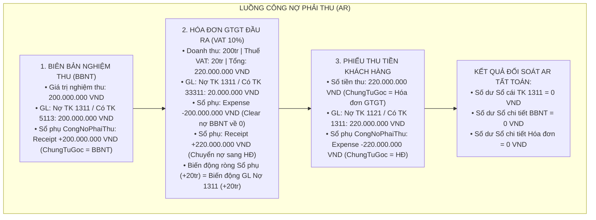
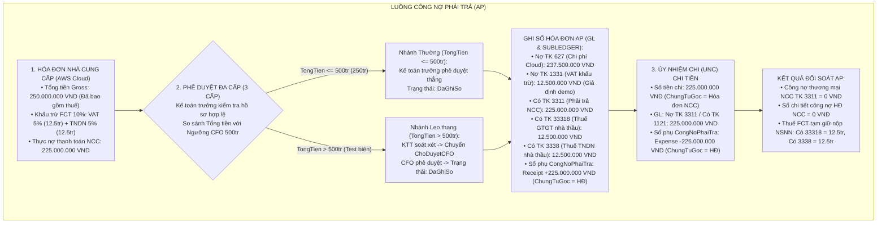

# KỊCH BẢN DEMO 5 PHÚT & BẢN ĐẶC TẢ NGHIỆP VỤ AR & AP (VERSION 3)

> **Dự án:** VinSmart Future (VSF) — Quản lý công nợ Phải thu (AR) & Phải trả (AP)  
> **Nền tảng:** 1C:Enterprise 8.3 (Taxi Interface / BSL)  
> **Chuẩn mực kế toán:** Thông tư 200/2014/TT-BTC & Thông tư 103/2014/TT-BTC (Thuế nhà thầu FCT)

---

## PHẦN 1: SƠ ĐỒ NGHIỆP VỤ CHUẨN HÓA (MERMAID)

### 1.1. Sơ đồ Phân hệ Phải thu (AR Flow) — Chuyển dịch công nợ động

---

### 1.2. Sơ đồ Phân hệ Phải trả (AP Flow) — FCT & Duyệt 3 cấp theo ngưỡng CFO

---

## PHẦN 2: KỊCH BẢN THUYẾT TRÌNH DEMO 5 PHÚT

### Chuẩn bị trước khi demo (Setup):
- Mở sẵn trình duyệt 1C hoặc Client với 3 tài khoản nghiệp vụ:
  1. `ketoan_ar` (Role: Kế toán phải thu)
  2. `ketoan_ap` (Role: Kế toán phải trả)
  3. `ketoan_truong` (Role: Kế toán trưởng)
  4. *(Dự phòng)* `cfo_giamdoc` (Role: Giám đốc tài chính) cho ca kiểm thử vượt ngưỡng.

---

### Phút 00:00 — 00:45: Giới thiệu bài toán & Mục tiêu thu hẹp scope
- **Người thuyết trình:**  
  *"Kính thưa Thầy/Cô và Hội đồng, theo góp ý của giáo viên hướng dẫn về việc tinh gọn phạm vi để tập trung chuyên sâu vào tính đúng đắn kế toán, hệ thống VinSmart Future hôm nay tập trung giải quyết dứt điểm **2 luồng nghiệp vụ cốt lõi**:
  1. **Luồng Phải thu (AR):** Quy trình nghiệm thu dịch vụ, phát hành hóa đơn GTGT đầu ra theo cơ chế Chuyển dịch công nợ (Debt Transfer) và thu tiền tất toán dứt điểm về 0.
  2. **Luồng Phải trả (AP):** Mua dịch vụ Cloud AWS quốc tế có khấu trừ Thuế nhà thầu (FCT) theo Thông tư 103/2014/TT-BTC, kiểm soát phê duyệt 3 cấp nghiêm ngặt theo ngưỡng 500 triệu của CFO và thanh toán tất toán công nợ nhà cung cấp."*

---

### Phút 00:45 — 02:15: Demo Luồng Phải thu (AR Flow)
1. **Bước 1 (User: `ketoan_ar`): Biên bản nghiệm thu 200.000.000 VND**
   - Mở chứng từ `BienBanNghiemThuGiaiDoan`.
   - Bấm **Ghi sổ (Post)**.
   - Cho hội đồng xem:
     + Sổ cái GL: Nợ 1311 / Có 5113 = 200.000.000 VND.
     + Sổ tích lũy `CongNoPhaiThu`: Phát sinh `Receipt` = 200.000.000 VND gắn với mã BBNT.
2. **Bước 2 (User: `ketoan_ar`): Hóa đơn GTGT đầu ra 220.000.000 VND**
   - Lập `HoaDonGTGTDauRa`, chọn `BienBanNghiemThu` tham chiếu tới BBNT trên.
   - Hệ thống tự động tính tiền thuế VAT 10% = 20.000.000 VND, Tổng tiền thanh toán = 220.000.000 VND.
   - Bấm **Ghi sổ (Post)**.
   - **Điểm nhấn thuyết trình (Cơ chế chuyển dịch công nợ):**  
     *"Hệ thống tự động thực hiện 2 chuyển động đồng thời trên Sổ chi tiết: Xuất giảm `Expense` 200tr của BBNT (giúp BBNT về đúng 0) và Nhập tăng `Receipt` 220tr sang Hóa đơn. Biến động ròng sổ phụ đúng bằng 20tr tiền VAT, khớp hoàn toàn với bút toán Nợ 1311 / Có 33311 trên Sổ cái."*
3. **Bước 3 (User: `ketoan_ar`): Phiếu thu tiền khách hàng 220.000.000 VND**
   - Lập `PhieuThuTienKhachHang`, chọn `ChungTuGoc` là Hóa đơn GTGT vừa phát hành.
   - Bấm **Ghi sổ**.
   - Mở báo cáo đối soát:
     + Dư nợ TK 1311 trên Sổ cái = **0 VND**.
     + Dư nợ chi tiết theo BBNT = **0 VND**.
     + Dư nợ chi tiết theo Hóa đơn = **0 VND**.

---

### Phút 02:15 — 04:00: Demo Luồng Phải trả (AP Flow)
1. **Bước 1 (User: `ketoan_ap`): Lập Hóa đơn NCC AWS 250.000.000 VND**
   - Mở `HoaDonNhaCungCap`, nhập Tổng tiền Gross = 250.000.000 VND, tích chọn `CoKhauTruFCT = True`.
   - Hệ thống tự động khấu trừ: FCT VAT 5% = 12.500.000 VND, FCT TNDN 5% = 12.500.000 VND.
   - Số tiền thực trả NCC: `NoThucTraNCC` = 225.000.000 VND. Chi phí VSF: 237.500.000 VND.
   - Kế toán AP bấm **Gửi duyệt** $\rightarrow$ Trạng thái chuyển sang `ChoKeToanTruongDuyet`.
   - **Thử nghiệm Maker-Checker:** Kế toán AP cố bấm duyệt tiếp $\rightarrow$ Hệ thống lập tức cảnh báo: *"Vi phạm nguyên tắc Maker-Checker: Người lập không được tự phê duyệt chứng từ!"*.
2. **Bước 2 (User: `ketoan_truong`): KTT phê duyệt & Ghi sổ**
   - Đăng nhập `ketoan_truong`, mở hóa đơn, kiểm tra đối chiếu Hợp đồng và Dịch vụ CNTT.
   - Vì giá trị 250tr $\le$ Ngưỡng CFO 500tr $\rightarrow$ KTT bấm **Phê duyệt & Ghi sổ**. Trạng thái chuyển sang `DaGhiSo`.
   - Cho hội đồng xem Sổ cái (GL Balance):
     + Nợ 627: 237.500.000 VND
     + Nợ 1331: 12.500.000 VND
     + Có 3311: 225.000.000 VND
     + Có 33318: 12.500.000 VND
     + Có 3338: 12.500.000 VND
     $$\sum Nợ = 250.000.000 = \sum Có = 250.000.000\text{ VND}$$
   - Sổ tích lũy `CongNoPhaiTra`: Ghi nhận đúng nghĩa vụ thực nợ NCC = 225.000.000 VND.
3. **Bước 3 (User: `ketoan_truong`): Thanh toán qua Ủy nhiệm chi (UNC)**
   - Lập `UyNhiemChi`, chọn `ChungTuGoc` là Hóa đơn NCC trên, số tiền chi = 225.000.000 VND.
   - Ghi sổ UNC $\rightarrow$ Bút toán Nợ 3311 / Có 1121 = 225.000.000 VND.
   - Sổ chi tiết AP ghi `Expense` 225.000.000 VND $\rightarrow$ Công nợ NCC về đúng **0 VND**.

---

### Phút 04:00 — 04:30: Trình diễn Ca kiểm thử biên (Boundary Cases)
- **Ca biên 1 (Hóa đơn đúng 500.000.000 VND):**  
  KTT kiểm tra và duyệt thẳng sang `DaGhiSo` thành công vì nằm trong hạn mức $\le 500$ triệu.
- **Ca biên 2 (Hóa đơn 500.000.001 VND hoặc 600.000.000 VND):**  
  KTT không thể duyệt thẳng (nếu cố tình duyệt sẽ bị hệ thống Raise Exception chặn lại). KTT chỉ có quyền chuyển sang `ChoDuyetCFO`. Sau đó phiên đăng nhập `cfo_giamdoc` mới có quyền phê duyệt ghi sổ. Chứng minh cơ chế kiểm soát 3 cấp tuân thủ 100%.

---

### Phút 04:30 — 05:00: Kết luận & Sẵn sàng trả lời phản biện
- Người thuyết trình mở Bảng cân đối thử và báo cáo đối soát độc lập: Toàn bộ công nợ thương mại AR (TK 1311) và AP (TK 3311) đều đã tất toán về 0, hệ thống cân đối hoàn toàn.

---

## PHẦN 3: CÂU TRẢ LỜI MẪU CHUẨN KHI HỘI ĐỒNG HỎI VỀ SỐ DƯ TREO FCT 25 TRIỆU

### Câu hỏi dự kiến từ Hội đồng:
> *"Tại sao sau khi chi trả UNC 225 triệu cho NCC, công nợ thương mại đã hết nhưng trên Bảng cân đối tài khoản vẫn còn số dư Có 25 triệu ở TK 33318 (12,5tr) và TK 3338 (12,5tr)? Khoản này xử lý thế nào?"*

### Câu trả lời chuẩn từng chữ của Người thuyết trình:
> **"Kính thưa Thầy/Cô và Hội đồng:**
> 
> Số dư Có 25 triệu trên TK 33318 (12,5 triệu) và TK 3338 (12,5 triệu) là **hoàn toàn chính xác về mặt chuẩn mực kế toán** và phản ánh đúng bản chất giao dịch thực tế:
> 
> 1. **Bản chất của khoản 25 triệu:** Theo Thông tư 103/2014/TT-BTC, VSF ký hợp đồng dịch vụ Cloud với nhà thầu nước ngoài theo giá đã bao gồm thuế. VSF có trách nhiệm khấu trừ tại nguồn 10% (5% thuế GTGT và 5% thuế TNDN) trước khi chuyển tiền ra nước ngoài. Do đó, nghĩa vụ công nợ thương mại với Nhà cung cấp chỉ là 225 triệu và đã được **tất toán dứt điểm về 0** thông qua Ủy nhiệm chi.
> 2. **Vì sao 25 triệu còn dư trên TK 333:** Khoản 25 triệu này không còn là nợ của nhà cung cấp mà đã chuyển thành **nghĩa vụ thuế VSF phải nộp thay vào Kho bạc Nhà nước Việt Nam**. Khoản này phải được ghi nhận là một khoản nợ phải trả Nhà nước (Số dư Có TK 33318 và 3338) cho đến khi công ty thực hiện kê khai và nộp tiền thuế nhà thầu vào Ngân sách Nhà nước.
> 3. **Định hướng xử lý tiếp theo:** Theo đúng phân kỳ phạm vi đề tài, buổi demo hôm nay tập trung giải quyết bài toán cốt lõi là Quản lý công nợ Phải thu (AR) và Phải trả (AP). Nghiệp vụ lập Tờ khai thuế nhà thầu và chứng từ Nộp tiền vào Ngân sách Nhà nước (bút toán Nợ 33318, Nợ 3338 / Có 1121: 25 triệu) thuộc phân hệ Kế toán Thuế Nhà nước nằm trong kế hoạch triển khai của Phase 2. Sau khi chứng từ nộp NSNN được ghi sổ ở Phase 2, toàn bộ số dư của hai tài khoản này sẽ được tất toán về đúng 0."

---

## PHẦN 4: TỔNG HỢP CÁC GIẢ ĐỊNH DEMO ĐÃ SỬ DỤNG
1. **Thuế suất FCT:** Giả định demo 5% VAT + 5% TNDN áp dụng cho dịch vụ phần mềm/Cloud của nhà thầu nước ngoài không có cơ sở thường trú tại Việt Nam theo Thông tư 103/2014/TT-BTC.
2. **Thời điểm ghi nhận Nợ 1331 của FCT:** Giả định demo ghi nhận Nợ 1331 ngay tại Hóa đơn NCC để thể hiện đầy đủ cấu trúc chi phí và thuế đầu vào, đảm bảo tính cân đối kép của chứng từ. Trong thực tế (Phase 2), điều kiện khấu trừ thuế GTGT nhà thầu cần chứng từ nộp thuế vào Kho bạc Nhà nước.
3. **Cố định VND trong luồng demo:** Hệ thống tự động gán `TienTe = VND`, `TyGia = 1`, `TongTienNgoaiTe = 0` để tập trung kiểm soát công nợ nội tệ, bỏ qua các nhánh xử lý chênh lệch tỷ giá ngoại tệ.
