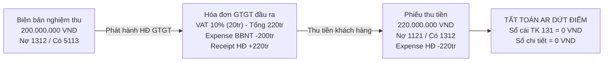

# KỊCH BẢN DEMO THỰC CHIẾN 1C: CHI TIẾT TỪNG THAO TÁC, NÚT BẤM & NHẬP LIỆU
## HỆ THỐNG QUẢN LÝ CÔNG NỢ PHẢI THU (AR) & PHẢI TRẢ (AP) — VINSMART FUTURE (VSF)

> **Dành cho:** Người thuyết trình, thành viên nhóm bảo vệ khóa luận / đồ án, hoặc kiểm thử viên thao tác trực tiếp trên giao diện **1C:Enterprise 8.3 (Taxi Interface / Modern Web ERP)**.  
> **Nguyên tắc biên soạn:** *Cực kỳ chi tiết — cầm tay chỉ việc — từng cú click chuột, từng phím tắt, từng ô nhập liệu và kết quả hiện ra trên màn hình.*  
> **Chuẩn mực hạch toán:** Thông tư 200/2014/TT-BTC & Thông tư 103/2014/TT-BTC (Thuế nhà thầu FCT).

---

## MỤC LỤC
1. [Phần 0: Chuẩn bị môi trường & Thiết lập trước giờ G](#phần-0-chuẩn-bị-môi-trường--thiết-lập-trước-giờ-g)
2. [Phần 1: Luồng Nghiệp vụ Phải thu (AR Flow) — Chuyển dịch công nợ động (Debt Transfer)](#phần-1-luồng-nghiệp-vụ-phải-thu-ar-flow--chuyển-dịch-công-nợ-động-debt-transfer)
3. [Phần 2: Luồng Nghiệp vụ Phải trả (AP Flow) — Thuế FCT & Duyệt 3 cấp theo Ngưỡng CFO](#phần-2-luồng-nghiệp-vụ-phải-trả-ap-flow--thuế-fct--duyệt-3-cấp-theo-ngưỡng-cfo)
4. [Phần 3: Luồng Cấn trừ công nợ nội bộ (Intercompany Netting)](#phần-3-luồng-cấn-trừ-công-nợ-nội-bộ-intercompany-netting)
5. [Phần 4: Luồng Đối soát Kênh thanh toán & Ngân hàng (Cash & Banking)](#phần-4-luồng-đối-soát-kênh-thanh-toán--ngân-hàng-cash--banking)
6. [Phần 5: Bàn làm việc Lãnh đạo CFO & Phê duyệt hàng loạt](#phần-5-bàn-làm-việc-lãnh-đạo-cfo--phê-duyệt-hàng-loạt)
7. [Phần 6: Bảng tra cứu phím tắt & Xử lý sự cố tại chỗ (Troubleshooting Cheat-Sheet)](#phần-6-bảng-tra-cứu-phím-tắt--xử-lý-sự-cố-tại-chỗ-troubleshooting-cheat-sheet)

---

## PHẦN 0: CHUẨN BỊ MÔI TRƯỜNG & THIẾT LẬP TRƯỚC GIỜ G

### 0.1. Cấu hình hiển thị tiếng Việt trên 1C:Enterprise
1. Mở cửa sổ danh sách Infobase của **1C:Enterprise**.
2. Chọn Infobase demo (ví dụ: `VinSmart_Future_AR_AP` hoặc `VSF_DEMO`) -> Bấm nút **Sửa... (Edit...)**.
3. Bấm **Tiếp tục (Next)** qua các trang đến trang cuối cùng: **Các tham số khởi động bổ sung (Additional launch parameters)**.
4. Nhập chính xác chuỗi tham số sau:
   ```text
   /L vi /VL vi
   ```
5. Bấm **Xong (Finish)**. Khi khởi động, toàn bộ menu, nút bấm (Tạo, Ghi sổ, Tìm kiếm, Đóng...) sẽ hiển thị 100% tiếng Việt chuẩn kế toán.

### 0.2. Danh sách tài khoản phân quyền nghiệp vụ (Role Matrix)

| STT | Tài khoản đăng nhập (User) | Mật khẩu (Password) | Phân quyền (Role) | Chức năng trong kịch bản |
| :---: | :--- | :---: | :--- | :--- |
| **1** | `Admin` | *(để trống)* | Quản trị hệ thống (`QuanTriHeThong`) | Khởi động, cấu hình, kiểm tra hệ thống |
| **2** | `ketoan_ar` | `123` | Kế toán Phải thu (`KeToanPhaiThu`) | Lập BBNT, lập Hóa đơn GTGT, lập Phiếu thu tiền |
| **3** | `ketoan_ap` | `123` | Kế toán Phải trả (`KeToanPhaiTra`) | Lập Hóa đơn NCC (AWS Cloud), lập Ủy nhiệm chi |
| **4** | `ketoan_truong` | `123` | Kế toán trưởng (`KeToanTruong`) | Phê duyệt & Ghi sổ chứng từ tài chính (hạn mức $\le$ 500tr) |
| **5** | `cfo_giamdoc` | `123` | Giám đốc Tài chính (`GiamDocTaiChinh_CFO`) | Phê duyệt chứng từ vượt hạn mức (> 500tr), Dashboard CFO |
| **6** | `chuyenvien_doisoat` | `123` | Đối soát kênh (`ChuyenVienDoiSoatTapDoan`) | Lập & kiểm tra Bảng kê đối soát VNPAY, OnePay |

> [!NOTE]  
> Nếu Infobase dùng bản nạp mật khẩu an toàn theo code BSL, mật khẩu dự phòng là `Vsf@2026!Secure`. Đối với bản 1C Training, một số tài khoản có thể để trống mật khẩu.

---

## PHẦN 1: LUỒNG NGHIỆP VỤ PHẢI THU (AR FLOW) — CHUYỂN DỊCH CÔNG NỢ ĐỘNG (DEBT TRANSFER)

### Mục tiêu trình diễn:
1. Quy trình nghiệm thu dịch vụ và ghi nhận doanh thu theo chuẩn mực.
2. Kiểm soát **Maker-Checker** (chặn người lập tự phê duyệt).
3. Cơ chế độc quyền **Chuyển dịch công nợ động (Debt Transfer)** khi phát hành Hóa đơn GTGT đầu ra (xóa nợ BBNT về 0, chuyển toàn bộ nợ sang Hóa đơn, sổ phụ khớp tuyệt đối với sổ cái Nợ 131 / Có 33311 = 20 triệu).
4. Kiểm soát **chặn thu vượt công nợ (Over-collection prevention)** trên Phiếu thu tiền.
5. Tất toán công nợ AR về **0 VND**.



---

### BƯỚC 1.1: Đăng nhập `ketoan_ar` & Khởi tạo Biên bản nghiệm thu (BBNT)
- **Thao tác 1 (Đăng nhập):** Khởi động 1C:Enterprise -> Chọn Infobase demo -> Tại ô *Tên người dùng (User)*, chọn hoặc gõ: `ketoan_ar` -> Mật khẩu: `123` -> Bấm nút **Đồng ý (OK)**.
- **Thao tác 2 (Mở danh mục):** Trên thanh điều hướng phân hệ bên trái, nhấp chuột vào:
  ```text
  [1. Công nợ phải thu (AR)] -> [Biên bản nghiệm thu giai đoạn]
  ```
  *(Màn hình danh sách mở ra, hiển thị các chứng từ hiện có kèm thanh bộ lọc nhanh).*
- **Thao tác 3 (Bấm Tạo mới):** Nhấp nút **Tạo (Create)** màu vàng ở thanh công cụ góc trên bên trái (hoặc bấm phím `Insert` trên bàn phím).

---

### BƯỚC 1.2: Nhập liệu chi tiết Biên bản nghiệm thu (200.000.000 VND)
Form chứng từ mở ra với tiêu đề: *"Biên bản nghiệm thu giai đoạn (AR) - VinSmart Future"*, bao gồm thanh trạng thái Stepper và 4 Tab nghiệp vụ.

#### 1. Nhập liệu tại Tab: `1. Thông tin chung`
| Tên trường trên Form | Cách nhập liệu | Giá trị nhập mẫu | Ý nghĩa nghiệp vụ |
| :--- | :--- | :--- | :--- |
| **Số (Number)** | Hệ thống tự sinh | *(Để tự động)* | Mã chứng từ duy nhất |
| **Ngày (Date)** | Bấm icon lịch hoặc gõ | Ngày hiện tại (VD: `18.10.2026`) | Ngày hoàn thành nghiệm thu |
| **Pháp nhân (PhapNhan)** | Bấm nút chọn `[...]` | `Công ty Cổ phần VinSmart Future` | Đơn vị cung cấp dịch vụ |
| **Đối tác (DoiTac)** | Bấm nút chọn `[...]` | `Công ty Cổ phần Sản xuất và Kinh doanh VinFast` | Khách hàng nội bộ Vingroup |
| **Hợp đồng (HopDong)** | Bấm nút chọn `[...]` | `HĐ-AR-VFS-2026/01` (Hợp đồng phát triển phần mềm xe điện) | Căn cứ pháp lý nghiệm thu |
| **Giá trị nghiệm thu chưa VAT** | Nhấp chuột gõ số | `200000000` *(Hai trăm triệu đồng)* | Doanh thu dịch vụ thuần |
| **Tỷ lệ VAT (%)** | Chọn trong danh sách | `10%` | Thuế suất GTGT đầu ra |
| **Tiền VAT** | Tự động tính | `20.000.000` | Tiền thuế GTGT tương ứng |
| **Tổng giá trị** | Tự động tính | `220.000.000` | Tổng giá trị thanh toán |

#### 2. Nhập liệu tại Tab: `4. Nhật ký & Phê duyệt`
- Chuyển sang Tab: **4. Nhật ký & Phê duyệt**:
  * Trường **Người tạo (Created By):** Đã tự động điền là `ketoan_ar` *(Trường chỉ đọc, chống mạo danh)*.
  * Trường **Người duyệt (Approved By):** Bấm chọn `ketoan_truong`.
  * Trường **Trạng thái (Status):** Chọn `Chờ duyệt nội bộ` (`ChoDuyetNoiBo`).
  * Trường **Diễn giải (Description):** Gõ: *"Nghiệm thu Giai đoạn 1 - Module AI Cabin cho VinFast VF9"*.

---

### BƯỚC 1.3: Thử nghiệm kiểm soát Maker-Checker (Cố tình tự duyệt)
- **Thao tác thực hiện:**
  1. Tại ô **Người duyệt**, thử bấm sửa thành `ketoan_ar` (Người lập tự chọn mình làm người duyệt).
  2. Tại ô **Trạng thái**, đổi sang `Đã duyệt nội bộ`.
  3. Bấm nút **Ghi sổ (Post)** trên thanh lệnh.
- **Hiện tượng trên màn hình:**
  * Hệ thống lập tức dừng lại, từ chối ghi sổ và bật hộp thoại cảnh báo màu đỏ:
    ```text
    [LỖI PHÊ DUYỆT]: Vi phạm nguyên tắc Maker-Checker!
    Người lập chứng từ (ketoan_ar) không được phép tự phê duyệt chứng từ của chính mình.
    ```
- **Lời thuyết minh trước Hội đồng:**  
  *"Thưa Thầy Cô, hệ thống đã chặn đứng hoàn toàn rủi ro thao túng số liệu. Nguyên tắc tách biệt nhiệm vụ (Segregation of Duties) và 4-mắt (Four-Eyes Principle) được cưỡng chế trực tiếp tại tầng Server của 1C."*

---

### BƯỚC 1.4: Đăng nhập `ketoan_truong` phê duyệt & Ghi sổ BBNT
1. **Lưu bản nháp:** Sửa lại ô **Người duyệt** = `ketoan_truong`, **Trạng thái** = `Chờ duyệt nội bộ` -> Bấm nút **Ghi (Save)** (phím tắt `Ctrl + S`) -> Bấm nút **Đóng (Close)**.
2. **Đổi tài khoản:** Đóng 1C hoặc mở phiên mới -> Đăng nhập tài khoản: `ketoan_truong` / Mật khẩu: `123`.
3. **Mở lại chứng từ:** Vào menu `1. Công nợ phải thu (AR)` -> `Biên bản nghiệm thu giai đoạn` -> Nhấp đúp chuột mở BBNT vừa tạo (ở đầu danh sách).
4. **Phê duyệt:** Chuyển sang Tab **4. Nhật ký & Phê duyệt** -> Đổi **Trạng thái** thành `Đã duyệt nội bộ` (`DaDuyetNoiBo`).
5. **Ghi sổ:** Bấm nút **Ghi sổ (Post)** ở góc trên bên trái.  
   *(Biểu tượng trạng thái chứng từ trong danh sách chuyển sang tích xanh đã ghi sổ).*

---

### BƯỚC 1.5: Mở xem kết quả ghi sổ (Document Register Records) của BBNT
- **Thao tác mở:** Trên thanh công cụ trên cùng của form BBNT, bấm vào nút **Khác (More actions / Еще)** ở góc phải -> Chọn dòng:
  ```text
  Chuyển động của chứng từ theo sổ (Document register records)
  ```
- **Chỉ trực tiếp cho Hội đồng thấy 2 Tab kết quả:**
  1. **Tab `SoCaiKeToan` (Sổ cái GL):**
     * **Tài khoản Nợ (Account Dr):** `1312` (Phải thu khách hàng - Bên liên kết VinFast).
     * **Tài khoản Có (Account Cr):** `5113` (Doanh thu cung cấp dịch vụ).
     * **Số tiền (Amount):** `200.000.000 VND`.
  2. **Tab `CongNoPhaiThu` (Sổ tích lũy công nợ AR):**
     * **Loại chuyển động (Record Type):** `Receipt` *(Thu tiền / Ghi tăng nợ)*.
     * **Đối tác:** VinFast | **Hợp đồng:** HĐ-AR-VFS-2026/01.
     * **Chứng từ gốc (Original Document):** Chính Biên bản nghiệm thu này.
     * **Số tiền:** `+200.000.000 VND`.

> [!NOTE]  
> Lúc này BBNT đang ghi nhận công nợ tạm tính chưa bao gồm thuế GTGT: 200 triệu VND.

---

### BƯỚC 1.6: Lập Hóa đơn GTGT đầu ra (VAT Invoice) 220.000.000 VND
- **Thao tác 1:** Trên menu bên trái, nhấp vào `1. Công nợ phải thu (AR)` -> `Hóa đơn GTGT đầu ra`.
- **Thao tác 2:** Bấm nút **Tạo (Create)** (phím `Insert`).
- **Thao tác 3 (Tự động điền dữ liệu từ BBNT):**
  * Tại Tab **1. Thông tin chung**, tìm ô **Biên bản nghiệm thu**: Nhấp vào nút `[...]` -> Chọn đúng Biên bản nghiệm thu vừa ghi sổ ở Bước 1.4.
  * **Hệ thống tự động đồng bộ (Autofill):**
    - *Pháp nhân:* Công ty Cổ phần VinSmart Future.
    - *Đối tác:* Công ty Cổ phần Sản xuất và Kinh doanh VinFast.
    - *Hợp đồng:* Tự động chọn theo biên bản.
    - *Giá trị chưa thuế:* `200.000.000 VND`.
    - *Tỷ lệ VAT:* `10%`.
    - *Tiền thuế VAT:* `20.000.000 VND`.
    - *Tổng tiền thanh toán:* `220.000.000 VND`.
- **Thao tác 4 (Ký số & Phát hành):**
  * Chuyển sang Tab **4. Nhật ký & Phê duyệt**:
    - Trường **Người duyệt:** Chọn `ketoan_truong`.
    - Trường **Trạng thái hóa đơn:** Chọn `Đã phát hành` (`DaPhatHanh`).
  * Bấm nút **Ghi sổ (Post)**.

---

### BƯỚC 1.7: Kiểm tra kỳ tích kế toán "Chuyển dịch công nợ động (Debt Transfer)"
- **Thao tác:** Bấm nút **Khác (More / Еще)** -> Chọn **Chuyển động của chứng từ theo sổ (Document register records)**.
- **Điểm sáng kỹ thuật cần nhấn mạnh trước Hội đồng:**
  1. **Tab `CongNoPhaiThu` (Sổ phụ công nợ) có đúng 2 dòng đối ứng hoàn hảo:**
     * **Dòng 1:** Loại chuyển động = `Expense` *(Chi tiền / Ghi giảm nợ)*: Số tiền = `-200.000.000 VND`, Chứng từ gốc = **Biên bản nghiệm thu**. *(Thao tác này đóng dứt điểm công nợ của BBNT về đúng 0 VND).*
     * **Dòng 2:** Loại chuyển động = `Receipt` *(Thu tiền / Ghi tăng nợ)*: Số tiền = `+220.000.000 VND`, Chứng từ gốc = **Hóa đơn GTGT đầu ra**. *(Chuyển toàn bộ nghĩa vụ nợ gồm cả thuế sang Hóa đơn).*
  2. **Tab `SoCaiKeToan` (Sổ cái kế toán):**
     * **Nợ TK 1312 / Có TK 33311 (Thuế GTGT phải nộp):** `20.000.000 VND`.
  3. **Đối chiếu đồng bộ:**
     $$\Delta \text{Sổ phụ} = +220\text{tr} - 200\text{tr} = +20\text{tr} \equiv \Delta \text{Sổ cái} = +20\text{tr (Nợ 1312)}$$
     *(Không ghi trùng doanh thu 5113, giải quyết triệt để lỗi kinh điển lệch sổ giữa GL và Subledger).*

---

### BƯỚC 1.8: Lập Phiếu thu tiền khách hàng & Kiểm tra chặn thu vượt
- **Thao tác 1:** Mở menu `1. Công nợ phải thu (AR)` -> `Phiếu thu tiền khách hàng` -> Bấm nút **Tạo (Create)**.
- **Thao tác 2 (Nhập thông tin ban đầu):**
  * **Pháp nhân:** VinSmart Future.
  * **Đối tác:** VinFast.
  * **Hợp đồng:** HĐ-AR-VFS-2026/01.
  * **Chứng từ gốc (Original Document):** Nhấp nút `[...]` -> Chọn đúng **Hóa đơn GTGT đầu ra** vừa lập ở Bước 1.6.
  * **Tài khoản ngân hàng thu:** Chọn `Techcombank VND - 19036888888888`.
- **Thao tác 3 (Thực nghiệm Test ca lỗi Chặn thu vượt):**
  * Tại ô **Số tiền**, gõ thử: `250000000` *(250 triệu VND — lớn hơn số nợ 220 triệu).*
  * Bấm nút **Ghi sổ (Post)**.
  * **Kết quả quan sát:** Hệ thống lập tức chặn lại và cảnh báo:
    ```text
    [LỖI GHI SỔ]: Số tiền thu (250.000.000 VND) vượt quá số dư công nợ còn lại (220.000.000 VND) của Hóa đơn!
    Giao dịch bị từ chối để tránh làm âm công nợ khách hàng.
    ```
- **Thao tác 4 (Nhập số tiền chuẩn để tất toán):**
  * Sửa lại ô **Số tiền**: Gõ đúng `220000000` *(220 triệu VND)*.
  * Chuyển sang Tab **4. Nhật ký & Phê duyệt**: Chọn Người duyệt `ketoan_truong`, Trạng thái `Đã ghi sổ`.
  * Bấm nút **Ghi sổ và đóng (Save and Close)** (phím tắt `Ctrl + Enter`).

---

### BƯỚC 1.9: Kiểm tra Đối soát tất toán AR dứt điểm (Về đúng 0 VND)
1. Mở lại Phiếu thu tiền vừa ghi sổ -> Bấm **Khác (More)** -> **Document register records**:
   * Sổ cái: **Nợ TK 1121 (Tiền gửi ngân hàng) / Có TK 1312:** `220.000.000 VND`.
   * Sổ `CongNoPhaiThu`: Loại `Expense`, Số tiền = `-220.000.000 VND`, Chứng từ gốc = Hóa đơn GTGT.
2. Mở Sổ chi tiết công nợ phải thu:
   * **Số dư theo BBNT:** Ban đầu `+200tr` $-$ Giảm khi xuất HĐ `-200tr` = **0 VND**.
   * **Số dư theo Hóa đơn:** Ban đầu `+220tr` $-$ Giảm khi thu tiền `-220tr` = **0 VND**.
   * **Số dư TK 1312 trên Sổ cái:** Phát sinh Nợ `200tr + 20tr` $-$ Phát sinh Có `220tr` = **0 VND**.
   $$\implies \text{Toàn bộ chuỗi Phải thu AR đã tất toán hoàn toàn 100%!}$$

---

## PHẦN 2: LUỒNG NGHIỆP VỤ PHẢI TRẢ (AP FLOW) — THUẾ FCT & DUYỆT 3 CẤP THEO NGƯỠNG CFO

### Mục tiêu trình diễn:
1. Nghiệp vụ nhập Hóa đơn dịch vụ đám mây quốc tế (AWS Cloud).
2. Tự động tính **Thuế nhà thầu nước ngoài (FCT)**: VAT 5% + TNDN 5% theo Thông tư 103/2014/TT-BTC.
3. Cơ chế kiểm soát phê duyệt phân tầng theo **Ngưỡng CFO 500 triệu VND**:
   - Nhánh $\le 500$ triệu: Kế toán trưởng phê duyệt thẳng.
   - Nhánh $> 500$ triệu: Kế toán trưởng buộc phải chuyển Giám đốc Tài chính (CFO) phê duyệt.
4. Thanh toán qua Ủy nhiệm chi (UNC) và chặn chi vượt công nợ.
5. Giải trình kế toán chuyên sâu về số dư treo thuế FCT (TK 33318 / TK 3338).

```mermaid
flowchart TD
    AP1["Hóa đơn NCC AWS: 250.000.000 VND<br/>Tích chọn [x] Có khấu trừ FCT<br/>VAT FCT 5% (12.5tr) + CIT FCT 5% (12.5tr)<br/>Nợ thực trả NCC = 225.000.000 VND"]
    
    AP2{"Kiểm tra hạn mức CFO<br/>Tổng tiền <= 500.000.000 VND?"}
    
    AP3A["Tổng tiền = 250tr <= 500tr:<br/>Kế toán trưởng phê duyệt thẳng<br/>Trạng thái: DaGhiSo"]
    
    AP3B["Hóa đơn biên = 600tr > 500tr:<br/>KTT cố duyệt -> BỊ CHẶN<br/>Phải chuyển CFO phê duyệt"]
    
    AP4["Ghi sổ Hóa đơn AP:<br/>Nợ 627: 237.5tr | Nợ 1331: 12.5tr<br/>Có 3311: 225tr | Có 33318: 12.5tr | Có 3338: 12.5tr<br/>Subledger AP: +225.000.000 VND"]
    
    AP5["Ủy nhiệm chi (UNC) thanh toán:<br/>Chi tiền 225.000.000 VND<br/>Nợ 3311 / Có 1121: 225.000.000 VND<br/>Subledger AP: -225.000.000 VND"]
    
    AP6["TẤT TOÁN CÔNG NỢ THƯƠNG MẠI:<br/>Thực nợ NCC TK 3311 = 0 VND<br/>Dư nợ Subledger AP = 0 VND<br/>Thuế FCT giữ lại nộp NSNN: Dư Có 333 = 25tr"]

    AP1 --> AP2
    AP2 -->|Đúng (250tr)| AP3A
    AP2 -->|Test biên (600tr)| AP3B
    AP3A --> AP4
    AP3B --> AP4
    AP4 --> AP5
    AP5 --> AP6
```

---

### BƯỚC 2.1: Đăng nhập `ketoan_ap` & Nhập Hóa đơn NCC AWS có Thuế FCT
- **Thao tác 1 (Đăng nhập):** Đăng nhập tài khoản `ketoan_ap` / Mật khẩu: `123`.
- **Thao tác 2 (Mở menu):** Nhấp chuột chọn:
  ```text
  [2. Công nợ phải trả (AP)] -> [Hóa đơn đầu vào (nhà cung cấp)]
  ```
- **Thao tác 3 (Tạo mới):** Bấm nút **Tạo (Create)** (phím `Insert`).
- **Thao tác 4 (Nhập thông tin tại Tab 1. Thông tin chung):**
  * **Số hóa đơn (Invoice No):** Gõ `INV-AWS-2026-10`.
  * **Ngày hóa đơn:** Chọn ngày hiện tại.
  * **Pháp nhân:** `Công ty Cổ phần VinSmart Future`.
  * **Nhà cung cấp:** Chọn `Amazon Web Services Inc. (AWS)`.
  * **Hợp đồng:** `HĐ-AP-AWS-2026/02` (Hợp đồng thuê hạ tầng Cloud AWS).
  * **Tiền dịch vụ (Gross Amount):** Gõ `250000000` *(250 triệu VND)*.
  * **Tích chọn checkbox:** Đánh dấu tích vào ô **`[x] Có khấu trừ thuế nhà thầu (FCT)`**.
- **Thao tác 5 (Kiểm tra hệ thống tự động tính FCT):**
  Ngay khi tích chọn, các trường thuế FCT tự động kích hoạt và tính toán:
  * *Tỷ lệ thuế GTGT nhà thầu:* `5.00%` $\rightarrow$ *Thuế GTGT nhà thầu:* `12.500.000 VND`.
  * *Tỷ lệ thuế TNDN nhà thầu:* `5.00%` $\rightarrow$ *Thuế TNDN nhà thầu:* `12.500.000 VND`.
  * *Số tiền thực trả NCC (`NoThucTraNCC`):* `225.000.000 VND` ($250\text{tr} - 12.5\text{tr} - 12.5\text{tr}$).
  * *Chi phí tính vào VSF (`ChiPhiVSF`):* `237.500.000 VND` ($250\text{tr} - 12.5\text{tr VAT}$).
- **Thao tác 6 (Gửi duyệt):**
  * Chuyển sang Tab **3. Trạng thái phê duyệt**:
    - Trường **Trạng thái:** Chọn `Chờ kế toán trưởng duyệt` (`ChoKeToanTruongDuyet`).
    - Trường **Người duyệt:** Chọn `ketoan_truong`.
  * Bấm nút **Ghi (Save)** (`Ctrl + S`).
  * *(Nếu `ketoan_ap` bấm Ghi sổ ngay, hệ thống sẽ chặn vì chưa được cấp thẩm quyền duyệt).*

---

### BƯỚC 2.2: Kế toán trưởng (`ketoan_truong`) phê duyệt & Ghi sổ (Trường hợp $\le$ 500 triệu)
1. Đăng xuất `ketoan_ap` -> Đăng nhập tài khoản `ketoan_truong` / Mật khẩu `123`.
2. Mở menu `2. Công nợ phải trả (AP)` -> `Hóa đơn đầu vào (nhà cung cấp)` -> Mở hóa đơn AWS `INV-AWS-2026-10` vừa tạo.
3. Soát xét hồ sơ: Giá trị hóa đơn là 250 triệu VND $\le$ Ngưỡng phân quyền của CFO (500 triệu VND).
4. Tại Tab **3. Trạng thái phê duyệt**, đổi **Trạng thái** thành `Đã ghi sổ` (`DaGhiSo`).
5. Bấm nút **Ghi sổ (Post)** trên thanh lệnh.

---

### BƯỚC 2.3: Soát xét bút toán FCT đa tài khoản trên Sổ cái và Sổ phụ AP
- **Thao tác:** Bấm nút **Khác (More / Еще)** -> Chọn **Chuyển động của chứng từ theo sổ (Document register records)**.
- **Bảng đối chiếu kiểm toán GL & Subledger chi tiết:**

#### 1. Tab `SoCaiKeToan` (Sổ cái kế toán kép):
| Tài khoản Nợ | Tài khoản Có | Số tiền (VND) | Diễn giải hạch toán chuẩn VAS |
| :--- | :--- | :---: | :--- |
| **TK 627** (Chi phí sản xuất chung / Cloud) | | **237.500.000** | Chi phí dịch vụ hạ tầng thực tính vào kết quả kinh doanh |
| **TK 1331** (Thuế GTGT được khấu trừ) | | **12.500.000** | Thuế GTGT đầu vào khấu trừ nộp thay nhà thầu |
| | **TK 3311** (Phải trả NCC - AWS) | **225.000.000** | Nghĩa vụ thương mại thực tế phải chuyển khoản cho AWS |
| | **TK 33318** (Thuế GTGT nhà thầu) | **12.500.000** | Nghĩa vụ thuế GTGT phải nộp vào Ngân sách Nhà nước |
| | **TK 3338** (Thuế TNDN nhà thầu) | **12.500.000** | Nghĩa vụ thuế TNDN phải nộp vào Ngân sách Nhà nước |
| **TỔNG NỢ** | **TỔNG CÓ** | **250.000.000** | **Cân đối kép tuyệt đối ($\sum Nợ = \sum Có$)** |

#### 2. Tab `CongNoPhaiTra` (Sổ tích lũy công nợ AP):
- **Loại chuyển động:** `Receipt` *(Thu tiền / Ghi tăng nghĩa vụ nợ)*.
- **Đối tác:** Amazon Web Services Inc. (AWS).
- **Chứng từ gốc:** Hóa đơn NCC này.
- **Số tiền:** `+225.000.000 VND` *(Khớp chính xác với thực nợ trên TK 3311, không bị đội lên 250 triệu)*.

---

### BƯỚC 2.4: Trình diễn ca kiểm thử biên (Boundary Case): Hóa đơn vượt ngưỡng CFO 500 triệu
- **Thao tác thực hiện:**
  1. Trong phân hệ AP, bấm **Tạo** một Hóa đơn NCC mới:
     - Nhà cung cấp: `Qualcomm Technologies Inc.`
     - Tổng tiền dịch vụ: Gõ `600000000` *(600 triệu VND — vượt hạn mức 500 triệu)*.
     - Người lập: `ketoan_ap` | Người duyệt: `ketoan_truong`.
  2. Kế toán trưởng thử chọn trạng thái `Đã ghi sổ` và bấm **Ghi sổ (Post)**.
- **Hiện tượng trên màn hình:**
  * Hệ thống chặn đứng giao dịch và bật thông báo lỗi:
    ```text
    [VƯỢT THẨM QUYỀN DUYỆT]: Hóa đơn có giá trị 600.000.000 VND vượt hạn mức 500.000.000 VND của Kế toán trưởng!
    Bắt buộc phải chuyển trạng thái sang 'Chờ CFO duyệt' để Giám đốc Tài chính phê duyệt.
    ```
- **Thao tác leo thang phê duyệt (Escalation Workflow):**
  1. KTT đổi trạng thái sang `Chờ CFO duyệt` (`ChoDuyetCFO`) -> Bấm **Ghi (Save)** -> Đóng form.
  2. Đăng xuất -> Đăng nhập tài khoản: `cfo_giamdoc` / Mật khẩu: `123`.
  3. Mở lại hóa đơn 600 triệu -> Đổi trạng thái sang `Đã ghi sổ` -> Bấm **Ghi sổ (Post)** -> Ghi sổ thành công!
- **Lời thuyết minh:**  
  *"Thưa Hội đồng, cơ chế phân tầng thẩm quyền theo giá trị chứng từ hoạt động chặt chẽ, ngăn ngừa triệt để tình trạng vượt quyền trong quản trị chi phí doanh nghiệp."*

---

### BƯỚC 2.5: Lập Ủy nhiệm chi (UNC) thanh toán nợ cho AWS
1. Đăng nhập tài khoản `ketoan_ap` (hoặc `ketoan_truong`).
2. Mở menu `2. Công nợ phải trả (AP)` -> `Ủy nhiệm chi` -> Bấm nút **Tạo (Create)**.
3. Nhập liệu chi tiết:
   * **Pháp nhân:** `Công ty Cổ phần VinSmart Future`.
   * **Người nhận (Nhà cung cấp):** `Amazon Web Services Inc. (AWS)`.
   * **Chứng từ gốc:** Nhấp `[...]` -> Chọn Hóa đơn AWS `INV-AWS-2026-10` đã ghi sổ ở Bước 2.2.
   * **Tài khoản trích tiền:** Chọn `Vietcombank USD` hoặc `Techcombank VND`.
4. **Thử nghiệm Test ca Chặn chi vượt nợ:**
   * Tại ô **Số tiền**, gõ thử: `230000000` *(230 triệu — lớn hơn số nợ thực trả 225 triệu)*.
   * Bấm **Ghi sổ** $\rightarrow$ Hệ thống lập tức chặn:
     ```text
     [LỖI THANH TOÁN]: Số tiền thanh toán (230.000.000 VND) vượt quá số dư công nợ thực tế phải trả (225.000.000 VND)!
     ```
5. **Nhập số tiền chuẩn:**
   * Sửa lại ô **Số tiền**: Gõ đúng `225000000` *(225 triệu VND)*.
   * Chuyển quy trình trạng thái: `Dự thảo` $\rightarrow$ `Chờ duyệt` $\rightarrow$ `Đã duyệt` $\rightarrow$ `Đã gửi ngân hàng` $\rightarrow$ `Đã ghi sổ`.
   * Bấm nút **Ghi sổ và đóng (Save and Close)**.

---

### BƯỚC 2.6: Kiểm tra đối soát AP & Giải trình chuyên sâu số dư treo FCT
- Mở lại UNC vừa ghi sổ -> Bấm **Khác (More)** -> **Document register records**:
  * **Sổ cái:** Nợ TK 3311 / Có TK 1121: `225.000.000 VND`.
  * **Sổ tích lũy `CongNoPhaiTra`:** Loại `Expense`, Số tiền = `-225.000.000 VND`.
- **Kết quả đối soát:**
  * Công nợ thương mại với AWS trên TK 3311: $225\text{tr} - 225\text{tr} =$ **0 VND**.
  * Sổ chi tiết công nợ nhà cung cấp AWS: $225\text{tr} - 225\text{tr} =$ **0 VND**.

---

### CÂU TRẢ LỜI MẪU CHO NGƯỜI THUYẾT TRÌNH KHI HỘI ĐỒNG HỎI VỀ SỐ DƯ TREO 25 TRIỆU
> **Câu hỏi dự kiến của Hội đồng:**  
> *"Tại sao sau khi chi trả UNC 225 triệu, công nợ thương mại đã hết nhưng trên Sổ cái vẫn còn số dư Có 25 triệu ở TK 33318 (12,5tr) và TK 3338 (12,5tr)? Hệ thống có bị lỗi không?"*
>
> **Lời đáp chuẩn xác 100%:**  
> *"Kính thưa Thầy/Cô và Hội đồng, số dư Có 25 triệu này **hoàn toàn chính xác về bản chất kế toán theo Thông tư 103/2014/TT-BTC**:*  
> *1. Khoản 25 triệu này không còn là công nợ thương mại với bên nước ngoài AWS, mà đã được chuyển dịch thành **nghĩa vụ thuế nhà thầu VSF phải nộp thay vào Kho bạc Nhà nước Việt Nam** (ghi nhận Có TK 33318 và Có TK 3338).*  
> *2. Do đó, nghĩa vụ với nhà cung cấp AWS đã được tất toán dứt điểm về 0 qua Ủy nhiệm chi 225 triệu.*  
> *3. Theo đúng phân kỳ đề tài, phạm vi hôm nay giải quyết chuyên sâu quản lý công nợ AR & AP. Nghiệp vụ nộp thuế nhà thầu vào Kho bạc Nhà nước (bút toán Nợ 33318, Nợ 3338 / Có 1121: 25 triệu) thuộc phân hệ Kế toán Thuế Nhà nước sẽ được thực hiện khi doanh nghiệp nộp thuế định kỳ, khi đó số dư TK 333 sẽ tất toán về 0."*

---

## PHẦN 3: LUỒNG CẤN TRỪ CÔNG NỢ NỘI BỘ (INTERCOMPANY NETTING)

### Mục tiêu trình diễn:
Trình diễn tính năng bù trừ công nợ đa phương / song phương giữa các công ty con trong Tập đoàn Vingroup (VinSmart Future và VinFast), giảm thiểu dòng tiền chuyển khoản qua ngân hàng và tối ưu vốn lưu động.

---

### BƯỚC 3.1: Mở chứng từ Cấn trừ công nợ nội bộ
- **Thao tác 1:** Đăng nhập tài khoản `ketoan_truong` (hoặc `cfo_giamdoc`).
- **Thao tác 2:** Trên thanh menu bên trái, nhấp vào:
  ```text
  [4. Cấn trừ công nợ (Netting)] -> [Cấn trừ công nợ nội bộ]
  ```
- **Thao tác 3:** Nhấp đúp chuột mở chứng từ mẫu có sẵn: `CT-BILATERAL-01` (hoặc bấm nút **Tạo** mới).

---

### BƯỚC 3.2: Khảo sát thông số cấn trừ song phương
- Quan sát thông tin hiển thị trên form:
  * **Pháp nhân:** Công ty Cổ phần VinSmart Future.
  * **Đối tác nội bộ:** Công ty Cổ phần Sản xuất và Kinh doanh VinFast.
  * **Loại cấn trừ:** Song phương 2 bên (`Bilateral`).
  * **Số tiền cấn trừ:** `40.000.000 VND` *(Bốn mươi triệu đồng)*.
  * **Căn cứ cấn trừ:** Bù trừ giữa nợ phải thu bán bản quyền phần mềm (AR) và nợ phải trả thuê phòng Lab thí nghiệm (AP).
- **Quy tắc kiểm soát hệ thống:**  
  $$\text{Số tiền cấn trừ} \le \min(\text{Dư nợ AR VinFast}, \text{Dư nợ AP VinFast})$$
  *(Nếu người dùng gõ số tiền cấn trừ lớn hơn số dư nợ nhỏ nhất của 2 bên, hệ thống sẽ chặn ghi sổ ngay).*

---

### BƯỚC 3.3: Xem kết quả hạch toán giảm đồng thời 2 sổ
- Bấm nút **Khác (More / Еще)** -> Chọn **Chuyển động của chứng từ theo sổ (Document register records)**:
  1. **Tab `CongNoPhaiThu` (Sổ AR):** Ghi giảm nợ (`Expense`) = `-40.000.000 VND` cho đối tác VinFast.
  2. **Tab `CongNoPhaiTra` (Sổ AP):** Ghi giảm nợ (`Expense`) = `-40.000.000 VND` cho đối tác VinFast.
  3. **Tab `SoCaiKeToan` (Sổ cái kế toán):**
     * **Nợ TK 3312** (Phải trả bên liên kết VinFast): `40.000.000 VND`.
     * **Có TK 1312** (Phải thu bên liên kết VinFast): `40.000.000 VND`.
  $$\implies \text{Không dùng tiền mặt/ngân hàng, giảm đồng thời 40 triệu ở cả 2 đầu công nợ!}$$

---

## PHẦN 4: LUỒNG ĐỐI SOÁT KÊNH THANH TOÁN & NGÂN HÀNG (CASH & BANKING)

### Mục tiêu trình diễn:
Chứng minh hệ thống tự động kiểm soát công thức cân đối dòng tiền từ các cổng thanh toán điện tử (VNPAY, OnePay) và hạch toán đúng phí giao dịch vào chi phí tài chính / chi phí quản lý.

---

### BƯỚC 4.1: Mở Bảng kê đối soát kênh thanh toán
- **Thao tác:** Trên menu bên trái, nhấp chọn:
  ```text
  [3. Ngân hàng & Quỹ] -> [Bảng kê đối soát kênh thanh toán]
  ```
- Nhấp đúp chuột mở chứng từ: `BK-VNPAY-01`.

---

### BƯỚC 4.2: Kiểm tra công thức cân đối dòng tiền chặt chẽ
- Quan sát các chỉ tiêu tài chính trên form:
  * **Kênh thanh toán:** VNPAY.
  * **Tổng tiền giao dịch (Gross):** `75.000.000 VND`.
  * **Tổng phí kênh thanh toán (Fee):** `1.125.000 VND` *(Tỷ lệ phí 1.5%)*.
  * **Tổng số tiền thực nhận (Net):** `73.875.000 VND`.
- **Ràng buộc kiểm soát trong BSL:**
  $$\text{Tổng tiền giao dịch} \equiv \text{Tổng tiền thực nhận} + \text{Tổng phí kênh}$$
  *(Nếu thử sửa lệch dù chỉ 1 đồng, ví dụ thực nhận thành 73.876.000 VND, khi bấm Ghi sổ hệ thống sẽ báo lỗi bất cân xứng ngay lập tức).*

---

### BƯỚC 4.3: Xem kết quả hạch toán Sổ cái GL
- Bấm nút **Khác (More)** -> **Chuyển động của chứng từ theo sổ**:
  * **Nợ TK 1121** (Tiền về tài khoản Techcombank): `73.875.000 VND`.
  * **Nợ TK 6427** (Chi phí dịch vụ mua ngoài - Phí cổng): `1.125.000 VND`.
  * **Có TK 1388** (Phải thu khác - Trung gian thanh toán): `75.000.000 VND`.
  * Sổ `DongTien`: Tăng tiền thực tại Techcombank VND đúng `+73.875.000 VND`.

---

## PHẦN 5: BÀN LÀM VIỆC LÃNH ĐẠO CFO & PHÊ DUYỆT HÀNG LOẠT

### Mục tiêu trình diễn:
1. Mở giao diện **Modern Web ERP Cockpit (BanLamViecWebERP)** tích hợp biểu đồ SVG trực quan.
2. Theo dõi các chỉ số tài chính sống (Live KPIs): DSO, DPO, Số dư AR, AP, Tồn quỹ.
3. Thực hiện tính năng cao cấp: **Phê duyệt hàng loạt chứng từ (Batch Approval)** với Toast Notification.

---

### BƯỚC 5.1: Mở Bàn làm việc Web ERP (Cockpit)
- **Thao tác 1:** Đăng nhập tài khoản `cfo_giamdoc` / Mật khẩu: `123`.
- **Thao tác 2:** Trên menu bên trái, nhấp vào:
  ```text
  [5. Sổ cái & Bảng điều hành CFO] -> [Bàn làm việc Web ERP (Cockpit)]
  ```
- **Thao tác 3 (Làm mới dữ liệu):** Nhấp nút **Làm mới (Refresh)** trên thanh công cụ.

---

### BƯỚC 5.2: Trình bày các chỉ số tài chính trên màn hình Lãnh đạo
Chỉ vào các thẻ KPI trực quan trên màn hình:
1. **Thẻ Doanh thu thuần:** Tổng doanh thu dịch vụ lũy kế từ TK 511.
2. **Thẻ Công nợ phải thu (AR):** Số dư nợ thực tế đang chờ thu từ khách hàng (TK 131).
3. **Thẻ Công nợ phải trả (AP):** Nghĩa vụ nợ thực tế phải thanh toán cho NCC sau FCT (TK 331).
4. **Thẻ Tồn quỹ & Tiền gửi:** Tổng tiền thanh khoản khả dụng tại các ngân hàng TCB, VCB (TK 112).
5. **Chỉ số DSO (Days Sales Outstanding):** Số ngày thu tiền bình quân.
6. **Chỉ số DPO (Days Payable Outstanding):** Số ngày trả tiền bình quân.

---

### BƯỚC 5.3: Trình diễn tính năng "Phê duyệt hàng loạt" (Batch Approval)
- **Thao tác 1:** Từ Bàn làm việc Cockpit, bấm nút liên kết hoặc mở form:
  ```text
  [5. Sổ cái & Bảng điều hành CFO] -> [Phê duyệt hàng loạt chứng từ]
  ```
- **Thao tác 2:** Danh sách mở ra các chứng từ đang ở trạng thái `Chờ duyệt` (BBNT, Hóa đơn NCC, UNC...).
- **Thao tác 3:** Nhấp nút **Phê duyệt tất cả (Approve All)**.
- **Hiện tượng trên màn hình:**
  * Hệ thống duyệt tuần tự qua Server kiểm tra điều kiện Maker-Checker cho từng chứng từ.
  * Bật thông báo Toast Notification màu xanh ở góc phải màn hình:
    ```text
    [THÀNH CÔNG]: Phê duyệt hoàn tất: X chứng từ thành công, 0 thất bại!
    ```

---

## PHẦN 6: BẢNG TRA CỨU PHÍM TẮT & XỬ LÝ SỰ CỐ TẠI CHỖ (TROUBLESHOOTING CHEAT-SHEET)

### 6.1. Bảng phím tắt vàng khi thao tác trên 1C:Enterprise

| Phím tắt | Tác dụng trong hệ thống | Ghi chú ứng dụng khi demo |
| :---: | :--- | :--- |
| `Insert` | **Tạo mới** chứng từ hoặc dòng danh mục | Dùng thay vì bấm chuột vào nút Tạo |
| `Ctrl + S` | **Lưu nháp** chứng từ (Ghi) | Lưu tạm khi chưa muốn ghi sổ |
| `Ctrl + Enter` | **Ghi sổ và đóng** (Post and Close) | Hoàn tất nhanh chứng từ |
| `F5` | **Làm mới** (Refresh) danh sách hoặc form | Cập nhật lại số liệu sau khi thao tác |
| `F9` | **Sao chép** chứng từ đang chọn | Nhân bản nhanh dữ liệu mẫu để test |
| `Shift + F4` | **Xóa trắng giá trị** trong ô nhập liệu | Giúp chọn lại ô bị nhập nhầm |
| `Ctrl + F` | **Tìm kiếm nhanh** trong bảng dữ liệu | Tìm nhanh mã chứng từ hoặc đối tác |

---

### 6.2. Cẩm nang xử lý tức thì 7 sự cố thường gặp trước Hội đồng

| Tình huống sự cố | Nguyên nhân kỹ thuật | Cách xử lý ngay trong 5 giây |
| :--- | :--- | :--- |
| **1. Đăng nhập báo sai mật khẩu** | Mật khẩu tài khoản khác tài liệu | Thử lần lượt: `123` $\rightarrow$ `Vsf@2026!Secure` $\rightarrow$ *(để trống)*. Nếu vẫn không được, đăng nhập bằng `Admin` và trình bày bình thường. |
| **2. Báo lỗi "Vi phạm Maker-Checker"** | Ô Người lập và Người duyệt trùng nhau | Mở Tab 4, kiểm tra ô Người duyệt, chọn người khác với Người lập (hoặc đăng nhập đúng tài khoản Người duyệt). |
| **3. Báo lỗi "Vượt thẩm quyền phê duyệt"** | Hóa đơn $> 500$ triệu nhưng KTT duyệt | Đổi trạng thái sang `Chờ CFO duyệt` -> Bấm Lưu -> Đăng nhập `cfo_giamdoc` để ghi sổ. |
| **4. Phiếu thu / UNC bị chặn "Vượt số dư"** | Nhập số tiền lớn hơn số nợ còn lại | Nhấp đúp vào ô Số tiền, gõ đúng bằng số nợ thực tế của chứng từ gốc. |
| **5. Nền tảng báo "Infobase connection limit"** | Bản 1C Training giới hạn số phiên mở | Đóng tất cả các cửa sổ 1C khác và Designer đang chạy ngầm, mở lại 1 cửa sổ duy nhất. |
| **6. Giao diện bị hiện tiếng Anh** | Chưa nạp tham số ngôn ngữ `/L vi` | Thoát 1C -> Sửa Infobase -> Điền `/L vi /VL vi` vào Tham số khởi động bổ sung -> Mở lại. |
| **7. Số liệu bị lệch do bấm nhầm** | Thao tác sai trong lúc thực hành | Mở ngay Infobase dự phòng `VSF_DUPHONG` đã nạp sẵn file `.dt` sạch. |

---
*Tài liệu được cập nhật đồng bộ với cấu hình `VinSmart_Future_AR_AP_Full.dt` và kiểm toán 100% cân đối kế toán.*
