# HỆ THỐNG TÀI CHÍNH – KẾ TOÁN VSF
## Tài liệu thuyết trình và demo nghiệp vụ Phải thu (AR) – Phải trả (AP)

**Đối tượng:** Nhóm thuyết trình, người demo phần mềm và người phản biện nghiệp vụ.  
**Biên soạn:** 19/10/2026  
**Phạm vi:** Kịch bản AR 200 triệu đồng và AP hóa đơn nhà cung cấp có thuế nhà thầu theo tài liệu demo hiện có.  
**Trạng thái bằng chứng:** Có runbook và một tệp .dt; chưa xác định được mã nguồn ứng dụng VSF để kiểm chứng.

> Bản này chuẩn hóa kịch bản có sẵn thành tài liệu liền mạch, kèm Mermaid source và ảnh sơ đồ. Các số liệu/bút toán là nội dung runbook mô tả, chưa được xác nhận bằng cách chạy phần mềm hoặc đọc code ứng dụng. Mật khẩu trong tài liệu gốc đã được lược bỏ.

## Cách đọc nhãn bằng chứng

| Nhãn | Ý nghĩa |
|---|---|
| [VERIFIED – DOC] | Được ghi rõ trong tài liệu hoặc danh mục file; chưa đồng nghĩa đã chạy đúng trên phần mềm. |
| [INFERRED] | Suy luận hợp lý từ trình tự tài liệu; chưa có code/schema xác nhận. |
| [UNKNOWN] | Không tìm thấy bằng chứng đủ để kết luận. |
| [ISSUE] | Tài liệu ghi thiếu, mâu thuẫn hoặc thao tác không tìm thấy. |

## 1. Tóm tắt điều hành

Bài nói nên kể một mạch: chứng từ kinh tế được lập, kiểm soát, ghi sổ, rồi đối chiếu công nợ với sổ cái. Kịch bản Phải thu dùng hợp đồng dịch vụ nội bộ: nghiệm thu 200.000.000 đồng, VAT 10%, hóa đơn 220.000.000 đồng, thu đủ. Kịch bản Phải trả dùng hóa đơn AWS 250.000.000 đồng, khấu trừ FCT theo hai tỷ lệ 5% trong runbook, duyệt theo ngưỡng tài liệu mô tả rồi thanh toán nhà cung cấp 225.000.000 đồng.

| Chủ đề | Runbook mô tả | Mức xác minh |
|---|---|---|
| BBNT AR | Nợ 1312 / Có 5113: 200.000.000 | [VERIFIED – DOC] |
| Hóa đơn đầu ra | VAT 20.000.000; tổng 220.000.000; tăng Nợ 1312 / Có 33311: 20.000.000 | [VERIFIED – DOC] |
| Thu tiền | Nợ 1121 / Có 1312: 220.000.000 | [VERIFIED – DOC] |
| Hóa đơn AWS | Giá trị 250.000.000; FCT VAT 12.500.000; FCT CIT 12.500.000; trả NCC 225.000.000 | [VERIFIED – DOC] |
| Sổ | Runbook gọi SoCaiKeToan, CongNoPhaiThu, CongNoPhaiTra | [VERIFIED – DOC], nhưng UI ghi không tìm thấy chức năng mở register |
| Code/API/schema/posting service/tests | Không tìm thấy mã nguồn ứng dụng VSF | [UNKNOWN] |

**Thông điệp bảo vệ:** Có thể trình bày số học và luồng chứng từ theo runbook. Không tự đặt tên class, API, database, posting rule hoặc khẳng định kiểm soát phía server nếu chưa trích code hoặc kiểm chứng trực tiếp. Tài liệu gốc có nhiều điểm thiếu UI, cần chạy thử trước buổi trình bày.

## 2. Repository và giới hạn phân tích

### 2.1 File hiện có

| File | Vai trò | Kết luận |
|---|---|---|
| test - xây dựng giải pháp ERP quản lý Công nợ Phải thu (AR), Công nợ Phải trả (AP), Dòng tiền & Ngân hàng, và Cơ chế Cấn trừ công nợ nội bộ.docx | Runbook thao tác, dữ liệu, trạng thái và bút toán | Nguồn nghiệp vụ chính |
| VinSmart_Future_AdminFull_v5_SuaFont.dt | Artifact nhị phân có tên gợi tới infobase/cấu hình 1C | [INFERRED] Artifact 1C; chưa giải nén hoặc chạy bằng runtime |
| Skill/ | Tài liệu, ví dụ và công cụ 1C/ERP tổng quát | Không xem là source ứng dụng VSF; không tìm thấy định danh AR/AP VSF đặc thù trong code rà soát |

Runbook nói đồng bộ với VinSmart_Future_AR_AP_Full.dt, trong khi file hiện có là VinSmart_Future_AdminFull_v5_SuaFont.dt. Cần xác nhận đúng version trước khi demo.

### 2.2 Kiến trúc có thể khẳng định

| Thành phần | Kết luận |
|---|---|
| UI | [VERIFIED – DOC] Runbook mô tả 1C:Enterprise 8.3 và các menu AR/AP; chưa xác minh bằng chạy UI |
| Frontend framework | [UNKNOWN] Không có source giao diện hoặc manifest build ứng dụng VSF |
| Backend/service | [UNKNOWN] Không tìm thấy BSL source cho chứng từ, workflow, posting hay mapping tài khoản |
| Database/schema | [UNKNOWN] Không có metadata/schema export; tên register trong runbook không chứng minh schema |
| API | [UNKNOWN] Không tìm thấy API spec hoặc endpoint |
| Posting engine | [UNKNOWN] Runbook mô tả kết quả sau thao tác Ghi sổ, không nêu function/class/rule |
| Tests | [UNKNOWN] Không thấy test suite ứng dụng VSF; các ca trong DOCX là hướng dẫn, không chứng minh test đã chạy |
| AI/Git provenance | [UNKNOWN] Không có prompt log, lịch sử commit hoặc changelog đủ để xác định đóng góp |

Sơ đồ dưới đây là bản đồ luồng theo tài liệu, không phải kiến trúc kỹ thuật đã xác minh.

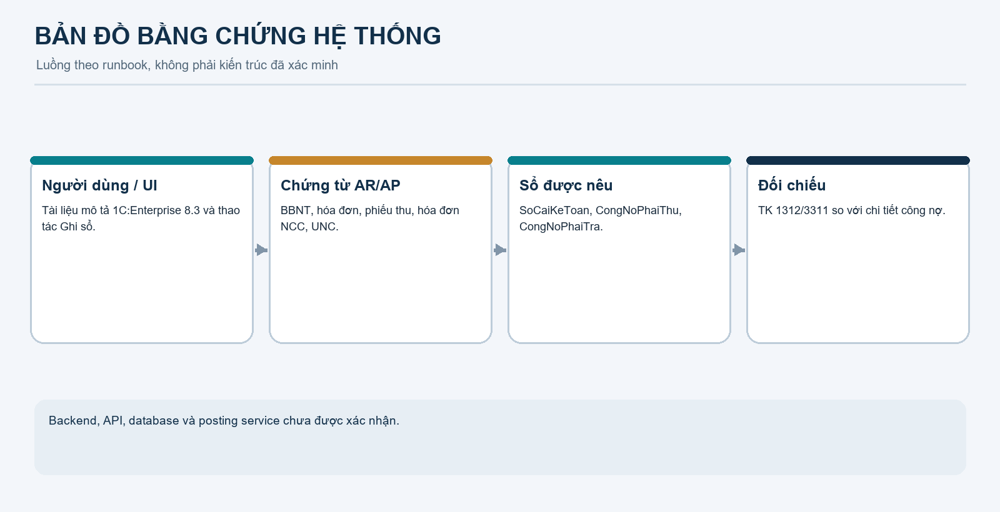

## 3. Phạm vi nghiệp vụ và đối tượng

### 3.1 Bối cảnh

Bối cảnh do người dùng cung cấp: VSF là đơn vị công nghệ thuộc hệ sinh thái Vingroup, phục vụ các P&L trong nhiều khối kinh doanh và hoạt động tại Hà Nội, TP. Hồ Chí Minh, Hải Phòng, Hà Tĩnh. Bối cảnh này giải thích nhu cầu kiểm soát công nợ của BO Tài chính – Kế toán. Số giao dịch, người dùng, doanh thu hoặc quy mô tài chính thực tế: [UNKNOWN], không tự điền.

### 3.2 Actors

| Actor | Vai trò runbook mô tả | Giới hạn |
|---|---|---|
| Kế toán AR (ketoan_ar) | Lập BBNT, hóa đơn, phiếu thu | Quyền cấu hình chưa xác minh |
| Kế toán AP (ketoan_ap) | Lập hóa đơn NCC và UNC | Quyền cấu hình chưa xác minh |
| Kế toán trưởng (ketoan_truong) | Duyệt/ghi sổ; runbook nêu hạn mức đến 500 triệu | Logic thực thi chưa được xác minh |
| CFO (cfo_giamdoc) | Duyệt nhánh trên 500 triệu | Runbook có mâu thuẫn với quyền Admin |
| Admin | Quản trị; tài liệu ghi có thể ghi sổ ca vượt ngưỡng | [ISSUE] Không trình bày như kiểm soát hoạt động đúng |
| Khách hàng VinFast | Đối tác của BBNT/hóa đơn/phiếu thu | Theo runbook |
| Nhà cung cấp AWS | Đối tác hóa đơn/UNC | Theo runbook |
| Ngân hàng | Tài khoản nhận/chi trên phiếu thu/UNC | Tài liệu nêu TCB/VCB; xác nhận loại tiền trên UI |
| Cơ quan thuế/Kho bạc | Bên nhận khoản FCT phải nộp | Nộp thuế nằm ngoài demo AP |

Không đưa mật khẩu runbook lên slide hoặc màn hình chiếu. Nhóm cần xác nhận tài khoản demo trước buổi bảo vệ.

### 3.3 Chứng từ và sổ được nhắc tới

- AR: Biên bản nghiệm thu giai đoạn (BBNT), Hóa đơn GTGT đầu ra, Phiếu thu tiền khách hàng.
- AP: Hóa đơn đầu vào nhà cung cấp, Ủy nhiệm chi (UNC).
- Sổ theo runbook: SoCaiKeToan, CongNoPhaiThu, CongNoPhaiTra.
- Trường/đối tượng được nhắc: pháp nhân, khách hàng/NCC, hợp đồng, chứng từ gốc, ngân hàng, người tạo/người duyệt, trạng thái, giá trị và thuế.

Đây là tên theo runbook/UI, không khẳng định là entity, bảng hay register trong source.

## 4. Phải thu – business flow

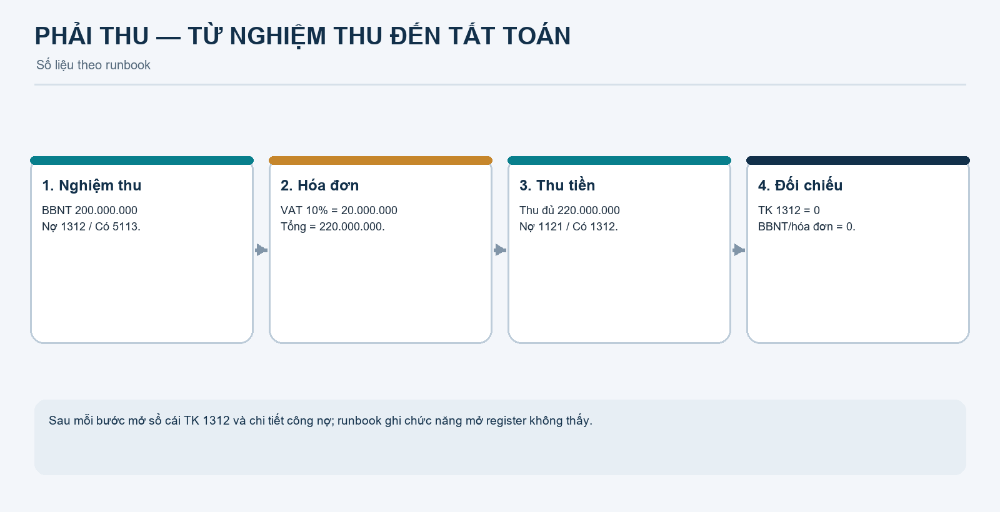

1. Kế toán AR tạo BBNT cho VinFast, hợp đồng HĐ-AR-VFS-2026/01, giá trị chưa VAT 200.000.000 đồng.
2. Runbook yêu cầu người lập và người duyệt khác nhau; Kế toán trưởng duyệt BBNT rồi ghi sổ.
3. Tạo hóa đơn đầu ra dựa trên BBNT. VAT 10% = 20.000.000; tổng hóa đơn 220.000.000 đồng.
4. Theo runbook, sổ chi tiết chuyển BBNT −200.000.000 và hóa đơn +220.000.000; mức tăng ròng 20.000.000 là VAT.
5. Tạo phiếu thu gắn hóa đơn, thu đủ 220.000.000; công nợ về 0.

| Bước | Đầu vào/điều kiện theo runbook | Kết quả kỳ vọng |
|---|---|---|
| Tạo BBNT | Pháp nhân VSF, VinFast, hợp đồng HĐ-AR-VFS-2026/01, base 200.000.000 | Lưu chứng từ; tách người lập/người duyệt |
| Duyệt BBNT | ChoDuyetNoiBo → DaDuyetNoiBo | Ghi sổ theo hướng dẫn |
| Hóa đơn | Liên kết BBNT, VAT 10% | [ISSUE] Autofill “chưa đồng bộ”; trường duyệt/trạng thái “thiếu” |
| Thu tiền | Chọn hóa đơn gốc, thu 220.000.000 | Tăng tiền gửi, giảm công nợ |
| Thu vượt | Runbook nêu thử 250.000.000 trên dư 220.000.000 | Tài liệu kỳ vọng chặn; chưa có code/log xác minh |

Rule nghiệm thu, kiểm tra hợp đồng, tính duy nhất, quyền và nơi validate (client/server): [UNKNOWN].

### 4.1 Công thức

Phép tính của kịch bản, không phải code hệ thống:

```text
Giá trị trước VAT = 200.000.000
VAT = 200.000.000 × 10% = 20.000.000
Tổng hóa đơn = 200.000.000 + 20.000.000 = 220.000.000
Thu đủ = 220.000.000
```

Công thức số học [VERIFIED – DOC]; function tính và nguồn cấu hình thuế suất [UNKNOWN].

## 5. Phải thu – Posting & accounting

| Chứng từ | Điều kiện runbook | TK | Nợ/Có | Số tiền | Nguồn/ý nghĩa |
|---|---|---:|---|---:|---|
| BBNT | KTT duyệt, người dùng bấm Ghi sổ | 1312 | Nợ | 200.000.000 | P23, P60–P67; tăng phải thu |
| BBNT | Cùng bước | 5113 | Có | 200.000.000 | P23, P60–P62; doanh thu dịch vụ theo tài liệu |
| Hóa đơn VAT | Runbook nói phát hành; trường trạng thái/duyệt ghi thiếu | 1312 | Nợ | 20.000.000 | P84–P91; phần VAT làm tăng phải thu |
| Hóa đơn VAT | Cùng bước | 33311 | Có | 20.000.000 | P90; VAT đầu ra theo tài liệu |
| Phiếu thu | Thu đủ, gắn hóa đơn | 1121 | Nợ | 220.000.000 | P108; tiền gửi tăng |
| Phiếu thu | Cùng bước | 1312 | Có | 220.000.000 | P108; công nợ giảm |

**Debt transfer theo runbook:** khi lập hóa đơn, sổ chi tiết ghi giảm BBNT 200 triệu và tăng hóa đơn 220 triệu. Tài liệu nói không ghi doanh thu lần hai; phần GL tăng thêm là Nợ 1312/Có 33311 20 triệu. Nguồn P87–P91.

**Cân đối:** BBNT 200m Nợ = 200m Có; phần VAT 20m Nợ = 20m Có; phiếu thu 220m Nợ = 220m Có. TK 1312 có tổng Nợ 220m, Có 220m, dư cuối bằng 0. Đây là kiểm tra số liệu runbook; chưa chứng minh ứng dụng ghi đúng.

## 6. Phải thu – demo script

**Chuẩn bị:** xác nhận đúng infobase, tài khoản và menu AR; mở sẵn màn hình sổ cái TK 1312/chi tiết công nợ. Runbook ghi Document register records không tìm thấy (P54–P57), autofill hóa đơn chưa đồng bộ. Không thay màn hình hệ thống bằng Excel rồi giới thiệu là kết quả live.

| Thứ tự | Thao tác | Số liệu cần nói | Đối chiếu |
|---|---|---|---|
| 1. BBNT | 1. Công nợ phải thu (AR) → Biên bản nghiệm thu giai đoạn → Tạo. Chọn VSF, VinFast, hợp đồng; nhập 200m. Lưu; người có thẩm quyền duyệt/ghi sổ theo UI thực tế. | Base 200m | TK 1312 Nợ lũy kế 200m; chi tiết BBNT +200m |
| 2. Hóa đơn | AR → Hóa đơn GTGT đầu ra. Chọn BBNT; xác nhận base 200m, VAT 10%, thuế 20m, tổng 220m; chỉ post khi UI cho phép | Tổng phải thu 220m | TK 1312 Nợ lũy kế 220m; BBNT 0; hóa đơn +220m |
| 3. Thu tiền | AR → Phiếu thu tiền khách hàng. Chọn hóa đơn, tài khoản ngân hàng đúng loại tiền, thu 220m | Thu đủ 220m | TK 1312 dư cuối 0; hóa đơn 0; tiền gửi tăng 220m theo runbook |

**Lời giải thích Posting:** BBNT ghi Nợ 1312/Có 5113 200m. Hóa đơn tăng thêm VAT 20m bằng Nợ 1312/Có 33311, đồng thời chuyển subledger khỏi BBNT. Phiếu thu ghi Nợ 1121/Có 1312 220m; cuối cùng sổ cái và chi tiết hóa đơn về 0.

## 7. Phải trả – business flow

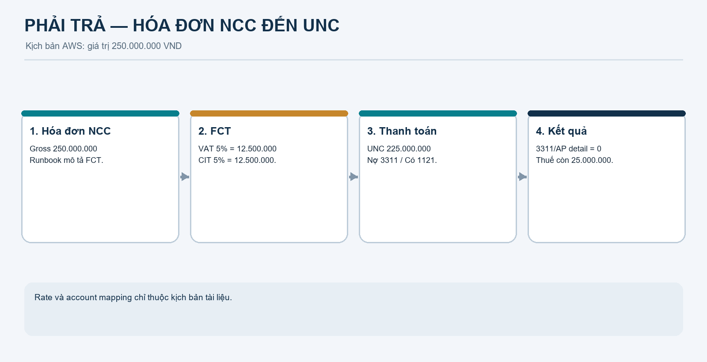

1. Kế toán AP tạo hóa đơn AWS INV-AWS-2026-10, hợp đồng HĐ-AP-AWS-2026/02, giá trị dịch vụ 250.000.000.
2. Runbook mô tả FCT VAT 5% = 12.500.000 và CIT 5% = 12.500.000; thực trả NCC 225.000.000.
3. Hóa đơn 250 triệu thuộc nhánh KTT trong ngưỡng runbook; trên 500 triệu được hướng dẫn chuyển CFO nhưng có mâu thuẫn quyền Admin.
4. Sau ghi sổ hóa đơn, lập UNC 225.000.000.
5. TK 3311 và chi tiết nợ AWS về 0; 25.000.000 còn lại là nghĩa vụ FCT theo giải thích trong runbook.

### 7.1 Thuế nhà thầu – số liệu kịch bản

| Khoản mục | Công thức runbook | Số tiền | Ghi chú |
|---|---|---:|---|
| Dịch vụ | Đầu vào | 250.000.000 | Runbook gọi Gross Amount |
| FCT VAT | 250.000.000 × 5% | 12.500.000 | Chỉ là rate kịch bản |
| FCT CIT | 250.000.000 × 5% | 12.500.000 | Chỉ là rate kịch bản |
| Thực trả NCC | 250.000.000 − 12.500.000 − 12.500.000 | 225.000.000 | Công nợ thương mại |
| Chi phí VSF | 250.000.000 − 12.500.000 VAT đầu vào | 237.500.000 | Cách tính tài liệu dùng |

```text
FCT VAT = 250.000.000 × 5% = 12.500.000
FCT CIT = 250.000.000 × 5% = 12.500.000
Thực trả NCC = 250.000.000 − 12.500.000 − 12.500.000 = 225.000.000
Chi phí theo runbook = 250.000.000 − 12.500.000 = 237.500.000
```

Runbook viện dẫn TT103/2014/TT-BTC nhưng repository không có cấu hình thuế, phân loại dịch vụ/hợp đồng hay code xác định rate. Không suy rộng cách tính này sang hợp đồng khác.

### 7.2 Workflow phê duyệt

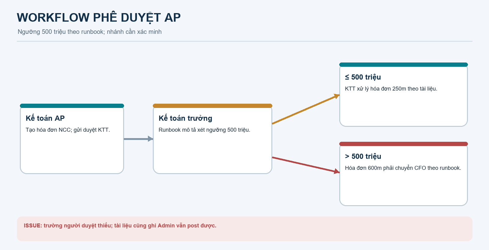

- Runbook nêu KTT duyệt trực tiếp khi giá trị không quá 500m; hóa đơn 600m phải chuyển CFO.
- Trường người duyệt AP bị ghi “không có” tại P155 và P177; P180 ghi Admin vẫn post bình thường.
- Nhánh CFO là quy tắc dự kiến trong tài liệu, chưa chứng minh hoạt động.
- Runbook liệt kê UNC Draft → Pending approval → Approved → Sent to bank → Posted, nhưng không xác định ai duyệt từng trạng thái.

## 8. Phải trả – Posting & accounting

### 8.1 Hóa đơn AWS

| Chứng từ | Điều kiện | TK | Nợ/Có | Số tiền | Giải thích theo runbook |
|---|---|---:|---|---:|---|
| Hóa đơn AWS | Ghi sổ sau duyệt | 627 | Nợ | 237.500.000 | Chi phí dịch vụ Cloud |
| Hóa đơn AWS | Cùng bước | 1331 | Nợ | 12.500.000 | VAT đầu vào được khấu trừ |
| Hóa đơn AWS | Cùng bước | 3311 | Có | 225.000.000 | Nghĩa vụ với AWS |
| Hóa đơn AWS | Cùng bước | 33318 | Có | 12.500.000 | FCT VAT phải nộp |
| Hóa đơn AWS | Cùng bước | 3338 | Có | 12.500.000 | FCT CIT phải nộp |

**Cân đối:** Tổng Nợ 237.500.000 + 12.500.000 = 250.000.000. Tổng Có 225.000.000 + 12.500.000 + 12.500.000 = 250.000.000.

### 8.2 Ủy nhiệm chi

| Chứng từ | Điều kiện | TK | Nợ/Có | Số tiền | Giải thích |
|---|---|---:|---|---:|---|
| UNC AWS | Chọn hóa đơn gốc, trả đủ 225m, ghi sổ | 3311 | Nợ | 225.000.000 | Tất toán công nợ thương mại |
| UNC AWS | Cùng bước | 1121 | Có | 225.000.000 | Giảm tiền gửi |

Sau UNC, AWS không còn dư nợ; 33318 + 3338 còn nghĩa vụ thuế tổng 25m đến khi có chứng từ nộp thuế. Nộp thuế nằm ngoài demo này.

### 8.3 Truy vết Posting

| Thành phần | Bằng chứng |
|---|---|
| Chứng từ nguồn | Tên/trường hóa đơn và UNC trong runbook |
| Trigger | Runbook hướng dẫn bấm Ghi sổ sau trạng thái duyệt |
| Posting service/function/class | [UNKNOWN] Không có source ứng dụng |
| Posting rule/account mapping | Có số liệu trong runbook; không có rule code |
| GL | Runbook gọi SoCaiKeToan; P165 nói không thấy thao tác mở register |
| AP subledger | Runbook gọi CongNoPhaiTra, ghi Receipt +225m và Expense −225m |
| Tự cân Nợ/Có ở ứng dụng | [UNKNOWN] Chỉ kiểm tra được phép cộng số liệu trong tài liệu |

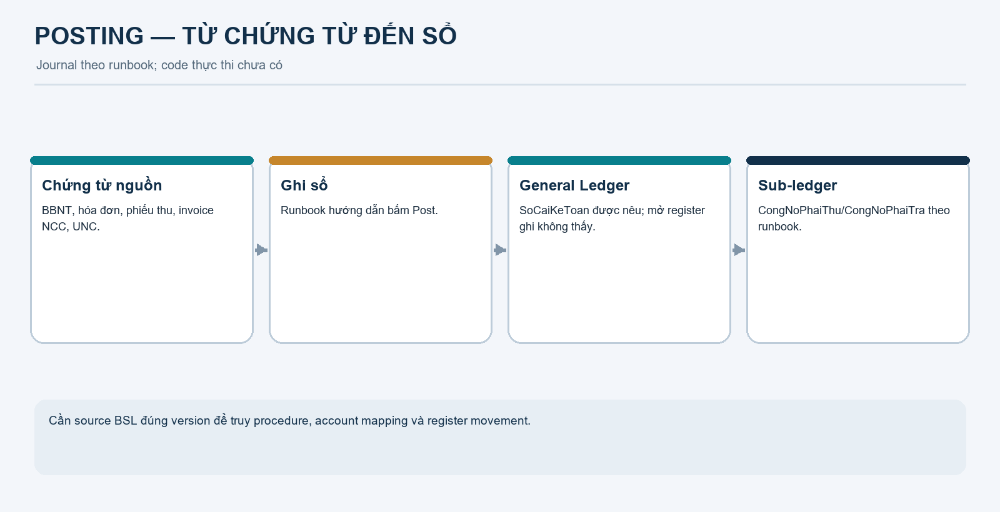

Code thực thi không có để trích dẫn. Mermaid là code sơ đồ; công thức là phép tính minh họa, không phải code chạy của ứng dụng.

## 9. Phải trả – demo script

| Bước | Thao tác theo runbook | Số liệu cần nói | Đối chiếu |
|---|---|---|---|
| Hóa đơn NCC | 2. Công nợ phải trả (AP) → Hóa đơn đầu vào (nhà cung cấp); nhập invoice AWS, hợp đồng và 250m | FCT VAT 12.5m; CIT 12.5m; payable 225m | [ISSUE] Checkbox FCT ghi “Không có” tại P145–P146 |
| Kiểm tra thuế | Xác nhận trường/rate nếu thực sự hiện trên UI | Chi phí 237.5m; VAT đầu vào 12.5m | Không nhập tay rồi nói hệ thống tự tính nếu không quan sát |
| Duyệt/ghi sổ | Trạng thái KTT theo UI; runbook hướng dẫn KTT xử lý hóa đơn 250m | AP +225m | Mở Posting, GL, AP detail nếu chức năng có |
| Tạo UNC | AP → Ủy nhiệm chi; chọn AWS/hóa đơn gốc và tài khoản đúng tiền tệ | 225m | Runbook nêu VCB USD hoặc TCB VND; xác minh tiền tệ |
| Ghi sổ UNC | Hoàn tất trạng thái UI thực tế | Nợ 3311/Có 1121 225m | AP AWS 0; FCT 25m còn phải nộp |

**Ca 600m:** chỉ demo sau khi xác nhận KTT không vượt quyền, CFO nhận chứng từ và Admin không bypass. Runbook hiện mô tả cả chuyển CFO và Admin post được.  
**Ca chi vượt:** runbook kỳ vọng chặn 230m khi dư 225m nhưng có ??? tại P196–P198; chưa dùng làm bằng chứng nếu chưa chạy lại.

## 10. Đối chiếu GL và sổ chi tiết

### AR

| Bước | Nghiệp vụ | Giá trị | TK 1312 | Sổ chi tiết | Kết quả |
|---|---|---:|---:|---|---|
| 1 | Nghiệm thu | 200.000.000 | Nợ lũy kế 200.000.000 | BBNT +200.000.000 | Ghi nhận phải thu chưa VAT |
| 2 | VAT 10% | VAT 20m; invoice 220m | Nợ lũy kế 220.000.000 | BBNT −200m; invoice +220m | Tăng ròng 20m |
| 3 | Thu đủ | 220.000.000 | Có 220m; dư cuối 0 | Invoice −220m; dư cuối 0 | Tất toán AR |

Đối chiếu TK 1312: Nợ 200m + Nợ 20m − Có 220m = 0.

### AP

| Bước | Nghiệp vụ | TK 3311 | AP detail | Nghĩa vụ thuế |
|---|---|---:|---:|---:|
| 1 | Hóa đơn AWS | Có 225.000.000 | +225.000.000 | Có 33318 12.5m; Có 3338 12.5m |
| 2 | UNC 225m | Nợ 225.000.000 | −225.000.000 | Còn nghĩa vụ 25m |
| Kết quả | Sau trả NCC | Dư 0 | Dư 0 | Chưa tất toán nếu chưa có chứng từ nộp thuế |

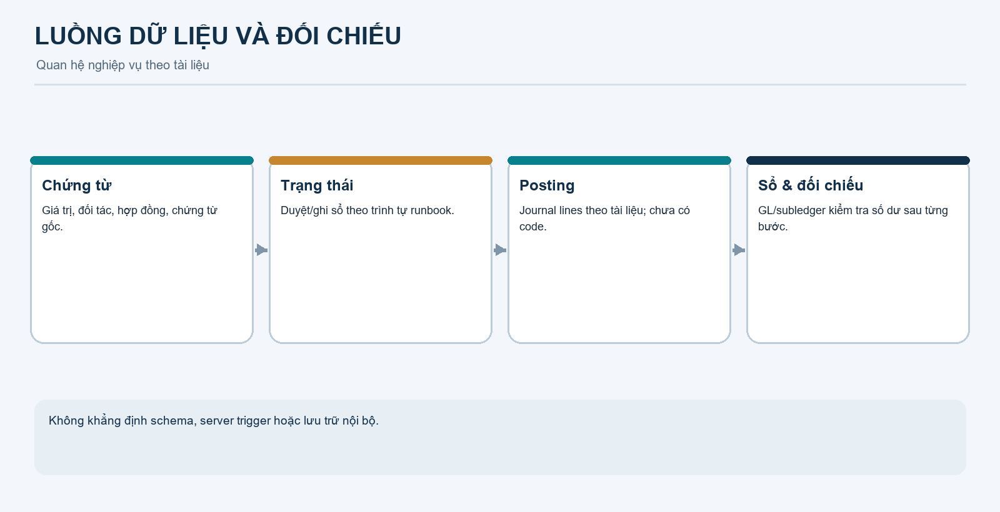

Các số liệu chứng minh phương trình kịch bản cân bằng; không chứng minh dữ liệu infobase thực tế khớp.

## 11. Mermaid diagrams và code

Ảnh PNG dùng được trong slide. Mermaid source dưới đây là code chỉnh sửa được. Sơ đồ phản ánh runbook, không phải implementation đã xác minh.

### 11.1 Bản đồ luồng tài liệu


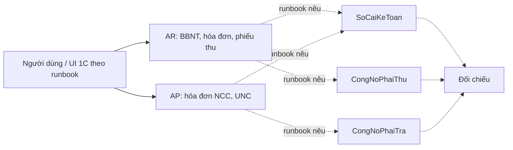

### 11.2 Flow Phải thu


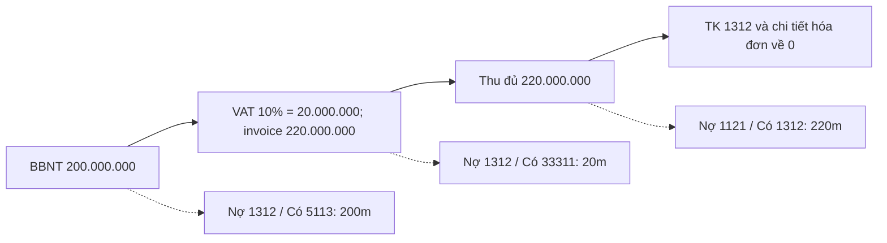

### 11.3 Flow Phải trả


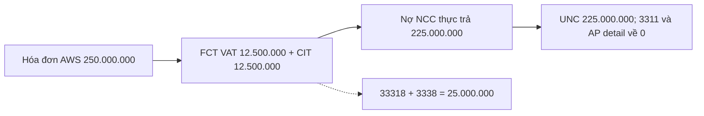

### 11.4 Workflow phê duyệt AP


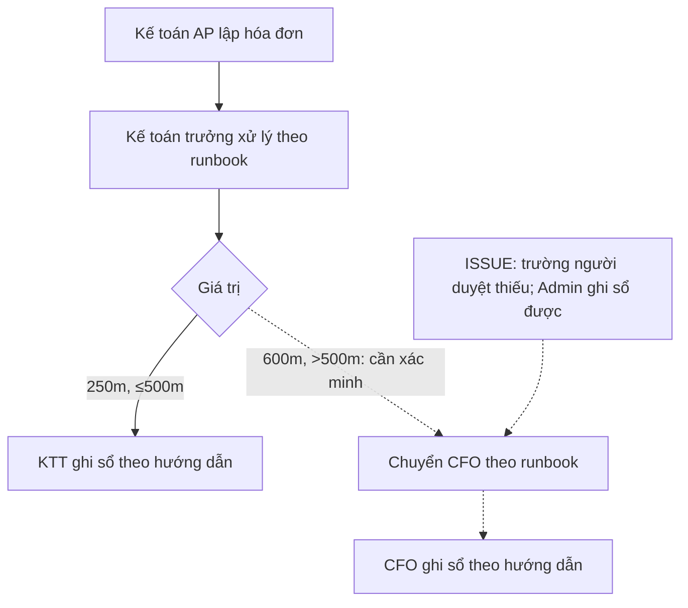

### 11.5 Posting


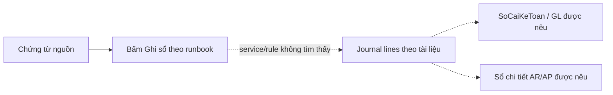

### 11.6 Lineage

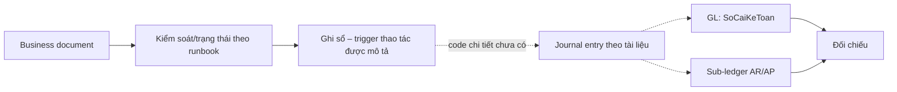

### 11.7 Mô hình đối tượng khái niệm

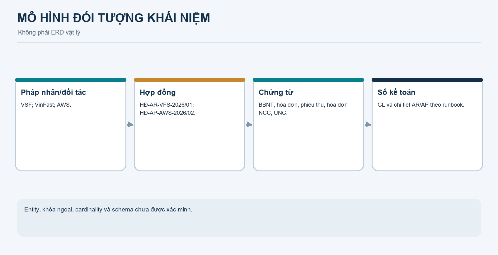

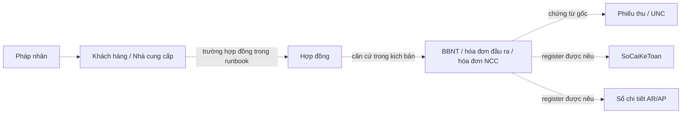

Đường nét chấm là mối liên hệ trong runbook chưa được xác nhận bằng schema/code. Không xem đây là ERD vật lý.

## 12. Bộ slide 10 phút

| Slide | Nội dung/mục tiêu | Hình/số | Thời lượng | Bằng chứng |
|---|---|---|---:|---|
| 1. Bối cảnh VSF | Mục tiêu AR/AP; BO phục vụ nhiều khối | Bối cảnh do nhóm cung cấp | 0:30 | Mở đầu |
| 2. Phạm vi xác minh | Runbook và .dt; thiếu source app | Bản đồ bằng chứng | 0:45 | DOCX và workspace |
| 3. Actors/chứng từ | AR/AP, kế toán, KTT, CFO, đối tác | Bảng mục 3 | 0:45 | Runbook |
| 4. Hai flow | Tóm lược chứng từ đến đối chiếu | Flow AR/AP | 0:50 | Mermaid 11.2–11.3 |
| 5. Số liệu AR | 200m → VAT20m → invoice220m → receipt | Bảng tài khoản | 0:55 | P23–P26, P84–P113 |
| 6. Demo AR | BBNT, hóa đơn, thu đủ; đối chiếu sau mỗi bước | 1312: 200m → 220m → 0 | 1:50 | UI cần kiểm tra |
| 7. Số liệu AP | AWS250m, FCT12.5m+12.5m, payable225m | 5 dòng journal | 0:55 | P127–P133, P164–P171 |
| 8. Demo AP | Hóa đơn, duyệt KTT, Posting, UNC | Trả225m; thuế còn25m | 1:55 | UI cần xác minh |
| 9. Posting và AI | Nêu dòng ghi sổ, giới hạn code/provenance | Posting flow | 1:00 | Source cần bổ sung nếu bảo vệ code |
| 10. Kết luận/rủi ro | Số chốt, giới hạn xác minh | 200m, 220m, 225m, 25m | 0:35 | Issues/checklist |

**Tổng mục tiêu: 10 phút.** Nếu demo chậm, giữ ba đối chiếu AR và một vòng UNC; bỏ ca biên 600m hoặc thu/chi vượt nếu chưa test.

## 13. Speaker notes

### Slide 1 — Bối cảnh (30 giây)
“VSF là đơn vị công nghệ phục vụ nhiều khối kinh doanh. Phần trình bày tập trung vào hai chuỗi có thể kiểm tra bằng số: Phải thu từ nghiệm thu đến thu tiền, và Phải trả từ hóa đơn có FCT đến thanh toán.”

### Slide 2 — Phạm vi (45 giây)
“Workspace có runbook demo và artifact .dt, nhưng không có source ứng dụng, schema, API hoặc test suite để xác nhận implementation. Số liệu hôm nay là số liệu tài liệu mô tả; nhóm đánh dấu rõ phần chưa xác minh và sẽ đối chiếu UI thật.”

### Slide 3 — Actors (45 giây)
“Kế toán AR lập BBNT, hóa đơn, phiếu thu; kế toán AP lập hóa đơn nhà cung cấp và UNC. KTT là người duyệt theo runbook. Nhánh CFO trên 500 triệu còn mâu thuẫn với trường người duyệt thiếu và việc Admin ghi sổ được, nên chúng em xem là cần kiểm chứng.”

### Slide 4 — Hai luồng (50 giây)
“AR khởi đầu từ base chưa VAT, hóa đơn tăng phải thu lên tổng có VAT, phiếu thu xóa khoản phải thu. AP dùng hóa đơn AWS 250 triệu; theo tài liệu khấu trừ 25 triệu và trả nhà cung cấp 225 triệu. Khoản thuế còn lại là nghĩa vụ riêng.”

### Slide 5 — AR (55 giây)
“200 triệu nghiệm thu, VAT 10% bằng 20 triệu, tổng hóa đơn 220 triệu. Runbook ghi BBNT Nợ 1312/Có 5113 200 triệu; bước hóa đơn ghi tăng phần VAT Nợ 1312/Có 33311 20 triệu và chuyển chi tiết công nợ sang hóa đơn. Thu đủ thì TK 1312 và chi tiết về 0.”

### Slide 6 — Demo AR (1:50)
“Sau BBNT, chúng em đối chiếu 1312 là 200 triệu và chi tiết BBNT +200. Sau hóa đơn, 1312 là 220 triệu; BBNT 0, hóa đơn +220. Sau phiếu thu 220 triệu, cả sổ cái và chi tiết hóa đơn về 0. Nếu UI không có register records, nhóm sẽ nêu giới hạn thay vì trình bày số giả.”

### Slide 7 — AP (55 giây)
“Runbook dùng AWS 250 triệu và hai khoản FCT 5%, mỗi khoản 12,5 triệu. Số chuyển cho AWS là 225 triệu. Nợ 627 237,5 triệu, Nợ 1331 12,5 triệu; Có 3311 225 triệu, Có 33318 và 3338 mỗi tài khoản 12,5 triệu. Tổng Nợ và Có đều 250 triệu.”

### Slide 8 — Demo AP (1:55)
“Nhóm tạo hóa đơn, xác nhận FCT trên UI, KTT duyệt và ghi sổ theo trạng thái thật. Công nợ AWS là 225 triệu; UNC 225 triệu ghi Nợ 3311/Có 1121, đưa công nợ thương mại về 0. 25 triệu thuế chưa nộp là nghĩa vụ thuế theo runbook, không còn là khoản phải trả AWS.”

### Slide 9 — Posting/AI (1 phút)
“Nhóm giải thích từng dòng theo tài liệu và nguồn số liệu. Repository không có code ứng dụng để nêu tên function/class. Cũng không có prompt log hoặc lịch sử đóng góp AI, nên nhóm không báo cáo phần trăm hay tuyên bố test nếu thiếu bằng chứng.”

### Slide 10 — Kết luận (35 giây)
“AR có 200 triệu nghiệm thu, 220 triệu hóa đơn, dư nợ 0 sau thu đủ. AP có khoản trả AWS 225 triệu và nghĩa vụ FCT 25 triệu còn lại theo kịch bản. Các số này cần xác nhận trên bản chạy trước khi gọi là kết quả live.”

## 14. Code walkthrough từng thành viên

Không có class/function/API nghiệp vụ để chia từ repository hiện tại. Chia theo chứng từ để mỗi thành viên demo và giải thích Posting; không tự đặt tên hàm.

| Thành viên | Chứng từ | Tài liệu mở | Function/Class | Nội dung |
|---|---|---|---|---|
| 1 | BBNT AR | DOCX, Bước 1.1–1.5 (P27–P68) | [UNKNOWN] | Trường BBNT, tách maker/checker theo tài liệu, 1312/5113 200m |
| 2 | Hóa đơn VAT | DOCX, Bước 1.6–1.7 (P69–P91) | [UNKNOWN] | VAT20m, tổng220m, Nợ1312/Có33311, chuyển subledger |
| 3 | Phiếu thu | DOCX, Bước 1.8–1.9 (P92–P114) | [UNKNOWN] | Nợ1121/Có1312 220m; hóa đơn về 0 |
| 4 | Hóa đơn AWS | DOCX, Bước 2.1–2.3 (P134–P171) | [UNKNOWN] | FCT theo kịch bản; 5 dòng journal; cân250m |
| 5 | Duyệt/UNC AP | DOCX, Bước 2.4–2.6 (P172–P215) | [UNKNOWN] | Nợ3311/Có1121 225m; phân biệt nợ NCC và thuế25m; nêu mâu thuẫn workflow |

Nếu giảng viên hỏi code, cần export source BSL đúng version và chỉ ra document module/procedure tạo Posting. Runbook Word không thay cho code; .dt chưa được mở trong 1C Designer.

## 15. AI vs Human contribution

| Nội dung | Bằng chứng |
|---|---|
| Phần nhóm tự thiết kế ứng dụng | [UNKNOWN] Không có commit, design file hoặc phân công |
| File do AI tạo/chỉnh | [UNKNOWN] Không có prompt log, changelog hoặc provenance |
| Tỷ lệ code AI | Không có dữ liệu; không đưa phần trăm |
| Unit/integration tests | Không tìm thấy test suite ứng dụng VSF |
| Manual test | Runbook có bước dự kiến và ghi nhận nhiều điểm lỗi/thiếu; không chứng minh mọi ca đã chạy |
| Cân Nợ/Có | Có thể tự tính từ số runbook; chưa chứng minh code tự validate |
| Tài liệu này | AI hỗ trợ tổng hợp, cấu trúc, Mermaid, ảnh sơ đồ và speaker notes; người dùng cần kiểm tra nghiệp vụ/UI |

Slide gợi ý: **“Nhóm tự thiết kế và AI hỗ trợ”**. Chỉ ghi phần nhóm thực sự làm, file/commit cụ thể, test đã chạy và kết quả có thể mở ra. Không nói “AI viết X%” khi không có dữ liệu.

Quy trình kiểm chứng cần thực hiện: (1) export source đúng infobase; (2) tìm document module và posting procedure; (3) truy account mapping/tax calculation; (4) chạy ca và lưu journal record; (5) đối chiếu Nợ=Có, 1312/3311 với subledger; (6) chỉ đưa test/review có bằng chứng lên slide. Đây là khuyến nghị, chưa phải hoạt động đã xác nhận hoàn tất.

## 16. ISSUES CẦN XỬ LÝ TRƯỚC KHI DEMO

| Mức | Vấn đề | Nguồn | Tác động | Cách xử lý |
|---|---|---|---|---|
| P0 | Không có source app để giải thích function/class/posting | Không thấy BSL ứng dụng; .dt chưa export | Không trả lời được câu hỏi code trực tiếp | Export source đúng version, truy một chứng từ tới posting procedure/mapping |
| P0 | Tên .dt trong runbook khác file hiện có | DOCX P285 | Có thể nhầm version | Xác nhận artifact chính thức |
| P0 | Document register records không tìm thấy | P54–P57, P164–P165 | Không mở Posting/GL/subledger theo demo | Test quyền/UI, xác nhận báo cáo thay thế |
| P0 | Autofill AR chưa đồng bộ; trường duyệt/status hóa đơn thiếu | P72, P81–P83 | Không tạo/post hóa đơn theo flow | Test đúng bản; ghi rõ trường thực tế |
| P0 | Checkbox FCT không có nhưng phần sau nói tự tính | P145–P151 | Không tái tạo FCT trên UI | Xác nhận UI; không tuyên bố tự động nếu chưa thấy |
| P0 | Workflow CFO mâu thuẫn; Admin có thể post | P172–P186, nhất là P177/P180 | Có thể phản chứng kiểm soát phân quyền | Test từng role; bỏ ca600m nếu chưa chứng minh |
| P1 | Ca UNC vượt có placeholder ??? | P196–P198 | Chưa có bằng chứng chặn chi vượt | Chạy lại 230m trên dư225m và lưu kết quả |
| P1 | Chọn VCB USD hoặc TCB VND cho thanh toán VND | P195/P200 | Rủi ro tiền tệ/tỷ giá | Dùng tài khoản VND đã xác minh |
| P1 | Runbook có credential | Role Matrix và hướng dẫn đăng nhập | Lộ mật khẩu khi chia sẻ | Không đưa mật khẩu lên slide; đổi nếu còn dùng |
| P1 | Thiếu schema/API/tests/provenance | Workspace | Không chứng minh kiến trúc và test coverage | Bổ sung source, report, commit history và phân công |

**Điều kiện sẵn sàng:** mở được chứng từ, tạo được dữ liệu, mở được Posting hoặc sổ thay thế có bằng chứng và đối chiếu được số dư. Nếu chưa đạt, gọi đây là kịch bản tài liệu, không gọi là kết quả live.

## 17. Appendix – đường dẫn và bằng chứng

- Runbook: test - xây dựng giải pháp ERP quản lý Công nợ Phải thu (AR), Công nợ Phải trả (AP), Dòng tiền & Ngân hàng, và Cơ chế Cấn trừ công nợ nội bộ.docx
- Artifact: VinSmart_Future_AdminFull_v5_SuaFont.dt
- Tài liệu 1C/ERP: Skill/ (tham khảo chung, không phải source VSF đã xác minh)

| Nội dung | Paragraph DOCX | Dùng để chứng minh |
|---|---:|---|
| Flow AR, số200/220m | P22–P26 | Luồng và tổng số |
| BBNT, Maker-Checker | P27–P68 | Trường, duyệt, bút toán mô tả |
| Hóa đơn VAT/debt transfer | P69–P91 | VAT, tổng hóa đơn, subledger |
| Thu tiền/tất toán AR | P92–P114 | Phiếu thu và dư cuối |
| AP/FCT | P119–P133 | Số250m, thuế, ngưỡng, bút toán |
| Hóa đơn NCC, checkbox FCT | P134–P171 | Trường nhập, thiếu checkbox, AP detail |
| CFO/UNC | P172–P202 | Ca600m và UNC |
| Đối chiếu AP/FCT | P203–P215 | 3311 tất toán, 25m thuế |
| Tên artifact được nói đồng bộ | P285 | Chênh lệch .dt |

Pxx là thứ tự paragraph trong Document.paragraphs, bắt đầu từ 0 khi trích DOCX; file nguồn không in số paragraph này trên trang.

## 18. DEMO CHECKLIST

- [ ] Xác nhận đúng infobase/version .dt; tên khớp runbook.
- [ ] Đăng nhập được tài khoản demo; không chiếu mật khẩu.
- [ ] Kiểm tra BBNT, hóa đơn VAT, phiếu thu, hóa đơn NCC, UNC.
- [ ] Xác nhận Posting/GL/subledger mở được; runbook ghi một số thao tác “không thấy”.
- [ ] Chuẩn bị hợp đồng, đối tác và dữ liệu sạch.
- [ ] AR: BBNT 200.000.000 → invoice 220.000.000 → thu 220.000.000.
- [ ] Sau mỗi bước AR mở TK1312 và chi tiết công nợ; bằng chứng 200m → 220m → 0.
- [ ] AP: UI xác nhận FCT 12.5m + 12.5m và phải trả AWS 225m.
- [ ] UNC 225m; đối chiếu 3311/AP detail về 0; ghi chú thuế25m chưa nộp.
- [ ] Chỉ demo ca600m hoặc vượt công nợ nếu đã chạy lại thành công.
- [ ] Mỗi thành viên giải thích được chứng từ, điều kiện, từng dòng Nợ/Có và số tiền.
- [ ] Slide AI không tự nêu tỷ lệ hoặc tuyên bố test chưa có bằng chứng.
- [ ] Nếu thiếu source, nói rõ chưa xác nhận function/class; không bịa tên code.

## Kết luận

Runbook cung cấp kịch bản có thể kiểm tra bằng phép tính: AR từ 200 triệu nghiệm thu lên 220 triệu phải thu rồi về 0; AP ghi nhận hóa đơn 250 triệu, trả AWS 225 triệu và giữ 25 triệu nghĩa vụ FCT theo mô tả. Tuy nhiên, tài liệu cũng ghi nhiều thao tác UI thiếu hoặc không tìm thấy. Vì workspace chưa có source ứng dụng VSF, đây là tài liệu thuyết trình dựa trên bằng chứng tài liệu, chưa phải báo cáo xác minh implementation. Muốn giải thích code và khẳng định demo live, nhóm cần kiểm tra đúng bản chạy và bổ sung source BSL/posting records.

