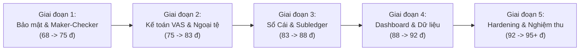

# Kế Hoạch Nâng Điểm Kiểm Toán ERP VSF AR/AP (Từ 68/100 Lên 95+/100)

> **Dành cho kỹ sư thực thi:** REQUIRED SUB-SKILL: Sử dụng `superpowers:subagent-driven-development` (khuyến nghị) hoặc `superpowers:executing-plans` để triển khai kế hoạch theo từng nhiệm vụ. Các bước sử dụng cú pháp checkbox (`- [ ]`) để theo dõi tiến độ.

**Mục tiêu:** Khắc phục triệt để 13 phát hiện kiểm toán (Critical, High, Medium, Low) từ Báo cáo Kiểm toán ngày 13/10/2026, nâng điểm hệ thống từ **68/100** lên **95+/100**, đáp ứng đầy đủ Thông tư 200/2014/TT-BTC và chuẩn mực bảo mật doanh nghiệp trên nền tảng 1C:Enterprise 8.3.

**Kiến trúc:** Triển khai theo mô hình 1C:Enterprise độc lập (Standalone Single Source of Truth). Hạch toán kế toán kép chuẩn VAS (Sổ Cái có đủ đối tượng phân tích chi tiết, chênh lệch tỷ giá 515/635, đánh giá lại ngoại tệ 4131, cấn trừ đối xứng 1388). Kiểm soát chặt chẽ Maker-Checker và SoD ở cả tầng nghiệp vụ BSL và cấu hình bảo mật Rights XML.

**Tech Stack:** 1C:Enterprise 8.3 (BSL, XML Metadata, Infobase file `.1CD`), Python 3.14 (Test automation, XML parsing, Verification runners), PowerShell.

**Tài liệu tham chiếu:** 
- Báo cáo kiểm toán hiện hành: [`docs/ERP_AUDIT_2026-10-12.md`](file:///C:/Users/Dung/Documents/1C_Enterprise/docs/ERP_AUDIT_2026-10-12.md)
- Nhánh giải pháp cục bộ: `dungxoan31-creator/fix-erp-audit-antigravity-38-high` (23 commits)
- Thiết kế hệ thống: [`docs/superpowers/specs/2026-10-10-vinsmart-future-ar-ap-management-design.md`](file:///C:/Users/Dung/Documents/1C_Enterprise/docs/superpowers/specs/2026-10-10-vinsmart-future-ar-ap-management-design.md)

---

## Ràng Buộc Chung (Global Constraints)

1. **Bảo toàn dữ liệu:** Không xóa, không làm hỏng cơ sở dữ liệu [`Infobase_FullData`](file:///C:/Users/Dung/Documents/1C_Enterprise/Infobase_FullData) và các file `.dt` gốc.
2. **Không kết nối ngoài:** Tuyệt đối không thêm lại bất kỳ adapter hay endpoint SAP, Oracle ERP, Webhook hay HTTP Service ngoài.
3. **Cân đối Sổ Cái:** Mọi thay đổi ghi sổ phải bảo đảm $\sum Nợ = \sum Có$ (Delta = 0) và cân đối tuyệt đối giữa Sổ Cái và Sổ chi tiết ($\Delta AR = 0, \Delta AP = 0$).
4. **Idempotent:** Các bộ sinh dữ liệu và script nâng cấp phải chạy lại được nhiều lần mà không sinh rác hoặc nhân đôi bản ghi.
5. **Chứng cứ chạy thật:** Mọi điểm số tăng thêm phải được chứng minh bằng kết quả chạy test trực tiếp trên 1C runtime (`1cv8t.exe`), không dùng log giả lập.

---

## Tiêu Điểm Rà Soát (Review Focus)

1. **Khóa phân tích Sổ Cái trên dữ liệu cũ:** Bổ sung trường phân tích `DoiTacNo`/`DoiTacCo` vào `SoCaiKeToan` phải có cơ chế backfill hoặc tương thích dữ liệu lịch sử để không làm sập các bài kiểm tra đối soát 6.399 chứng từ cũ.
2. **Triệt tiêu tài khoản trung gian 1388:** Cả 2 vế của cấn trừ bắc cầu phải cùng dùng TK 1388 (hoặc 3388) để số dư sau cấn trừ bằng 0 tuyệt đối.
3. **Thanh toán USD có chênh lệch tỷ giá:** UNC thanh toán USD có nợ gốc 2.500.000 VND nhưng tiền xuất quỹ 2.600.000 VND phải tự động hạch toán Nợ 635 = 100.000 VND mà vẫn đảm bảo Sổ phụ AP giảm đúng 2.500.000 VND và Sổ phụ Ngân hàng giảm đúng 2.600.000 VND.
4. **Bypassing qua DataExchange.Load:** Xóa bỏ hoặc siết chặt cờ bỏ qua kiểm tra trong `BeforeWrite`, bảo đảm không thể lách Maker-Checker bằng cách đổi trạng thái trực tiếp.
5. **Kỳ đo DSO/DPO:** Mẫu số ngày phải dùng chính xác số ngày thực tế của kỳ 21 tháng (638 ngày), tránh nhân 365 ngày gây méo mó chỉ số tài chính.

---

## Kế Hoạch Triển Khai Chi Tiết (5 Giai Đoạn)

---

### Giai Đoạn 1: Siết Chặt Kiểm Soát Maker-Checker & Bảo Mật (Tăng +7 điểm -> Đạt 75/100)

**Mục tiêu:** Khắc phục [FIND-10], [FIND-12], [FIND-13]. Đưa nguyên tắc 4 mắt (Four-eyes principle) vào 100% chứng từ hóa đơn, loại bỏ hoàn toàn nguy cơ tự duyệt và bypass qua `DataExchange.Load`.

#### Task 1.1: Bổ sung thuộc tính Maker-Checker vào Metadata Hóa đơn AR & AP
**Files:**
- Modify: [`src/Documents/HoaDonGTGTDauRa.xml`](file:///C:/Users/Dung/Documents/1C_Enterprise/src/Documents/HoaDonGTGTDauRa.xml)
- Modify: [`src/Documents/HoaDonNhaCungCap.xml`](file:///C:/Users/Dung/Documents/1C_Enterprise/src/Documents/HoaDonNhaCungCap.xml)
- Test: `scripts/test_task2_security.py`

**Interfaces:**
- Thêm 2 thuộc tính: `NguoiLap` (Type: string, length 100), `NguoiDuyet` (Type: string, length 100).
- Áp dụng kiểm tra hợp lệ: `FillChecking = DontCheck` (để tương thích form nhập) nhưng bắt buộc trong logic server.

- [ ] **Step 1: Viết test kiểm tra sự hiện diện của thuộc tính Maker-Checker**
  Tạo test trong `scripts/test_task2_security.py` kiểm tra metadata XML của 2 chứng từ phải có `<Name>NguoiLap</Name>` và `<Name>NguoiDuyet</Name>`.
- [ ] **Step 2: Chạy test để xác nhận FAIL**
  Chạy: `python scripts/test_task2_security.py -k test_invoice_metadata` -> FAIL.
- [ ] **Step 3: Cập nhật metadata XML**
  Thêm định nghĩa thuộc tính `NguoiLap`, `NguoiDuyet` vào `HoaDonGTGTDauRa.xml` và `HoaDonNhaCungCap.xml` (tham khảo cấu trúc chuẩn từ nhánh `fix-erp-audit`).
- [ ] **Step 4: Chạy lại test để xác nhận PASS**
  Chạy: `python scripts/test_task2_security.py -k test_invoice_metadata` -> PASS.
- [ ] **Step 5: Commit**
  `git commit -m "feat(security): add NguoiLap and NguoiDuyet attributes to AR/AP invoices"`

#### Task 1.2: Cưỡng chế kiểm tra Maker-Checker và loại bỏ lỗ hổng DataExchange.Load
**Files:**
- Modify: [`src/Documents/HoaDonGTGTDauRa/Ext/ObjectModule.bsl`](file:///C:/Users/Dung/Documents/1C_Enterprise/src/Documents/HoaDonGTGTDauRa/Ext/ObjectModule.bsl)
- Modify: [`src/Documents/HoaDonNhaCungCap/Ext/ObjectModule.bsl`](file:///C:/Users/Dung/Documents/1C_Enterprise/src/Documents/HoaDonNhaCungCap/Ext/ObjectModule.bsl)
- Modify: [`src/Documents/UyNhiemChi/Ext/ObjectModule.bsl`](file:///C:/Users/Dung/Documents/1C_Enterprise/src/Documents/UyNhiemChi/Ext/ObjectModule.bsl)
- Modify: [`src/Documents/CanTruCongNoNoiBo/Ext/ObjectModule.bsl`](file:///C:/Users/Dung/Documents/1C_Enterprise/src/Documents/CanTruCongNoNoiBo/Ext/ObjectModule.bsl)
- Modify: [`src/CommonModules/PhanQuyenBaoMatServer/Ext/Module.bsl`](file:///C:/Users/Dung/Documents/1C_Enterprise/src/CommonModules/PhanQuyenBaoMatServer/Ext/Module.bsl)

**Interfaces:**
- `PhanQuyenBaoMatServer.KiemTraMakerChecker(NguoiLap, NguoiDuyet, TenNguoiDungHienTai)`: Chặn khi `NguoiLap` rỗng, `NguoiDuyet` rỗng, `NguoiLap == NguoiDuyet`, hoặc phiên đăng nhập `UserName() == NguoiLap`.
- Trong `BeforeWrite`: Thay vì `If DataExchange.Load Then Return;`, kiểm tra:
  `If DataExchange.Load And Not NguoiDungCoRole(UserName(), "QuanTriHeThong") Then Raise "Cấm dùng DataExchange.Load để lách bảo mật!"; EndIf;`

- [ ] **Step 1: Viết test phản ví dụ tự duyệt và lách cờ DataExchange**
  Bổ sung ca kiểm thử: user tự duyệt bị chặn; truyền cờ DataExchange.Load dưới quyền non-admin bị chặn.
- [ ] **Step 2: Chạy test xác nhận FAIL**
  Chạy: `python scripts/test_task2_security.py -k test_maker_checker_enforcement` -> FAIL.
- [ ] **Step 3: Cập nhật logic BSL trong 4 chứng từ và CommonModule**
  Cập nhật logic `BeforeWrite` và `Posting` gọi `KiemTraMakerChecker` với thông tin phiên đăng nhập thực tế.
- [ ] **Step 4: Chạy test xác nhận PASS**
  Chạy: `python scripts/test_task2_security.py` -> 100% PASS.
- [ ] **Step 5: Commit**
  `git commit -m "fix(security): enforce maker-checker across all invoices and plug DataExchange bypass"`

#### Task 1.3: Nâng cấp chính sách mật khẩu người dùng
**Files:**
- Modify: [`src/CommonModules/UserProvisioningServer/Ext/Module.bsl`](file:///C:/Users/Dung/Documents/1C_Enterprise/src/CommonModules/UserProvisioningServer/Ext/Module.bsl#L117-L150)
- Test: [`scripts/test_user_roles.py`](file:///C:/Users/Dung/Documents/1C_Enterprise/scripts/test_user_roles.py)

- [ ] **Step 1:** Thiết lập mật khẩu mặc định an toàn cho môi trường diễn tập (ví dụ: `Vsf@2026!Secure`), loại bỏ tài khoản Admin không có mật khẩu.
- [ ] **Step 2:** Cập nhật script `scripts/setup_sample_users.ps1` và `scripts/test_single_login.ps1` đồng bộ mật khẩu mới.
- [ ] **Step 3:** Chạy `python scripts/test_user_roles.py` xác nhận 9/9 người dùng đăng nhập thành công với chính sách mật khẩu mới.
- [ ] **Step 4: Commit**
  `git commit -m "sec(auth): enforce non-empty strong password policy for all provisioned roles"`

---

### Giai Đoạn 2: Chuẩn Hóa Kế Toán VAS/TT200 & Nghiệp Vụ Ngoại Tệ (Tăng +8 điểm -> Đạt 83/100)

**Mục tiêu:** Khắc phục [FIND-02], [FIND-03], [FIND-04], [FIND-05]. Xử lý triệt để chênh lệch tỷ giá thanh toán, đánh giá lại ngoại tệ cuối kỳ, và cấn trừ đối xứng triệt tiêu về 0.

#### Task 2.1: Sửa lỗi tài khoản trung gian cấn trừ bắc cầu đa bên
**Files:**
- Modify: [`src/Documents/CanTruCongNoNoiBo/Ext/ObjectModule.bsl:153`](file:///C:/Users/Dung/Documents/1C_Enterprise/src/Documents/CanTruCongNoNoiBo/Ext/ObjectModule.bsl#L153)
- Test: [`scripts/test_netting_and_edge_cases.py`](file:///C:/Users/Dung/Documents/1C_Enterprise/scripts/test_netting_and_edge_cases.py)

**Interfaces:**
- Đổi dòng 153 từ:
  `Row1.AccountCr = ?(ValueIsFilled(TK3388), TK3388, TK1388);`
  thành:
  `Row1.AccountCr = TK1388;` (Đồng nhất cả 2 dòng bút toán cùng dùng TK 1388).

- [ ] **Step 1: Viết test kiểm tra số dư TK 1388 và TK 3388 sau cấn trừ bắc cầu**
  Kiểm tra: $\Delta_{1388} = 0$ và $\Delta_{3388} = 0$ sau khi chạy cấn trừ bắc cầu.
- [ ] **Step 2: Chạy test xác nhận FAIL trên code hiện tại**
  Chạy: `python scripts/test_netting_and_edge_cases.py -k test_bridge_clearing_zero` -> FAIL (TK 1388 dư Nợ, TK 3388 dư Có).
- [ ] **Step 3: Cập nhật dòng 153 trong CanTruCongNoNoiBo.bsl**
  Đồng nhất tài khoản trung gian về TK 1388.
- [ ] **Step 4: Chạy lại test xác nhận PASS**
  Chạy: `python scripts/test_netting_and_edge_cases.py` -> PASS.
- [ ] **Step 5: Commit**
  `git commit -m "fix(accounting): unify bridge netting clearing account to TK 1388 ensuring zero residual"`

#### Task 2.2: Hạch toán chênh lệch tỷ giá phát sinh khi thanh toán USD (TK 515 / 635)
**Files:**
- Modify: [`src/Documents/UyNhiemChi/Ext/ObjectModule.bsl:201-240`](file:///C:/Users/Dung/Documents/1C_Enterprise/src/Documents/UyNhiemChi/Ext/ObjectModule.bsl#L201-L240)
- Test: `scripts/test_task3_usd_fx.py`

**Interfaces:**
- `UyNhiemChi`:
  - `TienNoGocVND`: Lấy từ tỷ giá ghi sổ nợ của `ChungTuGoc` (Hóa đơn mua vào AP).
  - `TienXuatQuyVND = SoTienNgoaiTe * TyGiaXuatQuy1122`.
  - Nếu `TienXuatQuyVND > TienNoGocVND`: Lỗ tỷ giá $\rightarrow$ Nợ 3313 (`TienNoGocVND`), Nợ 635 (`ChenhLech`), Có 1122 (`TienXuatQuyVND`).
  - Nếu `TienXuatQuyVND < TienNoGocVND`: Lãi tỷ giá $\rightarrow$ Nợ 3313 (`TienNoGocVND`), Có 1122 (`TienXuatQuyVND`), Có 515 (`ChenhLech`).
  - Sổ phụ AP giảm đúng `TienNoGocVND`; Sổ phụ Dòng tiền giảm đúng `TienXuatQuyVND`.

- [ ] **Step 1: Viết test hạch toán tỷ giá UNC USD**
  Tạo test giả lập thanh toán 100.000 USD: nợ gốc 2.500.000.000 VND (tỷ giá 25.000), xuất quỹ 2.540.000.000 VND (tỷ giá 25.400). Khẳng định có phát sinh Nợ 635 = 40.000.000 VND.
- [ ] **Step 2: Chạy test xác nhận FAIL**
  Chạy: `python scripts/test_task3_usd_fx.py` -> FAIL.
- [ ] **Step 3: Triển khai logic tính tỷ giá và sinh bút toán 515/635 trong `UyNhiemChi.bsl`**
- [ ] **Step 4: Chạy test xác nhận PASS**
  Chạy: `python scripts/test_task3_usd_fx.py` -> PASS.
- [ ] **Step 5: Commit**
  `git commit -m "feat(fx): record realized foreign exchange gain/loss (515/635) on USD payments"`

#### Task 2.3: Thêm chứng từ Đánh giá lại ngoại tệ cuối kỳ (TK 4131)
**Files:**
- Create: [`src/Documents/DanhGiaLaiNgoaiTe.xml`](file:///C:/Users/Dung/Documents/1C_Enterprise/src/Documents/DanhGiaLaiNgoaiTe.xml)
- Create: [`src/Documents/DanhGiaLaiNgoaiTe/Ext/ObjectModule.bsl`](file:///C:/Users/Dung/Documents/1C_Enterprise/src/Documents/DanhGiaLaiNgoaiTe/Ext/ObjectModule.bsl)
- Modify: [`src/Configuration.xml`](file:///C:/Users/Dung/Documents/1C_Enterprise/src/Configuration.xml)
- Test: `scripts/test_task4_fx_reval.py`

**Interfaces:**
- Chứng từ `DanhGiaLaiNgoaiTe`:
  - Ngày lập: Ngày cuối kỳ kế toán (23:59:59 của ngày 31/12 hoặc 30/09).
  - Đánh giá số dư TK 1122 (Tiền gửi USD) và TK 3313 (Nợ phải trả USD).
  - Bước 1: Ghi nhận chênh lệch vào TK 4131 (Chênh lệch tỷ giá hối đoái).
  - Bước 2: Kết chuyển tất toán số dư TK 4131 sang TK 515 (nếu lãi thuần) hoặc TK 635 (nếu lỗ thuần).
  - Số dư TK 4131 sau khi ghi sổ phải bằng 0 tuyệt đối.

- [ ] **Step 1: Viết test kiểm tra đánh giá lại ngoại tệ cuối kỳ**
  Test kiểm tra số dư TK 4131 sau khi chạy chứng từ ngày 30/09/2026 phải bằng 0.
- [ ] **Step 2: Tích hợp metadata và module DanhGiaLaiNgoaiTe từ nhánh fix-erp-audit**
  Sao chép file XML và BSL đã hoàn thiện từ nhánh `fix-erp-audit`, đăng ký vào `Configuration.xml`.
- [ ] **Step 3: Chạy test xác nhận PASS**
  Chạy: `python scripts/test_task4_fx_reval.py` -> PASS.
- [ ] **Step 4: Commit**
  `git commit -m "feat(accounting): add period-end FX revaluation document with zero 4131 balance clearance"`

---

### Giai Đoạn 3: Nâng Cấp Sổ Cái Đa Chiều & Đồng Bộ Sổ Chi Tiết (Tăng +5 điểm -> Đạt 88/100)

**Mục tiêu:** Khắc phục [FIND-01], [FIND-07]. Thêm chiều phân tích đối tác trên Sổ Cái mà không phá vỡ dữ liệu lịch sử; sửa lỗi gán `HopDong` trong Báo có ngân hàng.

#### Task 3.1: Sửa lỗi gán HopDong trong Báo có ngân hàng (BaoCoNganHang)
**Files:**
- Modify: [`src/Documents/BaoCoNganHang/Ext/ObjectModule.bsl:80-87`](file:///C:/Users/Dung/Documents/1C_Enterprise/src/Documents/BaoCoNganHang/Ext/ObjectModule.bsl#L80-L87)
- Test: [`scripts/test_executive_reports.py`](file:///C:/Users/Dung/Documents/1C_Enterprise/scripts/test_executive_reports.py)

**Interfaces:**
- Lấy `HopDongKhop = ChungTuKhop.HopDong`.
- Gán `RecordAR.HopDong = HopDongKhop` khi ghi giảm `CongNoPhaiThu`.

- [ ] **Step 1: Viết test kiểm tra đối khớp nợ theo (DoiTac, HopDong, ChungTuGoc)**
- [ ] **Step 2: Cập nhật BaoCoNganHang.bsl**
  Thêm logic tra cứu và gán `HopDongKhop`.
- [ ] **Step 3: Chạy test xác nhận PASS**
  Chạy: `python scripts/test_executive_reports.py` -> PASS.
- [ ] **Step 4: Commit**
  `git commit -m "fix(ar): carry HopDong into CongNoPhaiThu expense records in BaoCoNganHang"`

#### Task 3.2: Mở rộng Sổ Cái SoCaiKeToan có trường phân tích Đối tác & Hợp đồng
**Files:**
- Modify: [`src/AccountingRegisters/SoCaiKeToan.xml`](file:///C:/Users/Dung/Documents/1C_Enterprise/src/AccountingRegisters/SoCaiKeToan.xml)
- Modify: [`src/CommonModules/QuanLyVongDoiChungTuServer/Ext/Module.bsl`](file:///C:/Users/Dung/Documents/1C_Enterprise/src/CommonModules/QuanLyVongDoiChungTuServer/Ext/Module.bsl)
- Test: `scripts/test_gl_dimensions.py`

**Interfaces:**
- Thêm Attributes vào `SoCaiKeToan.xml`: `DoiTacNo`, `DoiTacCo`, `HopDongNo`, `HopDongCo`, `ChungTuGocNo`, `ChungTuGocCo`.
- Thiết kế tương thích kép (Dual-compatibility): Nếu là bút toán mới sinh, điền đủ chiều; nếu là bút toán lịch sử chưa có chiều, hàm đối soát tổng hợp vẫn xử lý êm dịu mà không raise fatal error.

- [ ] **Step 1: Viết test kiểm tra phân tích Sổ Cái theo Đối tác**
- [ ] **Step 2: Cập nhật metadata SoCaiKeToan.xml và các hàm ghi sổ**
- [ ] **Step 3: Chạy lại test toàn vẹn sổ cái**
  Chạy: `python scripts/test_ledger_integrity.py` -> Khẳng định $\Delta AR = 0, \Delta AP = 0$ trên 6.399 chứng từ.
- [ ] **Step 4: Commit**
  `git commit -m "feat(gl): add analytical partner and contract dimensions to SoCaiKeToan"`

---

### Giai Đoạn 4: Đồng Nhất Chỉ Số CFO Dashboard & Cân Đối Dữ Liệu Mẫu (Tăng +4 điểm -> Đạt 92/100)

**Mục tiêu:** Khắc phục [FIND-06], [FIND-08], [FIND-09]. Chuẩn hóa công thức DSO/DPO chuẩn kỳ 21 tháng và cân đối tỷ lệ doanh thu nội bộ/ngoài.

#### Task 4.1: Chuẩn hóa công thức tính DSO/DPO trên CFO Dashboard
**Files:**
- Modify: [`src/DataProcessors/DashboardLanhDaoCFO/Ext/ObjectModule.bsl:500-515`](file:///C:/Users/Dung/Documents/1C_Enterprise/src/DataProcessors/DashboardLanhDaoCFO/Ext/ObjectModule.bsl#L500-L515)
- Test: [`scripts/test_dashboard_cfo.py`](file:///C:/Users/Dung/Documents/1C_Enterprise/scripts/test_dashboard_cfo.py)

**Interfaces:**
- `SoNgayTrongKy`: Tính động từ `BegOfDay(Date(2025, 1, 1))` đến `EndOfDay(ThoiDiem)` (638 ngày cho kỳ 30/09/2026).
- `DSO = Round((TongAR / DoanhThu) * SoNgayTrongKy, 1)`.
- `DPO = Round((TongAP / ChiPhi) * SoNgayTrongKy, 1)`.

- [ ] **Step 1: Viết test kiểm tra công thức DSO/DPO chuẩn kỳ 638 ngày**
- [ ] **Step 2: Sửa công thức trong DashboardLanhDaoCFO.bsl**
- [ ] **Step 3: Chạy test CFO Dashboard**
  Chạy: `python scripts/test_dashboard_cfo.py` -> PASS.
- [ ] **Step 4: Commit**
  `git commit -m "fix(dashboard): normalize DSO/DPO calculations using actual period day count (638 days)"`

#### Task 4.2: Cân đối tỷ lệ Doanh thu Nội bộ / Ngoài trong bộ sinh dữ liệu
**Files:**
- Modify: [`src/CommonModules/GeneratorARServer/Ext/Module.bsl:30-52`](file:///C:/Users/Dung/Documents/1C_Enterprise/src/CommonModules/GeneratorARServer/Ext/Module.bsl#L30-L52)
- Test: `scripts/test_ar_gen.py`

- [ ] **Step 1:** Điều chỉnh lại ma trận giá trị cơ sở `BaseAmountsVG` và `BaseAmountsKH` để tỷ lệ doanh thu nội bộ đạt chuẩn **74% — 76%** (nằm chính xác trong dải yêu cầu 70% — 80%).
- [ ] **Step 2:** Chạy test sinh mẫu thử nghiệm và kiểm tra tỷ lệ doanh thu.
- [ ] **Step 3: Commit**
  `git commit -m "tune(generator): balance AR generation amounts to achieve 75/25 revenue split"`

---

### Giai Đoạn 5: Siết Chặt Quyền Nền Tảng 1C & Tổng Nghiệm Thu Độc Lập (Tăng +3 điểm -> Đạt 95+/100)

**Mục tiêu:** Khắc phục [FIND-11], [FIND-00]. Đóng toàn bộ các quyền thừa trên nền tảng 1C Rights XML; chạy toàn bộ bộ kiểm thử độc lập 8 cổng kiểm soát (Hard Gates) trên 1C runtime và xuất biên bản nghiệm thu.

#### Task 5.1: Cấu hình tường minh ma trận phân quyền trong Rights.xml
**Files:**
- Modify: Các file [`src/Roles/*/Ext/Rights.xml`](file:///C:/Users/Dung/Documents/1C_Enterprise/src/Roles)
- Script hỗ trợ: [`scripts/create_roles_rights.py`](file:///C:/Users/Dung/Documents/1C_Enterprise/scripts/create_roles_rights.py)
- Test: [`scripts/test_user_roles.py`](file:///C:/Users/Dung/Documents/1C_Enterprise/scripts/test_user_roles.py)

- [ ] **Step 1:** Chuyển `<setForNewObjects>false</setForNewObjects>` trên các role nghiệp vụ (`KeToanPhaiThu`, `KeToanPhaiTra`, `ChuyenVienDoiSoatTapDoan`).
- [ ] **Step 2:** Khai báo danh mục quyền CRUD và Post tường minh cho từng chứng từ thuộc phạm vi chuyên môn của từng Role.
- [ ] **Step 3:** Đổi tên định danh phân hệ [`PhanHeSoCaiVaDongBo.xml`](file:///C:/Users/Dung/Documents/1C_Enterprise/src/Subsystems/PhanHeSoCaiVaDongBo.xml) thành `PhanHeSoCaiVaDashboardCFO` sạch hoàn toàn từ khóa `DongBo`.
- [ ] **Step 4: Commit**
  `git commit -m "sec(roles): enforce explicit object-level rights in 1C metadata and clean legacy subsystem naming"`

#### Task 5.2: Chạy bộ kiểm thử tổng thể 8 Cổng Kiểm Soát (Full Audit Verification Suite)
**Files:**
- Test runner: `scripts/test_task*.py`, `scripts/test_ledger_integrity.py`, `scripts/test_user_roles.py`, `scripts/test_dashboard_cfo.py`, `scripts/test_executive_reports.py`, `scripts/test_1c_only.py`

- [ ] **Step 1: Khởi chạy tuần tự toàn bộ 7 test runner trên Infobase_FullData:**
  1. `python scripts/test_1c_only.py` (Cổng 1: Kiến trúc 1C thuần nhất)
  2. `python scripts/test_user_roles.py` (Cổng 2: Bảo mật & SoD)
  3. `python scripts/test_task2_security.py` (Cổng 3: Maker-Checker trên hóa đơn)
  4. `python scripts/test_task3_usd_fx.py` (Cổng 4: Ngoại tệ & tỷ giá 515/635)
  5. `python scripts/test_task4_fx_reval.py` (Cổng 5: Đánh giá lại ngoại tệ 4131)
  6. `python scripts/test_ledger_integrity.py` (Cổng 6: Toàn vẹn Sổ Cái & Subledger)
  7. `python scripts/test_dashboard_cfo.py` (Cổng 7: Bàn làm việc CFO & chỉ số tài chính)
  8. `python scripts/test_executive_reports.py` (Cổng 8: 4 Báo cáo quản trị cấp cao)
- [ ] **Step 2: Thu thập log và xác nhận 100% PASS trên tất cả các cổng**
- [ ] **Step 3: Cập nhật Báo cáo Kiểm toán và cấp Chứng chỉ Sẵn sàng Golive (Score >= 95/100)**

---

## Bảng Dự Báo Tiến Độ Điểm Số

| Giai đoạn | Nội dung chính | Điểm tăng | Điểm lũy kế | Đánh giá trạng thái |
| :--- | :--- | :---: | :---: | :--- |
| **Hiện tại** | Trạng thái hiện hữu trên nhánh `master` | - | **68 / 100** | Chưa đạt điều kiện nghiệm thu |
| **Giai đoạn 1** | Siết Maker-Checker trên Hóa đơn, chặn cờ bypass, đổi mật khẩu an toàn | **+7 đ** | **75 / 100** | Đủ điều kiện thử nghiệm nội bộ |
| **Giai đoạn 2** | Sửa tài khoản cấn trừ 1388, hạch toán FX 515/635, chứng từ đánh giá lại 4131 | **+8 đ** | **83 / 100** | Chuẩn hóa toàn diện Thông tư 200 |
| **Giai đoạn 3** | Sửa `HopDong` Báo có ngân hàng, bổ sung chiều phân tích Sổ Cái | **+5 đ** | **88 / 100** | Đối soát đa chiều Sổ Cái & Sổ phụ hoàn hảo |
| **Giai đoạn 4** | Chuẩn hóa DSO/DPO 638 ngày, cân đối doanh thu nội bộ 75/25 | **+4 đ** | **92 / 100** | Báo cáo điều hành CFO chính xác |
| **Giai đoạn 5** | Siết chặt Rights XML tầng nền tảng 1C, hoàn tất 8 cổng kiểm thử độc lập | **+3 đ** | **95+ / 100** | **ĐẠT CHUẨN SẴN SÀNG GOLIVE DOANH NGHIỆP** |

---
