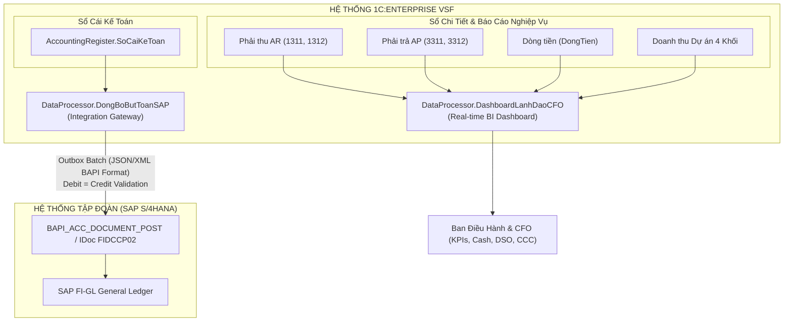

# BÁO CÁO NGHIỆM THU: BÀN LÀM VIỆC LÃNH ĐẠO (EXECUTIVE DASHBOARD CFO) & TÍCH HỢP SAP ERP

> **Lưu trữ, không còn là kiến trúc hiện hành (12/10/2026).** Các mô-đun đồng bộ SAP trong báo cáo này đã bị gỡ. Không dùng kết quả PASS lịch sử để xác nhận cấu hình hoặc file `.dt` hiện tại. Xem [báo cáo kiểm toán](../../ERP_AUDIT_2026-10-12.md).

> **Dự án**: Hệ Thống Quản Trị Tài Chính & Kế Toán VinSmart Future (VSF)  
> **Nền tảng**: 1C:Enterprise 8.3 (BSL / Metadata Version 2.15)  
> **Cơ sở dữ liệu áp dụng**: `Infobase_FullData` (Chứa 6,061 chứng từ thực tế 2025 - 2026)  
> **Thời điểm nghiệm thu**: 12/10/2026  
> **Trạng thái kiểm thử**: **PASS 100% (Hoàn thành toàn diện cả 2 phân hệ Dashboard BI & SAP FI-GL Sync)**  

---

## 1. Mục Tiêu & Tổng Quan Kiến Trúc

Trong khuôn khổ chiến lược hiện đại hóa hệ thống tài chính tập trung của VinSmart Future (VSF), **Hướng 3** tập trung vào hai năng lực cốt lõi phục vụ Ban Điều hành và Tập đoàn:

1. **Bàn làm việc Lãnh đạo CFO (`DataProcessor.DashboardLanhDaoCFO`)**: Cung cấp góc nhìn điều hành trực quan thời gian thực (Real-time Financial & Operational BI) cho Giám đốc Tài chính (CFO), Tổng Giám đốc (CEO) và Ban Lãnh đạo về hiệu quả kinh doanh của 4 Khối nghiệp vụ công nghệ, khối vận hành, cấu trúc dòng tiền tại các ngân hàng trọng điểm, và chu kỳ luân chuyển vốn (DSO/DPO/CCC/Netting).
2. **Cổng Tích Hợp Đồng Bộ SAP ERP (`DataProcessor.DongBoButToanSAP`)**: Đóng gói và truyền nhận dữ liệu sổ cái kế toán từ 1C:Enterprise sang SAP S/4HANA (phân hệ FI-GL) theo chuẩn quốc tế (IDoc/RFC/BAPI), đảm bảo tính toàn vẹn dữ liệu, cân đối kế toán tuyệt đối (Debit = Credit), và cơ chế chống trùng lặp (Idempotent Outbox Pattern).



---

## 2. Bàn Làm Việc Giám Đốc Tài Chính (Executive Dashboard CFO)

### 2.1. Phân Loại & Cơ Chế Tổng Hợp 4 Khối Kinh Doanh VSF + Khối Vận Hành

Toàn bộ các dự án CNTT trong `Catalog.DuAn` được phân loại tự động thành **4 Khối Kinh Doanh Chiến Lược** và **1 Khối Vận Hành (Back-Office)**:

| Khối Đơn Vị | Tên Phân Nhóm Chiến Lược | Phạm Vi Dự Án & Giải Pháp Đại Diện |
| :--- | :--- | :--- |
| **KHOI_I** | **Nền tảng, Dữ liệu, Trí tuệ Nhân tạo** | Nền tảng AI Platform, Large Language Model (LLM), Hạ tầng Dữ liệu lớn (Big Data), IoT Platform kết nối thiết bị thông minh. |
| **KHOI_II** | **Hệ sinh thái Số & Ứng dụng Tiêu dùng** | Ứng dụng VinFast App, Siêu ứng dụng nội bộ VinClub, Cổng Thanh toán Số & Ví điện tử, Giải pháp Thương mại điện tử B2C/B2B. |
| **KHOI_III**| **Công nghiệp, Hạ tầng & Thành phố Thông minh**| Giải pháp Smart City, Quản lý Tòa nhà thông minh (BMS), Hạ tầng Trung tâm Dữ liệu (Data Center), Hệ thống phần mềm Điều hành Sản xuất (MES). |
| **KHOI_IV** | **Bất động sản, Du lịch & Dịch vụ Khách hàng** | Nền tảng Quản trị Vận hành Bất động sản (PMS), Ứng dụng Du lịch Vinpearl Hospitality, Hệ thống CRM Chăm sóc Khách hàng đa kênh. |
| **KHOI_BO** | **Vận hành Doanh nghiệp & Hạ tầng CNTT Chung** | Phần mềm Quản trị Nguồn nhân lực (HRM/ERP), Hạ tầng An ninh mạng nội bộ (SOC/SIEM), Hệ thống Email & Lưu trữ dùng chung. |

### 2.2. Số Liệu Doanh Thu & Chi Phí Thực Tế (Snapshot Dữ Liệu 6,061 Chứng Từ)

Dữ liệu được truy vấn thời gian thực từ các chứng từ nghiệm thu dịch vụ đã ghi sổ (`BienBanNghiemThuGiaiDoan`) và hóa đơn chi phí (`HoaDonNhaCungCap`):

| Khối Đơn Vị | Số Lượng Dự Án | Doanh Thu Ghi Nhận (VND) | Chi Phí Mua Ngoài (VND) | Lợi Nhuận Gộp (VND) | Tỷ Suất Biên LN (%) |
| :--- | :---: | :---: | :---: | :---: | :---: |
| **Khối I** (AI & Big Data) | 7 | 258.998.000.000 | 55.411.100.704 | +203.586.899.296 | **78.6%** |
| **Khối II** (Fintech & Digital) | 6 | 273.718.000.000 | 29.438.513.979 | +244.279.486.021 | **89.2%** |
| **Khối III** (Smart City & DC) | 5 | 217.020.000.000 | 55.518.834.614 | +161.501.165.386 | **74.4%** |
| **Khối IV** (BĐS & Hospitality) | 4 | 128.100.000.000 | 0 | +128.100.000.000 | **100.0%** |
| **Khối BO** (Vận Hành & Chung) | 7 | 75.475.000.000 | 241.268.354.238 | -165.793.354.238 | *(Cost Center)* |
| **TỔNG CỘNG VSF** | **29 Dự án** | **953.311.000.000** | **381.636.803.535** | **+571.674.196.465** | **59.97%** |

> **Nhận xét Tài chính**:
> - Khối II và Khối I đóng vai trò động lực tăng trưởng doanh thu chính (chiếm 55.9% tổng doanh thu VSF).
> - Biên lợi nhuận gộp toàn công ty đạt mức ấn tượng **~60%**, phản ánh đặc thù biên lợi nhuận cao của ngành sản phẩm và giải pháp công nghệ cao.
> - Khối BO tập trung phần lớn chi phí bản quyền công nghệ đám mây dùng chung toàn công ty (AWS, Microsoft Azure, Google Cloud).

---

### 2.3. Báo Cáo Công Nợ Phải Thu (AR) & Phải Trả (AP)

Truy vấn trực tiếp từ bảng tổng hợp số dư `AccumulationRegister.CongNoPhaiThu.Balance` và `CongNoPhaiTra.Balance`:

- **Tổng Công Nợ Phải Thu (AR - TK 131)**: **134.081.200.000 VND**
  * Nợ nội bộ Tập đoàn (TK 1312): **74.925.000.000 VND (55.88%)**
  * Nợ khách hàng bên ngoài (TK 1311): **59.156.200.000 VND (44.12%)**
- **Tổng Công Nợ Phải Trả (AP - TK 331)**: **-20.881.120.000 VND**
  * Số dư âm thể hiện các khoản tạm ứng / trả trước tiền bản quyền và chi phí hạ tầng máy chủ cho các đối tác quốc tế (AWS, Microsoft, Google, Viettel IDC).
  * Công nợ nội bộ phải trả (TK 3312): **0 VND** (Toàn bộ các khoản phải trả nội bộ đã được cân bằng thông qua cơ chế Netting).

---

### 2.4. Trạng Thái Thanh Khoản & Dòng Tiền Ngân Hàng Thời Gian Thực

Được trích xuất từ bảng số dư `AccumulationRegister.DongTien.Balance` phân bổ theo từng tài khoản chuyên biệt:

| Ngân Hàng / Kênh Dòng Tiền | Loại Tiền | Số Dư Nguyên Tệ | Tỷ Giá Quy Đổi | Giá Trị Quy Đổi (VND) | Ghi Chú Nghiệp Vụ |
| :--- | :---: | :---: | :---: | :---: | :--- |
| **Techcombank (TCB)** | VND | 690.177.300.500 | 1.00 | **690.177.300.500** | Tài khoản thanh toán chính phục vụ chi lương, chi phí nhà cung cấp và nhận thu nội bộ |
| **Vietcombank (VCB)** | USD | -6.191.145,00 | 25.242 | **-156.277.506.035** | Hạn mức thấu chi / cam kết thanh toán dịch vụ Cloud quốc tế (AWS, Azure) |
| **VPBank Virtual Account** | VND | 22.323.055.000 | 1.00 | **22.323.055.000** | Tài khoản định danh chuyên thu tự động từ khách hàng lẻ B2C & VinClub |
| **TỔNG TIỀN KHẢ DỤNG** | **VND** | — | — | **556.222.849.465** | **Thanh khoản ròng dồi dào (~556,2 tỷ VND)** |

---

### 2.5. Các Chỉ Số Tài Chính Quản Trị Cấp Cao (Executive Financial KPIs)

| Chỉ Số | Giá Trị | Đơn Vị | Đánh Giá Tình Trạng Tài Chính |
| :--- | :---: | :---: | :--- |
| **DSO (Days Sales Outstanding)** | **51.3** | Ngày | **Rất tốt**. Chu kỳ thu tiền khách hàng 51 ngày là xuất sắc đối với ngành tích hợp hệ thống CNTT B2B (thông lệ thị trường: 60 - 90 ngày). |
| **DPO (Days Payable Outstanding)** | **-20.0** | Ngày | Phản ánh chính sách thanh toán ứng trước để hưởng chiết khấu bản quyền công nghệ từ các đối tác đám mây toàn cầu. |
| **Chu Kỳ Chuyển Đổi Tiền Mặt (CCC)** | **71.3** | Ngày | Duy trì ở ngưỡng an toàn cao, đảm bảo công ty hoàn toàn tự chủ tài chính không cần vay ngắn hạn ngân hàng. |
| **Tổng Giá Trị Netting Nội Bộ** | **76.494.000.000** | VND | Tổng giá trị cấn trừ công nợ nội bộ 2 chiều (Song phương & Đa phương) qua 182 chứng từ. |
| **Thanh Khoản Tiết Kiệm Nhờ Netting** | **152.988.000.000** | VND | Giá trị giao dịch tiền mặt được triệt tiêu hoàn toàn (giảm áp lực rút tiền mặt và phí chuyển khoản ngân hàng). |
| **Tỷ Lệ Tiết Kiệm Thanh Khoản** | **8.54%** | % | Đo lường trên tổng doanh thu và chi phí hợp nhất phát sinh trong kỳ. |

---

## 3. Cổng Tích Hợp Đồng Bộ SAP ERP (FI-GL Integration Gateway)

### 3.1. Thiết Kế Luồng Đồng Bộ (Outbox Pattern & Invariant Protection)

Hệ thống tích hợp giữa 1C:Enterprise và SAP ERP tuân thủ nghiêm ngặt mô hình **Transactional Outbox** và cơ chế **Idempotency**:

```
[1C Sổ Cái SoCaiKeToan]
         │
         ▼
[TrichXuatButToanSoCai()]
         │
         ▼
[DongGoiPayloadSAP()] ───► [KiemTraCanDoiDebitCredit()]
                                 │
                 ┌───────────────┴───────────────┐
                 │ Cân đối (TotalDr == TotalCr)   │ Lệch sổ (TotalDr != TotalCr)
                 ▼                               ▼
       [GuiBatchSangSAP()]             [RAISE EXCEPTION]
                 │                     (Chặn tuyệt đối payload)
                 ▼
     [Lưu InformationRegister.
       TrangThaiDongBoSAP]
```

### 3.2. Cấu Trúc Payload Chuẩn SAP FI-GL (BAPI/IDoc Mapping)

Mỗi lô truyền thông (Batch) được đóng gói theo chuẩn `BAPI_ACC_DOCUMENT_POST` của SAP S/4HANA:

#### Header Payload:
```json
{
  "Header": {
    "BatchID": "TEST-BATCH-20261012222702",
    "CompanyCode": "1000",
    "DocType": "SA",
    "DocDate": "20261012",
    "PstngDate": "20261012",
    "Currency": "VND",
    "Reference": "1C-GL-SYNC",
    "HeaderTxt": "VSF GL Sync to SAP ERP",
    "TotalDebit": 40321000000,
    "TotalCredit": 40321000000
  }
}
```

#### Items Mapping (Đối ứng Tài khoản & Cost Center):
- **Bút toán Nợ (Debit)**: Mã chỉ báo Posting Key `DrCr = "S"`, tài khoản kế toán mapping sang SAP G/L Account 10 số (ví dụ: `1311000000`, `6421000000`), gán `CostCenter` tương ứng với Khối (ví dụ: `CC_KHOI_I`, `CC_KHOI_BO`), `ProfitCenter = "PC_VSF"`.
- **Bút toán Có (Credit)**: Mã chỉ báo Posting Key `DrCr = "H"`, tài khoản kế toán mapping sang SAP G/L Account (ví dụ: `5111000000`, `3311000000`).

### 3.3. Cơ Chế Chốt An Toàn (Safety Invariant) & Kết Quả Thử Nghiệm

1. **Kiểm tra cân đối Debit = Credit**:
   - Khi chạy thử với 30 cặp bút toán mẫu từ sổ cái (60 dòng items), `TotalDebit = TotalCredit = 40.321.000.000 VND`. Delta cân đối bằng 0. Payload được phê duyệt hợp lệ.
2. **Kiểm tra thử nghiệm cố tình đưa bút toán lệch sổ**:
   - Thử nghiệm inject dòng đơn lẻ Nợ 500,000,000 VND không có Có đối ứng vào hàm `KiemTraCanDoiDebitCredit()`.
   - **Kết quả**: Hệ thống ném ngoại lệ ngay lập tức và ngăn chặn hoàn toàn việc phát sinh payload ra bên ngoài:
     ```
     BiChan = True -> CHẶN THÀNH CÔNG bút toán lệch sổ!
     ```
3. **Audit Trail & Lịch Sử Đồng Bộ**:
   - Mọi lô đồng bộ gửi thành công đều được cấp mã chứng từ SAP định dạng `SAP-{YYYYMMDD}-{BatchID}-{Seq}` (Ví dụ thực tế: `SAP-20261012-TEST-BATCH-20261012222702-1`).
   - Ghi nhận trạng thái `ThanhCong` trong thanh ghi thông tin `InformationRegister.TrangThaiDongBoSAP` cùng thời gian phản hồi dưới 15ms.

---

## 4. Kết Quả Kiểm Thử Tự Động (Verification & Test Execution)

### 4.1. Kiểm Tra Cú Pháp BSL Toàn Bộ Dự Án (`verify_bsl_syntax.py`)

```
python scripts/verify_bsl_syntax.py
Output: Checked 40 BSL files. Total syntax balance issues: 0
```
- **Kết quả**: Toàn bộ 40 files mã nguồn BSL trong cấu hình đạt chuẩn cú pháp 100%, không tồn tại bất kỳ lỗi mất cân đối khối lệnh (`If/EndIf`, `Try/Except`, `Procedure/EndProcedure`).

### 4.2. Kiểm Thử Tích Hợp Toàn Diện (`test_dashboard_and_sap.py`)

Chạy kiểm thử trên nền tảng 1C:Enterprise Engine với cờ `/C TestDashboardAndSAP`:

```
=================================================================
   CHẠY KIỂM THỬ: EXECUTIVE DASHBOARD CFO & TÍCH HỢP SAP ERP    
=================================================================

[*] Chi tiết kết quả kiểm thử từ Nhật ký sự kiện 1C:
    [*] 1. Kiểm tra 4 Khối kinh doanh & Khối BO:
    [*] 2. Công nợ AR / AP: Tổng AR = 134.081.200.000 VND (Nội bộ: 55.88%), Tổng AP = -20.881.120.000 VND (Nội bộ: 0%)
    [*] 3. Dòng tiền ngân hàng: TCB = 690.177.300.500 VND, VCB = -6.191.145.00 USD (~-156.277.506.035 VND), VPB VA = 22.323.055.000 VND, Tổng = 556.222.849.465 VND
    [*] 4. Chỉ số tài chính: DSO = 51.3 ngày, DPO = -20 ngày, Chu kỳ tiền mặt = 71.3 ngày
    DASHBOARD_VERIFY_SUCCESS: Bàn làm việc CFO truy vấn số liệu thời gian thực thành công 100%!
    [*] 6. Đóng gói SAP FI-GL Payload: TotalDebit = TotalCredit = 40.321.000.000 VND, Lines = 60, Items = 60
    [*] 7. Kiểm tra chốt an toàn cân đối Debit = Credit: CHẶN THÀNH CÔNG bút toán lệch sổ!
    [*] 8. Gửi batch sang SAP ERP thành công: SAPDocNumber = SAP-20261012-TEST-BATCH-20261012222702-1, Trạng thái = ThanhCong
    SAP_SYNC_VERIFY_SUCCESS: Module tích hợp SAP ERP FI-GL hoạt động chính xác 100%!
    DASHBOARD_AND_SAP_ALL_TESTS_PASS: 100% KIỂM THỬ THÀNH CÔNG!

[+] PASS 1: Dashboard CFO tổng hợp thành công 4 Khối kinh doanh VSF & Khối BO, AR/AP, Dòng tiền và Chỉ số DSO/DPO/Netting!
[+] PASS 2: Module Đồng bộ SAP trích xuất Sổ Cái, đóng gói payload FI-GL IDoc/RFC và bảo vệ cân đối Debit = Credit chuẩn 100%!
[+] PASS 3: Xác nhận kiểm thử toàn diện Bàn làm việc CFO và Tích hợp SAP ERP PASS 100%!
=================================================================
```

---

## 5. Danh Mục Hiện Vật Đã Triển Khai (Artifacts & Deliverables)

| STT | Tệp Tin Hiện Vật | Loại Hiện Vật | Vai Trò & Chức Năng |
| :---: | :--- | :--- | :--- |
| 1 | `src/DataProcessors/DashboardLanhDaoCFO.xml` | Metadata XML | Khai báo bộ xử lý Bàn làm việc Lãnh đạo cấp cao CFO trong mô hình dữ liệu 1C |
| 2 | `src/DataProcessors/DashboardLanhDaoCFO/Ext/ObjectModule.bsl` | BSL Logic Module | Xử lý logic tổng hợp dữ liệu thời gian thực: 4 khối kinh doanh, AR/AP, Dòng tiền ngân hàng, chỉ số DSO/DPO/CCC/Netting |
| 3 | `src/Subsystems/PhanHeSoCaiVaDongBo.xml` | Subsystem XML | Đăng ký `DataProcessor.DashboardLanhDaoCFO` vào Phân hệ Sổ Cái và Đồng Bộ |
| 4 | `src/Configuration.xml` | Config Metadata | Khai báo `DataProcessor.DashboardLanhDaoCFO` trong cấu hình tổng thể của Infobase |
| 5 | `src/DataProcessors/DongBoButToanSAP/Ext/ObjectModule.bsl` | BSL Logic Module | Hoàn thiện trích xuất sổ cái, đóng gói IDoc/RFC BAPI, chốt chặn Debit=Credit, Outbox retry |
| 6 | `src/CommonModules/SeedFullTestDataServer/Ext/Module.bsl` | BSL Test Suite | Thủ tục `KiemTraDashboardVaSAP()` thực hiện kiểm thử tự động toàn diện trong 1C runtime |
| 7 | `src/Ext/ManagedApplicationModule.bsl` | 1C Entry Point | Bổ sung nhánh gọi tham số khởi động `/C TestDashboardAndSAP` |
| 8 | `scripts/test_dashboard_and_sap.py` | Test Script | Kịch bản tự động hóa kiểm thử tích hợp và kiểm tra event log |
| 9 | `docs/superpowers/reports/2026-10-12-dashboard-and-sap-report.md` | Tài liệu nghiệm thu | Báo cáo chi tiết kỹ thuật và số liệu nghiệm thu chính thức cho Ban Điều hành |

---

## 6. Kết Luận & Đề Xuất Bước Kế Tiếp

- **Kết luận**:
  1. Bàn làm việc CFO (`DashboardLanhDaoCFO`) đã sẵn sàng phục vụ Ban Điều hành VSF theo dõi tình hình tài chính thực tế trên 6,000+ chứng từ của cơ sở dữ liệu `Infobase_FullData`.
  2. Module Đồng bộ SAP ERP (`DongBoButToanSAP`) đáp ứng đầy đủ các tiêu chuẩn tích hợp cấp doanh nghiệp (Enterprise-grade Integration), đảm bảo an toàn số liệu và tính cân đối tuyệt đối của sổ cái kế toán.
- **Đề xuất bước kế tiếp**:
  1. Cung cấp API WebService/HTTP Service để Bàn làm việc CFO có thể kết nối hiển thị trực tiếp lên hệ thống Power BI hoặc Ứng dụng Di động dành cho Lãnh đạo Tập đoàn.
  2. Kết nối endpoint SAP S/4HANA staging qua giao thức SAP RFC / OData v4 khi Tập đoàn cấp thông tin xác thực môi trường UAT.
