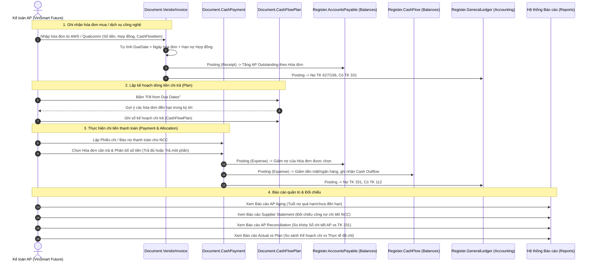

# Thiết Kế Kiến Trúc: VinSmart Future Accounts Payable Management (AP) MVP
**Dự án:** Phân hệ Quản lý Công nợ Phải trả (AP) & Dòng tiền Chi trả cho Công ty Công nghệ VinSmart Future  
**Nền tảng:** 1C:Enterprise 8.3 (Training Version 8.3.22.1704 / Managed Application / Taxi)  
**Thời gian thực hiện:** 2 tuần (14 ngày làm việc)  
**Ngày lập tài liệu:** 03/10/2026  
**Tác giả:** Senior 1C Solution Architect / Business Analyst  

---

## 1. Bối Cảnh & Mục Tiêu Nghiệp Vụ (Context & Business Objectives)

### 1.1. Bối cảnh doanh nghiệp: VinSmart Future
Công ty Công nghệ **VinSmart Future** là doanh nghiệp phát triển sản phẩm công nghệ (phần cứng thông minh, IoT, giải pháp phần mềm). Khác với các doanh nghiệp thương mại thuần túy, cơ cấu công nợ phải trả (AP) và dòng tiền chi trả của VinSmart Future tập trung vào các nhóm nhà cung cấp đặc thù:
1. **Linh kiện phần cứng & Bo mạch (Hardware BOM, Chips, Modules)**: Nhập khẩu hoặc gia công từ các đối tác OEM/ODM (như Qualcomm, Foxconn...).
2. **Hạ tầng Điện toán Đám mây & Máy chủ (Cloud Infrastructure)**: AWS, Google Cloud Platform, Azure, Viettel IDC... (phát sinh hóa đơn định kỳ hàng tháng).
3. **Bản quyền phần mềm & Dịch vụ SaaS (Software Licenses)**: JetBrains, Microsoft, Jira/Atlassian, Figma, GitHub Enterprise...
4. **Gia công phần mềm & Dịch vụ R&D thuê ngoài (Outsource Development & Testing)**: Các hợp đồng gia công công nghệ, kiểm thử chuyên sâu theo milestone.
5. **Bảo trì hệ thống & Thiết bị văn phòng IT (IT Maintenance & Equipment)**.

### 1.2. Mục tiêu dự án MVP (2 tuần)
Xây dựng một giải pháp lát cắt dọc hoàn chỉnh (**smallest complete vertical slice**) giải quyết bài toán:
* Ghi nhận và theo dõi đầy đủ nợ phải trả của nhà cung cấp từ hóa đơn mua linh kiện và dịch vụ công nghệ.
* Quản lý chặt chẽ hạn thanh toán (**Due Date**) theo hợp đồng/điều khoản tín dụng để không bị gián đoạn dịch vụ hạ tầng cloud/license.
* Thanh toán công nợ linh hoạt (thanh toán đủ, thanh toán một phần, thanh toán ứng trước) gắn liền với quản lý số dư tiền mặt/ngân hàng (**Cash Position**).
* Tự động phân loại dòng tiền chi trả theo mục vụ công nghệ và so sánh ngân sách chi trả kế hoạch vs thực tế (**Actual vs Plan**).
* Cung cấp bộ 8 năng lực chuẩn của phân hệ AP, kết thúc bằng việc đối chiếu tự động với Sổ cái kế toán (**AP Reconciliation with Accounting**).

---

## 2. Phạm Vi 8 Năng Lực Cốt Lõi (8 Core AP Capabilities)

1. **AP Outstanding (Số dư công nợ phải trả)**:
   * Theo dõi chính xác số tiền còn nợ theo từng Nhà cung cấp, từng Hợp đồng và từng Hóa đơn chi tiết (`VendorInvoice`).
2. **Due Date (Hạn thanh toán)**:
   * Tính toán tự động theo công thức: `DueDate = VendorInvoice.Date + Contract.PaymentTermsDays`.
   * Cảnh báo các hóa đơn sắp đến hạn hoặc đã quá hạn thanh toán.
3. **Payment Allocation (Phân bổ thanh toán)**:
   * Cho phép chỉ định chính xác chứng từ Chi tiền (`CashPayment`) được phân bổ để bù trừ cho hóa đơn nào trong bảng phân bổ.
4. **Partial Payment (Thanh toán một phần)**:
   * Hỗ trợ thanh toán từng đợt cho một hóa đơn lớn (ví dụ hợp đồng phần cứng 100.000.000 VNĐ, đợt 1 trả 40.000.000 VNĐ, dư nợ còn lại 60.000.000 VNĐ vẫn được theo dõi chính xác).
5. **Unallocated Payment (Khoản thanh toán chưa phân bổ / Trả trước NCC)**:
   * Hỗ trợ ghi nhận các khoản tạm ứng/thanh toán trước hợp đồng khi chưa có hóa đơn; các khoản này được theo dõi riêng để cấn trừ vào các hóa đơn xuất hiện sau đó.
6. **AP Aging (Báo cáo Tuổi nợ công nợ)**:
   * Phân loại công nợ theo các nhóm ngày: *Chưa đến hạn (Current)*, *Quá hạn 1-30 ngày*, *Quá hạn 31-60 ngày*, *Quá hạn 61-90 ngày*, *Quá hạn > 90 ngày*.
7. **Supplier Statement (Bảng đối chiếu công nợ nhà cung cấp)**:
   * Thống kê chi tiết lịch sử giao dịch với nhà cung cấp trong một kỳ: Số dư đầu kỳ, Phát sinh tăng (Hóa đơn mua), Phát sinh giảm (Chi tiền thanh toán), Số dư cuối kỳ.
8. **AP Reconciliation with Accounting (Đối chiếu AP với Sổ cái Kế toán)**:
   * Tự động so sánh số dư tổng hợp của sổ chi tiết công nợ (`AccumulationRegister.AccountsPayable`) với số dư Có của Tài khoản 331 (Phải trả cho người bán) trên Sổ cái kế toán (`AccountingRegister.GeneralLedger`), làm rõ chênh lệch nếu có.

---

## 3. Kiến Trúc Mô Hình Dữ Liệu 1C (1C Data Model Architecture)

### 3.1. Danh mục (Catalogs)
* **`Catalog.Counterparties`** (Tái sử dụng hiện có):
  * Thêm thuộc tính `IsSupplier` (Boolean), `TaxCode` (Mã số thuế), `PaymentTermsDays` (Số ngày nợ mặc định).
* **`Catalog.Contracts` (Mới - Hợp đồng & Điều khoản thanh toán)**:
  * Thuộc quyền sở hữu (`Owner`): `CatalogRef.Counterparties`.
  * Thuộc tính:
    * `Description` (Số/Tên hợp đồng, ví dụ: `HĐ-AWS-2026/01`).
    * `PaymentTermsDays` (Number 3, 0 - Số ngày được nợ: 15, 30, 45, 60...).
    * `DefaultCashFlowItem` (`CatalogRef.CashFlowItems`).
    * `Active` (Boolean).
* **`Catalog.CashAccounts` (Mới - Quỹ tiền mặt & Tài khoản ngân hàng)**:
  * Thuộc tính: `Code`, `Description`, `AccountType` (Enum: Cash / Bank Account), `AccountNumber` (Số tài khoản), `BankName`.
* **`Catalog.CashFlowItems` (Mới - Mục lưu chuyển dòng tiền)**:
  * Thuộc tính: `Code`, `Description`, `Parent` (Cây phân cấp), `FlowType` (Enum: Inflow / Outflow), `Active` (Boolean).
  * Predefined items đặc thù cho VinSmart Future:
    * `Chi mua linh kiện phần cứng (BOM & Hardware)`
    * `Chi phí hạ tầng Cloud & Server (AWS/GCP/IDC)`
    * `Chi phí bản quyền phần mềm & SaaS (Licenses)`
    * `Chi phí thuê ngoài R&D và Gia công công nghệ (Outsource)`
    * `Chi phí bảo trì hạ tầng IT & Thiết bị`
    * `Chi trả trước cho nhà cung cấp (Advance Payment)`
    * `Chi khác cho nhà cung cấp`

### 3.2. Chứng từ (Documents)
* **`Document.ReceiveAndImportProducts`** (Tái sử dụng hiện có):
  * Giữ nguyên vai trò nhập kho hàng hóa/linh kiện vật lý, ghi sổ tồn kho `AccumulationRegister.Inventory`.
  * Bổ sung nút tạo dẫn xuất (`Generate`) sang chứng từ `VendorInvoice`.
* **`Document.VendorInvoice` (Mới - Hóa đơn mua hàng / Dịch vụ công nghệ)**:
  * Header: `Number`, `Date`, `VendorInvoiceNumber` (Số hóa đơn NCC), `Counterparty` (NCC), `Contract` (Hợp đồng), `DueDate` (Hạn thanh toán), `CashFlowItem`, `SourceWarehouseDoc` (Tham chiếu phiếu nhập kho nếu có).
  * Tabular Section `ServicesAndItems`: `Product` (CatalogRef.Products), `ExpenseAccount` (Tài khoản chi phí: TK 156, TK 642, TK 627), `Quantity`, `Price`, `TotalAmount`.
  * Ghi sổ:
    * Tăng nợ trong `AccumulationRegister.AccountsPayable` (Receipt).
    * Hạch toán kế toán trong `AccountingRegister.GeneralLedger`: Nợ TK 156 / 642 / 627, Có TK 331.
* **`Document.CashPayment` (Mới - Phiếu chi tiền / Báo nợ ngân hàng)**:
  * Header: `Number`, `Date`, `Account` (`CatalogRef.CashAccounts`), `Counterparty`, `Contract`, `CashFlowItem`, `PaymentAmount` (Tổng tiền chi).
  * Tabular Section `PaymentAllocation` (Bảng phân bổ thanh toán):
    * `Invoice` (`DocumentRef.VendorInvoice` - để trống nếu là Unallocated/Trả trước).
    * `AllocatedAmount` (Số tiền phân bổ cho hóa đơn).
  * Ghi sổ:
    * Giảm nợ trong `AccumulationRegister.AccountsPayable` (Expense).
    * Giảm số dư tiền trong `AccumulationRegister.CashFlow` (Expense).
    * Hạch toán kế toán trong `AccountingRegister.GeneralLedger`: Nợ TK 331, Có TK 111 / 112.
* **`Document.CashFlowPlan` (Mới - Kế hoạch dòng tiền chi trả)**:
  * Header: `Number`, `Date`, `PlanPeriod` (Tháng/Kỳ kế hoạch).
  * Tabular Section `PlannedPayments`: `Counterparty`, `Contract`, `CashFlowItem`, `PlannedDueDate`, `PlannedAmount`.
  * Chức năng: Nút `FillFromDueDates` (Tự động quét các hóa đơn sắp đến hạn trong kỳ để gợi ý số tiền cần thanh toán).
  * Ghi sổ: `AccumulationRegister.CashFlowPlan` (Turnovers).

### 3.3. Biểu ghi tích lũy (Accumulation Registers)
1. **`AccumulationRegister.AccountsPayable` (Sổ chi tiết công nợ phải trả)**:
   * Loại register: `Balances`.
   * Dimensions:
     * `Company` (`String` / Constant VinSmart Future)
     * `Counterparty` (`CatalogRef.Counterparties`)
     * `Contract` (`CatalogRef.Contracts`)
     * `Invoice` (`DocumentRef.VendorInvoice` - có thể trống đối với tiền trả trước)
   * Resources:
     * `Amount` (`Number(15, 2)`)
   * Attributes:
     * `DueDate` (`Date` - Hạn nợ của hóa đơn, dùng tính nhanh Aging)
2. **`AccumulationRegister.CashFlow` (Sổ dòng tiền & Vị thế quỹ tiền mặt/ngân hàng)**:
   * Loại register: `Balances`.
   * Dimensions:
     * `Account` (`CatalogRef.CashAccounts`)
     * `CashFlowItem` (`CatalogRef.CashFlowItems`)
   * Resources:
     * `Amount` (`Number(15, 2)`)
   * Attributes:
     * `Counterparty` (`CatalogRef.Counterparties`)
     * `SourceDocument` (`DocumentRef`)
3. **`AccumulationRegister.CashFlowPlan` (Sổ lưu lượng kế hoạch dòng tiền)**:
   * Loại register: `Turnovers`.
   * Dimensions: `CashFlowItem`, `Counterparty`.
   * Resources: `PlannedAmount`.

### 3.4. Bảng tài khoản & Sổ kế toán (Chart of Accounts & Accounting Register)
* **`ChartOfAccounts.Main`**:
  * `111`: Tiền mặt (Cash)
  * `112`: Tiền gửi ngân hàng (Bank Deposits)
  * `156`: Hàng hóa & Linh kiện kho (Merchandise & Hardware Components)
  * `331`: Phải trả cho người bán (Accounts Payable - có Subconto: Đối tác, Hợp đồng, Hóa đơn)
  * `627`: Chi phí hạ tầng & Kỹ thuật chung (IT Cloud & Infrastructure Overhead)
  * `642`: Chi phí quản lý doanh nghiệp (G&A Expenses - Software Licenses, Tools)
* **`AccountingRegister.GeneralLedger`**:
  * Dimensions: `Company`.
  * Accounting flag: Active/Passive theo chuẩn kép Nợ/Có (Debit/Credit).
  * Resources: `Amount`.

---

## 4. Luồng Dữ Liệu Nghiệp Vụ Toàn Trình (End-to-End Business Flow)

---

## 5. Danh Mục Báo Cáo Chuyên Sâu (Management Reports)

1. **`Report.APOutstanding`**:
   * Xem công nợ còn phải trả theo Nhà cung cấp, Hợp đồng và Hóa đơn; hiển thị `InvoiceDate`, `DueDate`, `OriginalAmount`, `PaidAmount`, `OutstandingAmount`.
2. **`Report.APAging`**:
   * Phân nhóm tuổi nợ theo cột: *Chưa đến hạn*, *1-30 ngày*, *31-60 ngày*, *61-90 ngày*, *>90 ngày*. Hỗ trợ lọc theo Ngày chốt dữ liệu, Nhà cung cấp.
3. **`Report.SupplierStatement`**:
   * Bảng kê chi tiết công nợ gửi đối tác: Tồn nợ đầu kỳ, Danh sách hóa đơn phát sinh trong kỳ (+), Danh sách chứng từ chi trả thanh toán (-), Tồn nợ cuối kỳ.
4. **`Report.APReconciliationWithAccounting`**:
   * Cột hiển thị: Nhà cung cấp | Dư nợ sổ chi tiết AP | Dư Có TK 331 Kế toán | Chênh lệch (Variance). Đảm bảo tính toàn vẹn 100% giữa quản trị tác nghiệp và sổ sách tài chính.
5. **`Report.CashPosition`**:
   * Tồn quỹ đầu kỳ + Tổng thu - Tổng chi = Tồn quỹ cuối kỳ theo từng Quỹ tiền mặt / Tài khoản ngân hàng.
6. **`Report.ActualVsPlanCashFlow`**:
   * So sánh Kế hoạch chi trả vs Thực tế đã thanh toán theo từng Mục dòng tiền công nghệ (`CashFlowItems`) kèm tỷ lệ giải ngân và chênh lệch.

---

## 6. Kế Hoạch Triển Khai 14 Ngày (14-Day Delivery Plan)

| Ngày | Trọng tâm công việc | Kết quả bàn giao (Deliverables) |
| :--- | :--- | :--- |
| **DAY 1** | **Discovery & Technical Scoping** | Hoàn thành khảo sát cấu hình, thống nhất phạm vi AP VinSmart Future. |
| **DAY 2** | **Data Model & Metadata Creation** | Tạo `Catalog.Contracts`, `Catalog.CashAccounts`, `Catalog.CashFlowItems`, `ChartOfAccounts.Main`, `AccountingRegister.GeneralLedger`. |
| **DAY 3** | **AP Register & Purchase Invoicing** | Tạo `AccumulationRegister.AccountsPayable`, `Document.VendorInvoice`, tính toán tự động `DueDate`. |
| **DAY 4** | **Inventory Integration** | Kết nối `ReceiveAndImportProducts` với `VendorInvoice` (chức năng Generate hóa đơn mua từ phiếu nhập kho linh kiện). |
| **DAY 5** | **Payment & Allocation Engine** | Tạo `Document.CashPayment`, lập trình bảng phân bổ `PaymentAllocation`, xử lý thanh toán từng phần (`Partial Payment`) và thanh toán trả trước (`Unallocated`). |
| **DAY 6** | **Cash Flow Register & Position** | Hoàn thiện `AccumulationRegister.CashFlow`, đồng bộ giảm tiền khi thanh toán nợ, kiểm tra báo cáo `CashPosition`. |
| **DAY 7** | **Cash Flow Planning & Due Date Scan** | Tạo `Document.CashFlowPlan`, `AccumulationRegister.CashFlowPlan`, lập trình tính năng `FillFromDueDates`. |
| **DAY 8** | **Accounting Reconciliation Engine** | Hoàn thiện bút toán kép Nợ/Có (TK 331, 112, 156, 627, 642) khi Post hóa đơn và thanh toán; xây dựng báo cáo đối chiếu `APReconciliationWithAccounting`. |
| **DAY 9** | **AP Reporting Suite** | Xây dựng báo cáo `APOutstanding`, `APAging` (các bucket tuổi nợ), `SupplierStatement`. |
| **DAY 10**| **Integration Testing & Data Consistency** | Kiểm thử liên thông toàn bộ luồng từ Hóa đơn → Phân bổ → Sổ cái → Báo cáo; xử lý chống trùng lặp dữ liệu. |
| **DAY 11**| **Edge-Case & Multi-transaction Testing** | Kiểm thử các ca: Hủy chứng từ (Unpost), sửa chứng từ, trả tiền nhiều hóa đơn một lúc, thanh toán vượt quá số nợ. |
| **DAY 12**| **UAT Scenario for VinSmart Future** | Dựng kịch bản kinh doanh thực tế hoàn chỉnh (AWS Cloud, Qualcomm Chipset, JetBrains License) và chạy kiểm thử chấp nhận. |
| **DAY 13**| **Bug Fixing & UI Stabilization** | Tinh chỉnh form giao diện, format số tiền chuẩn, kiểm tra hiệu năng trên 1C Training version. |
| **DAY 14**| **Final Review & Handover** | Nghiệm thu giải pháp MVP, tài liệu hướng dẫn sử dụng, tổng kết các hạn chế và đề xuất Phase 2. |

---

## 7. Tiêu Chí Hoàn Thành & Kịch Bản Kiểm Thử Chấp Nhận (Definition of Done & Acceptance Test)

### 7.1. Definition of Done (DoD)
Dự án được nghiệm thu khi chứng minh thành công kịch bản thực tế sau:
1. **Ghi nhận nợ**: VinSmart Future nhận hóa đơn dịch vụ AWS Cloud (100.000.000 VNĐ) và hóa đơn mua linh kiện vi xử lý Qualcomm (200.000.000 VNĐ).
2. **Xác định Due Date**: Hệ thống tự động áp dụng điều khoản hợp đồng Net 30 để tính ngày đến hạn chính xác.
3. **Lập Kế hoạch**: Hệ thống tự động gợi ý lịch thanh toán trong kỳ tới trên `CashFlowPlan`.
4. **Thanh toán một phần**: Kế toán lập lệnh chi chuyển khoản trả trước 40.000.000 VNĐ cho AWS Cloud.
5. **Cập nhật công nợ**:
   * Hóa đơn AWS giảm nợ xuống còn 60.000.000 VNĐ (`Partial Payment` thành công).
   * Hóa đơn Qualcomm chưa trả vẫn nợ nguyên 200.000.000 VNĐ.
6. **Báo cáo Tuổi nợ (Aging)**: Thể hiện đúng các khoản nợ theo khoảng thời gian đến hạn.
7. **Bảng đối chiếu (Supplier Statement)**: Hiển thị minh bạch lịch sử giao dịch với AWS.
8. **Đối chiếu Kế toán (Reconciliation)**: Tổng dư nợ chi tiết của AWS và Qualcomm khớp 100% với số dư Có trên Tài khoản 331 trên Sổ kế toán tổng hợp (`Variance = 0`).
9. **Dòng tiền (Cash Position)**: Số dư tài khoản ngân hàng giảm đúng 40.000.000 VNĐ, phân loại đúng mục `Chi phí hạ tầng Cloud & Server`.
