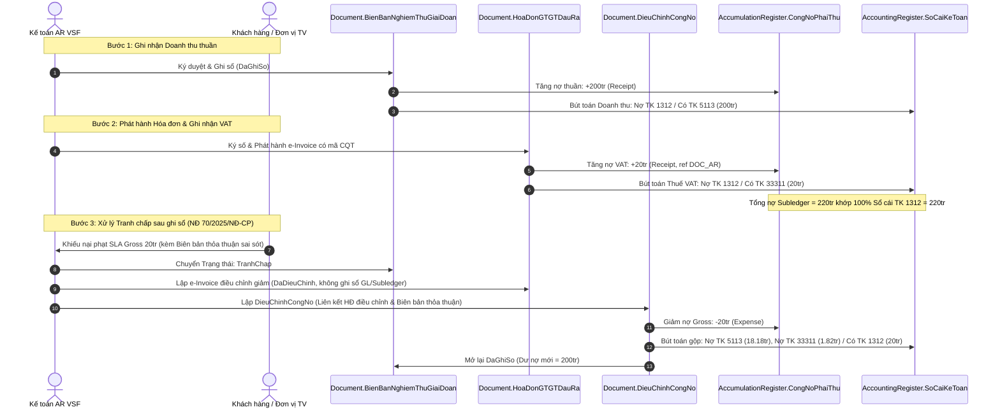
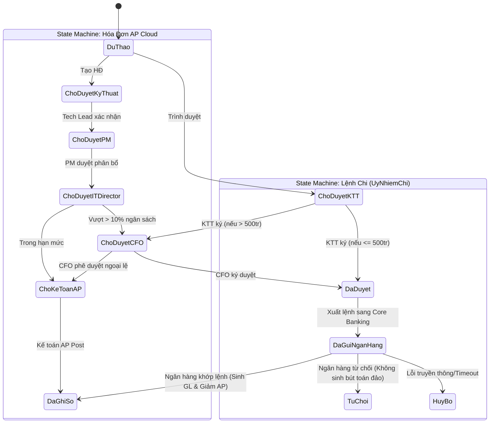

# Đặc Tả Kiến Trúc Phân Hệ Quản Lý Công Nợ AR & AP (Phiên Bản 5.0 - Audited Pre-Implementation)
**Dự án:** Phân hệ Quản lý Công nợ Phải thu (AR) & Phải trả (AP) — VinSmart Future (VSF), Tập đoàn Vingroup  
**Nền tảng:** 1C:Enterprise 8.3 (Platform Build 8.3.22.2243 / Managed Application / Taxi / BSL)  
**Hệ quản trị CSDL:** PostgreSQL 15 / MS SQL Server 2022 Enterprise  
**Kiến trúc lịch sử, không còn áp dụng từ 12/10/2026:** Thiết kế 1C/SAP đã được thay bằng hệ thống kế toán tập trung duy nhất trong 1C. Xem [báo cáo kiểm toán](../../ERP_AUDIT_2026-10-12.md).
**Ngày cập nhật:** 10/10/2026  
**Trạng thái tài liệu:** Kiến Trúc Đã Kiểm Toán — Sẵn Sàng Triển Khai Sau Khi Rà Soát Nhóm Nghiệp Vụ Chờ Sign-off  

---

## 1. TỔNG QUAN HỆ THỐNG & NGUYÊN TẮC THIẾT KẾ BẮT BUỘC

### 1.1. Bối cảnh & Ranh giới Hệ thống (System Boundaries)
1. **1C:Enterprise là Operational Subledger of Record:** 
   - Quản lý chi tiết từng khoản mục công nợ theo Hợp đồng, Hóa đơn gốc, Hạn thanh toán (`DueDate`), Biên bản nghiệm thu dịch vụ Cloud/SaaS, Virtual Account và bảng phân bổ thanh toán đa dòng (`PhanBoThanhToan`).
   - Đảm bảo tính toàn vẹn nghiệp vụ hằng ngày, đối soát 3 tầng thời gian thực với Core Banking và điều phối ma trận cấn trừ đa bên nội bộ Tập đoàn Vingroup.
2. **SAP S/4HANA là General Ledger of Record:**
   - Hệ thống sổ cái kế toán tổng hợp cấp Tập đoàn Vingroup. Tiếp nhận các batch bút toán tổng hợp (`DaGhiSo`) từ 1C hằng ngày lúc 22:00 phục vụ lập Báo cáo tài chính hợp nhất.
3. **Quy chuẩn kỹ thuật bắt buộc:**
   - Định danh 100% đối tượng Metadata và thuộc tính bằng **Tiếng Việt không dấu (PascalCase)**.
   - Mọi hàm BSL không sử dụng ký tự có dấu trong tên hàm hoặc tham số (ví dụ: `SoTienHoaDon` thay vì `SoTienHĐ`).

---

## 2. PHÂN LOẠI QUẢN TRỊ 36 GIẢ ĐỊNH THIẾT KẾ (ASSUMPTIONS GOVERNANCE)

Để tránh rủi ro "khóa cứng thiết kế quá sớm", toàn bộ 36 giả định được phân loại thành 3 nhóm rõ ràng:
- **Nhóm A: `Architectural-Approved` (Đã duyệt kiến trúc):** Các quyết định nền tảng đã được kiểm toán và chốt kỹ thuật.
- **Nhóm B: `Provisional-Dev` (Giả định tạm thời cho dev):** Các tham số kỹ thuật phục vụ lập trình khung, cấu hình động qua Constant/Config.
- **Nhóm C: `Pending-Signoff` (Bắt buộc KTT & Kế toán thuế xác nhận trước khi khóa kế toán):** Rà soát chính thức tại **Milestone 2.5 (Early Review)** trước khi lập trình Phase 3.

| # | Điểm nghiệp vụ | Nội dung giả định thiết kế | Cơ chế kỹ thuật trên 1C | Phân loại |
| :-: | :--- | :--- | :--- | :---: |
| **1** | TK hạch toán Phí ngân hàng | Mặc định **TK 6427** (hoặc 6428/635 theo quyết định KTT). | `Constant.TaiKhoanPhiNganHang` | `Pending-Signoff` |
| **2** | Đánh giá lại tỷ giá ngoại tệ | Cuối tháng đánh giá lại số dư USD (3311/1122), đảo đầu tháng sau; kết chuyển 635/515 cuối năm tài chính. | Scheduled Job & InfoReg | `Architectural-Approved` |
| **3** | Phân loại NCC Cloud quốc tế | Sử dụng cờ danh mục để phân loại NCC đã/chưa kê khai thuế điện tử. | `Catalog.DoiTac.DaDangKyThueTrucTiep` | `Architectural-Approved` |
| **4** | Cơ chế Thuế Nhà Thầu (FCT) | Hỗ trợ 2 mô hình qua cờ hợp đồng: Mặc định là **Khấu trừ tại nguồn (Withholding)**; hỗ trợ **Gross-up**. | `Catalog.HopDong.GrossUpThue` | `Pending-Signoff` |
| **5** | Tiểu khoản Thuế GTGT Nhà thầu | Sử dụng tiểu khoản chuyên biệt (tạm đặt **TK 33318**), quản lý qua bảng ánh xạ logic. | `ChartOfAccounts.HeThongTaiKhoan` | `Pending-Signoff` |
| **6** | Biểu thuế suất GTGT 2026 | Hỗ trợ thuế suất **8% (NQ 204/2025/QH15)** và **10%** dựa trên bảng quy tắc thuế theo ngày hiệu lực & loại dịch vụ. | Bảng quy tắc thuế & Tabular Sec | `Pending-Signoff` |
| **7** | Ngưỡng thanh toán không tiền mặt | Áp dụng ngưỡng **5,000,000 VND** cho điều kiện khấu trừ thuế GTGT đầu vào (Luật Thuế GTGT 48/2024). | `Constant.NguongThanhToanKhongDungTienMat` | `Pending-Signoff` |
| **8** | Cơ chế pháp lý Cấn trừ đa bên | Căn cứ Biên bản đối soát khung 3 bên qua đơn vị điều phối Tập đoàn Vingroup. | `Document.CanTruCongNoNoiBo` | `Architectural-Approved` |
| **9** | Tiền về qua VA lệch số nợ | Treo đích danh đối tác: `Nợ TK 1121 / Có TK 1312_[DoiTac]` (Chưa phân bổ), không đưa vào 3388 nặc danh. | `Document.BaoCoNganHang` | `Architectural-Approved` |
| **10**| Dung sai làm tròn số học | Khách ngoài: Tự động xử lý chênh lệch $\le 1.000$đ (thiếu vào 6427, thừa vào 711). Nội bộ: **Dung sai tuyệt đối = 0**. | Logic `DongCoDoiSoatTuDong` | `Provisional-Dev` |
| **11**| Xử lý Thu thừa / Thu thiếu | Thu thừa: Tiền trả trước (Có 1311/1312 chưa phân bổ). Thu thiếu: Chuyển `DaThanhToanMotPhan`, cấm tự xóa nợ. | Logic `PhanBoThanhToan` | `Architectural-Approved` |
| **12**| Thời hạn thanh toán mặc định | Mặc định áp dụng điều khoản **Net 30 ngày** nếu hợp đồng chưa quy định cụ thể. | Thuộc tính `HanThanhToanNgay` | `Provisional-Dev` |
| **13**| Nguồn tỷ giá hối đoái | Tích hợp API ngân hàng chỉ định nạp tỷ giá mua/bán hằng ngày vào 08:00 sáng. | `InformationRegister.TyGiaHoiDoai` | `Architectural-Approved` |
| **14**| Khóa sổ kỳ kế toán | Khóa sổ mềm vào ngày làm việc thứ 5; sau thời điểm này điều chỉnh qua `DieuChinhCongNo`. | Cơ chế DataLock Period | `Provisional-Dev` |
| **15**| Duyệt Chi phí Cloud vượt ngân sách | Vượt $\le 10\%$: IT Director duyệt kèm giải trình. Vượt $> 10\%$: Bắt buộc bổ sung CFO phê duyệt ngoại lệ. | `CommonModule.PheDuyetDaCapServer` | `Architectural-Approved` |
| **16**| Thời hạn ủy quyền & SLA duyệt | Ủy quyền tối đa 7 ngày làm việc kèm audit trail. Quá 48h chuyển cấp trên. Cấm tự động duyệt. | Workflow Subsystem | `Provisional-Dev` |
| **17**| Lịch trình & Retry Đồng bộ SAP | Batch 22:00 hằng ngày, chỉ đẩy chứng từ `DaGhiSo`. Lỗi tự động retry tối đa 3 lần. | `DataProcessor.DongBoButToanSAP` | `Provisional-Dev` |
| **18**| Cấu trúc Ngân sách chi tiêu | Information Register chi tiết 4 chiều: `(Thang, DuAn, KhoanMucDongTien, PhapNhan)`. | `InformationRegister.KeHoachChiTien`| `Architectural-Approved` |
| **19**| Quy trình hoàn tiền B2C | Bắt buộc lập Hóa đơn điện tử điều chỉnh giảm trước, sau đó mới chi tiền qua `YeuCauHoanTienChiHo`. | Quy trình B2C e-Invoice | `Architectural-Approved` |
| **20**| Cơ chế Watchdog Timeout Netting | Phiên cấn trừ có thời hạn 120 phút. Watchdog Scheduled Job quét và phục hồi `TrangThaiTruocDo` (không giữ DB lock). | Watchdog Job & Field Phiên | `Provisional-Dev` |
| **21**| Tranh chấp sau ghi sổ (AR) | Có Văn bản thỏa thuận sai sót (NĐ 70/2025); Hóa đơn điều chỉnh phi bút toán; `DieuChinhCongNo` ghi sổ duy nhất. | State Machine & HĐĐT | `Architectural-Approved` |
| **22**| Enum Trạng thái Lệnh thanh toán | Đủ 7 trạng thái: `DuThao, ChoDuyet, DaDuyet, DaGuiNganHang, DaGhiSo, TuChoi, HuyBo`. | `Enum.TrangThaiLenhThanhToan` | `Architectural-Approved` |
| **23**| Ghi sổ Lệnh chi Ngân hàng | Khi `DaGuiNganHang`: CHƯA ghi sổ GL. Chỉ ghi sổ khi ngân hàng xác nhận thành công. Ngân hàng từ chối: Chuyển `TuChoi`, không đảo. | Logic `UyNhiemChi.Posting` | `Architectural-Approved` |
| **24**| Reversal thực tế khi ngân hàng hoàn trả | Chỉ thực hiện khi lệnh đã `DaGhiSo` nhưng phát sinh tra soát trả lại tiền sau đó. | Quy trình Reversal thực tế | `Architectural-Approved` |
| **25**| Trùng Webhook (Idempotency) | Transaction nguyên tử với Unique Key; trùng key cùng payload trả 200 OK; khác payload trả 409 Conflict. | Unique Index & HTTP Service | `Architectural-Approved` |
| **26**| Giới hạn thuật toán FIFO | Chỉ áp dụng cho khách lẻ/đối tác ngoài với hóa đơn $\le 100$tr; **Cấm áp dụng cho nội bộ Vingroup**. | Logic `PhanBoThanhToan` | `Architectural-Approved` |
| **27**| Maker-Checker & Quyền Quản trị | Cấm người tạo tự duyệt chứng từ (kể cả Admin); cấm tuyệt đối với lệnh chi `UyNhiemChi`. Chứng từ hệ thống có audit riêng. | `CommonModule.QuanLyVongDoi` | `Architectural-Approved` |
| **28**| Operational Safety Gate | Khi đối tác nội bộ Vingroup nợ quá hạn: Tuyệt đối không tự động khóa API/ngắt dịch vụ; chỉ cảnh báo CFO. | Scheduled Job & Safety Module | `Architectural-Approved` |
| **29**| Tiền chưa rõ đối tác (Tầng 3) | Hạch toán vào tài khoản tạm giữ nặc danh `Nợ TK 1121 / Có TK 3388`, mở ticket tra soát 48h. | Logic Tầng 3 Đối Soát | `Architectural-Approved` |
| **30**| Khung Chế độ Kế toán Doanh nghiệp | Xác định rõ khung áp dụng (TT 99/2025/TT-BTC có hiệu lực 01/01/2026); `MaLogic` giữ vai trò nghiệp vụ ổn định. | `ChartOfAccounts.HeThongTaiKhoan` | `Pending-Signoff` |
| **31**| Tỷ lệ Thuế Nhà Thầu (FCT) | Tỷ lệ 5% VAT và 5% CIT là giả định kiểm thử; tỷ lệ chính thức phụ thuộc loại dịch vụ theo phê duyệt của Kế toán thuế. | Bảng thuế suất FCT | `Pending-Signoff` |
| **32**| Anti-Split Rule cộng dồn theo tháng | Quét tổng giá trị các hóa đơn mua dịch vụ phát sinh/ghi sổ trong tháng của NCC để kích hoạt duyệt CFO $\ge 500$tr. | `CommonModule.PheDuyetDaCapServer` | `Architectural-Approved` |
| **33**| Cấn trừ giảm đồng thời 2 Sổ tích lũy | `CanTruCongNoNoiBo` bắt buộc ghi giảm đồng thời cả `CongNoPhaiThu` (Expense) và `CongNoPhaiTra` (Expense). | Posting Module `CanTruCongNoNoiBo` | `Architectural-Approved` |
| **34**| Bảng ánh xạ Tài khoản Kế toán | Ánh xạ độc lập `MaLogic -> SoHieuTK`, cho phép đổi số hiệu tài khoản mà không sửa code BSL. | Bảng ánh xạ hệ thống | `Architectural-Approved` |
| **35**| Dual Subledger of Record độc lập | Hai sổ tích lũy `CongNoPhaiThu` và `CongNoPhaiTra` độc lập tuyệt đối, kiểm soát cân đối với GL qua Invariants. | Dual Accumulation Registers | `Architectural-Approved` |
| **36**| Hóa đơn điện tử theo NĐ 70/2025/NĐ-CP | Lưu trữ Văn bản thỏa thuận sai sót giữa hai bên khi phát hành hóa đơn điều chỉnh/thay thế cho doanh nghiệp. | Thuộc tính & File đính kèm | `Pending-Signoff` |

---

## 3. CẤU TRÚC DỮ LIỆU METADATA (69 ĐỐI TƯỢNG) & TRACEABILITY MATRIX

### 3.1. Danh mục 69 Đối tượng Cấu hình 1C:Enterprise
- **Catalogs (10):** `PhapNhan`, `DoiTac`, `HopDong`, `TaiKhoanTien`, `KhoanMucDongTien`, `TienTe`, `DuAn`, `DichVuCNTT`, `KenhThanhToan`, `TaiKhoanAo`.
- **Documents (12):** `DeNghiThanhToanDichVu`, `BienBanNghiemThuGiaiDoan`, `HoaDonGTGTDauRa`, `HoaDonNhaCungCap`, `NghiemThuThauPhu`, `CanTruCongNoNoiBo`, `BaoCoNganHang`, `PhieuThuTienKhachHang`, `UyNhiemChi`, `BangKeDoiSoatKenhThanhToan`, `DieuChinhCongNo`, `YeuCauHoanTienChiHo`.
- **Accumulation Registers (4):** `CongNoPhaiThu`, `CongNoPhaiTra`, `DongTien`, `GiaoDichDienTuTamGiu`.
- **Information Registers (5):** `TyGiaHoiDoai`, `HanMucVaChanXuatDichVu`, `TrangThaiDongBoSAP`, `LichSuGiaoDichNganHang`, `KeHoachChiTien`.
- **Chart of Accounts & GL (2):** `ChartOfAccounts.HeThongTaiKhoan`, `AccountingRegister.SoCaiKeToan`.
- **Enumerations (8):** `TrangThaiNghiemThuAR`, `TrangThaiHoaDonAP`, `TrangThaiLenhThanhToan`, `TrangThaiCanTru`, `TrangThaiHoaDonDienTu`, `LoaiDoiTac`, `HuongDongTien`, `TrangThaiDongBo`.
- **Constants (12):** `PhapNhanMacDinh`, `NguongPheDuyetChiTienCFO`, `TaiKhoanTrungGianCanTru`, `TuDongDongBoSAP`, `NguongThanhToanKhongDungTienMat`, `TaiKhoanPhiNganHang`, `SoLuongHoaDonFIFOMax`, `GiaTriFIFOMax`, `TimeoutChoCanTruPhut`, `CanhBaoCloudMucVang`, `CanhBaoCloudMucCam`, `CanhBaoCloudMucDo`.
- **Data Processors (3):** `DongCoDoiSoatTuDong`, `LapMaTranCanTruTapDoan`, `DongBoButToanSAP`.
- **Reports (4):** `BaoCaoTuoiNoPhanTachNoiBo`, `MaTranCanTruNoiBoTapDoan`, `DoiSoatKenhThanhToanVaDongTienAo`, `CanhBaoHanMucVaGiaHanCloud`.
- **Roles (9):** `QuanTriHeThong`, `KeToanPhaiThu`, `KeToanPhaiTra`, `ChuyenVienDoiSoatTapDoan`, `KeToanTruong`, `GiamDocTaiChinh_CFO`, `TechLead_KiemTraKyThuat`, `ProjectManager_QuanLyDuAn`, `ITDirector_GiamDocHaTang`.
- **Scheduled Jobs (2):** `DongBoSAPHangNgay`, `WatchdogNettingVaCanhBaoCloud`.

---

## 4. THIẾT KẾ CHI TIẾT NGHIỆP VỤ & SỔ CÁI KÉP (GL & SUBLEDGER)

### 4.1. Phân hệ AR Intercompany: Khớp Nối Subledger và Sổ Cái Tuyệt Đối (P0.1)

#### Nguyên tắc khớp số dư:
Để triệt tiêu hoàn toàn rủi ro lệch giữa Sổ chi tiết (`CongNoPhaiThu`) và Sổ cái (`TK 1312` trên `SoCaiKeToan`), quy tắc ghi nhận được chuẩn hóa như sau:
1. **Khi ghi sổ Nghiệm thu (`Document.BienBanNghiemThuGiaiDoan`):**
   - Ghi nhận Doanh thu thuần dịch vụ:
     $$\text{Nợ TK 1312} \quad / \quad \text{Có TK 5113: 200.000.000 VND}$$
   - Cập nhật tăng Sổ chi tiết:
     $$\text{AccumulationRegister.CongNoPhaiThu.AddReceipt(): 200.000.000 VND}$$
2. **Khi phát hành Hóa đơn điện tử (`Document.HoaDonGTGTDauRa`):**
   - Ghi nhận nghĩa vụ thuế GTGT đầu ra:
     $$\text{Nợ TK 1312} \quad / \quad \text{Có TK 33311: 20.000.000 VND}$$
   - **Bắt buộc cập nhật tăng Sổ chi tiết phần thuế VAT:**
     $$\text{AccumulationRegister.CongNoPhaiThu.AddReceipt(): 20.000.000 VND}$$
     *(Ghi vết với `ChungTuGoc = BienBanNghiemThuGiaiDoan` liên quan)*.
3. **Kết quả đối chiếu:**
   - Số dư nợ chi tiết trên `CongNoPhaiThu` $= 200\text{tr} + 20\text{tr} = \mathbf{220.000.000\text{ VND}}$.
   - Số dư Nợ TK 1312 trên `SoCaiKeToan` $= 200\text{tr} + 20\text{tr} = \mathbf{220.000.000\text{ VND}}$.
   - **Độ lệch (Reconciliation Variance) $= 0$ tuyệt đối!**



---

### 4.2. Phân hệ AP: Vòng Đời Lệnh Chi Ngân Hàng & Reversal Chuẩn Xác (P0.2)

#### Nguyên tắc ghi sổ Lệnh chi `UyNhiemChi`:
1. **Giai đoạn gửi lệnh sang ngân hàng (`DaGuiNganHang`):**
   - **CHƯA ghi sổ Sổ cái GL và CHƯA giảm nợ trên `CongNoPhaiTra`**. Tiền vẫn nằm trên tài khoản ngân hàng của VSF, nợ NCC vẫn chưa được thanh toán về mặt kế toán.
   - Hệ thống chỉ tạm giữ hạn mức chi tiêu trong `InformationRegister.KeHoachChiTien` để chống chi trùng.
2. **Nhánh 1: Ngân hàng xử lý thành công (Nhận Webhook / Báo Nợ thành công):**
   - Chuyển trạng thái sang `DaGhiSo`.
   - Lúc này MỚI sinh bút toán kế toán:
     $$\text{Nợ TK 3311} \quad / \quad \text{Có TK 1121 (hoặc 1122)}$$
   - Ghi giảm nợ chi tiết trên `AccumulationRegister.CongNoPhaiTra` (Expense).
3. **Nhánh 2: Ngân hàng từ chối (Sai STK, tài khoản đích đóng, lỗi Core Banking):**
   - Chuyển trạng thái sang `TuChoi` hoặc `HuyBo`.
   - **KHÔNG sinh bút toán đảo (Reversal)** vì chứng từ chưa từng phát sinh bút toán kế toán ghi sổ.
   - Hệ thống tự động giải phóng hạn mức giữ chỗ, cho phép kế toán sửa thông tin và gửi lại lệnh.
4. **Nhánh 3: Quy trình Reversal thực tế (Xử lý Tra soát hoàn tiền):**
   - Chỉ phát sinh khi lệnh chi đã `DaGhiSo` thành công, nhưng sau đó ngân hàng phát sinh điện tra soát hoàn tiền (ví dụ tra soát liên ngân hàng trả lại tiền sau 2 ngày).
   - Kế toán tiếp nhận Báo Có hoàn tiền, lập chứng từ điều chỉnh hoặc Bút toán đảo:
     $$\text{Nợ TK 1121} \quad / \quad \text{Có TK 3311}$$
   - Khôi phục lại khoản nợ phải trả trên `CongNoPhaiTra` (Receipt).

---

### 4.3. Schema Sổ `DongTien` và Công Thức Tỷ Giá BQGQ (P1.1)

#### Cấu trúc chuẩn hóa của `AccumulationRegister.DongTien`:
- **Chế độ:** `BalancesAndTurnovers`
- **Dimensions:**
  - `PhapNhan` (CatalogRef.PhapNhan)
  - `TaiKhoanTien` (CatalogRef.TaiKhoanTien)
  - `TienTe` (CatalogRef.TienTe)
  - `KhoanMucDongTien` (CatalogRef.KhoanMucDongTien)
- **Resources:**
  - `SoTien` (Number 15, 2) — Giá trị ghi sổ bằng VND.
  - `SoTienNgoaiTe` (Number 15, 2) — Số lượng nguyên tệ (USD, EUR,...).

#### Hàm tính tỷ giá xuất quỹ BQGQ di động chuẩn mực:
```bsl
Function TinhTyGiaXuatQuyBQGQ(PhapNhan, TaiKhoanTien, TienTe, NgayHachToan) Export
    Query = New Query;
    Query.Text = 
        "SELECT
        |   SUM(DongTienBalance.SoTienBalance) AS DuVND,
        |   SUM(DongTienBalance.SoTienNgoaiTeBalance) AS DuNgoaiTe
        |FROM
        |   AccumulationRegister.DongTien.Balance(&NgayHachToan, 
        |       PhapNhan = &PhapNhan 
        |       AND TaiKhoanTien = &TaiKhoanTien 
        |       AND TienTe = &TienTe) AS DongTienBalance";
    Query.SetParameter("NgayHachToan", NgayHachToan);
    Query.SetParameter("PhapNhan", PhapNhan);
    Query.SetParameter("TaiKhoanTien", TaiKhoanTien);
    Query.SetParameter("TienTe", TienTe);
    
    Result = Query.Execute().Unload();
    If Result.Count() > 0 And Result[0].DuNgoaiTe > 0 Then
        Return Round(Result[0].DuVND / Result[0].DuNgoaiTe, 4);
    Else
        Raise "Lỗi xuất quỹ ngoại tệ: Số dư nguyên tệ tại thời điểm hạch toán bằng 0 hoặc âm. Kiểm tra thứ tự ghi sổ mua ngoại tệ!";
    EndIf;
EndFunction
```

---

### 4.4. Cơ chế Thuế Nhà Thầu (FCT) & Biểu thuế VAT 2026 (P0.4 & 4.2)

1. **Ma trận xác định FCT:**
   - Áp dụng Thông tư 103/2014/TT-BTC theo 2 chế độ:
     * **Mặc định theo Giả định 4 (Khấu trừ tại nguồn - Gross Contract):**
       $$\text{Nợ TK 627: 237.5tr}, \quad \text{Nợ TK 1331: 12.5tr} \quad / \quad \text{Có TK 3311: 225tr}, \quad \text{Có TK 33318: 12.5tr}, \quad \text{Có TK 3338: 12.5tr}$$
       Chi phí của VSF chuẩn xác 237.5tr, thuế TNDN 12.5tr do NCC chịu và được trừ từ nợ NCC, không đi vào chi phí VSF.
     * **Chế độ Gross-up (`Catalog.HopDong.GrossUpThue = True`):**
       VSF chịu toàn bộ thuế thay NCC, nợ trả NCC giữ nguyên 250tr (`Có TK 3311: 250tr`), thuế TNDN nộp thay được tính vào chi phí (`Nợ TK 627: 12.5tr / Có TK 3338: 12.5tr`).
2. **Quy tắc Thuế suất GTGT 2026 (NQ 204/2025/QH15):**
   - Quản lý biểu thuế suất theo ngày hiệu lực và loại dịch vụ (`DichVuCNTT`).
   - Hỗ trợ mức 8% (cho dịch vụ đủ điều kiện giảm thuế theo Nghị quyết 204/2025) và 10% cho dịch vụ thông thường.
   - Bút toán điều chỉnh giảm công nợ đọc đúng thuế suất từ dòng dịch vụ của hóa đơn gốc, không chia cố định cho 1.1.

---

## 5. KIẾN TRÚC VÒNG ĐỜI CHỨNG TỪ (STATE MACHINES TÁCH BIỆT) (P1.3)

Thay vì áp dụng chung một State Machine cồng kềnh, hệ thống phân tách rõ 4 State Machines chuyên biệt:



---

## 6. CƠ CHẾ AN TOÀN VẬN HÀNH & HIỆU NĂNG CAO

### 6.1. Idempotency Nguyên Tử (P3.1)
- Endpoint Webhook kiểm tra `IdempotencyKey` trong giao dịch nguyên tử (Atomic Database Transaction).
- Tạo Unique Index trên `IdempotencyKey` trong `InformationRegister.LichSuGiaoDichNganHang`.
- Nếu trùng key:
  * Khớp Payload Hash: Trả ngay HTTP 200 OK `"Already Processed"`.
  * Khác Payload Hash: Trả HTTP 409 Conflict `"Key exists with mismatched payload"`.

### 6.2. Cơ chế Watchdog Timeout Netting (Không Giữ Lock 120 phút) (P3.2)
- Phiên Netting lưu `ThoiGianBatDau`, `ThoiGianHetHan = ThoiGianBatDau + 120 phút`.
- Trạng thái chứng từ được chuyển sang `ChoCanTru`, lưu `TrangThaiTruocDo`.
- **Tuyệt đối không giữ Database Lock trong 120 phút**. Khóa DataLock ngắn hạn của 1C chỉ kích hoạt trong tích tắc (< 500ms) lúc thực thi ghi sổ bù trừ.
- `ScheduledJob.WatchdogNetting` chạy định kỳ 5 phút quét các phiên quá hạn để giải phóng trạng thái chứng từ về `TrangThaiTruocDo`.

### 6.3. Operational Safety Gate (Bảo vệ Nội bộ Vingroup)
- Khi đơn vị thành viên Vingroup (VinFast, Vinhomes, GSM, Vinmec) quá hạn thanh toán:
  * **NGHIÊM CẤM TỰ ĐỘNG KHÓA API HOẶC NGẮT DỊCH VỤ**.
  * Tự động gửi cảnh báo khẩn cấp lên Dashboard CFO và điều phối sang phiên Netting kỳ tới.
