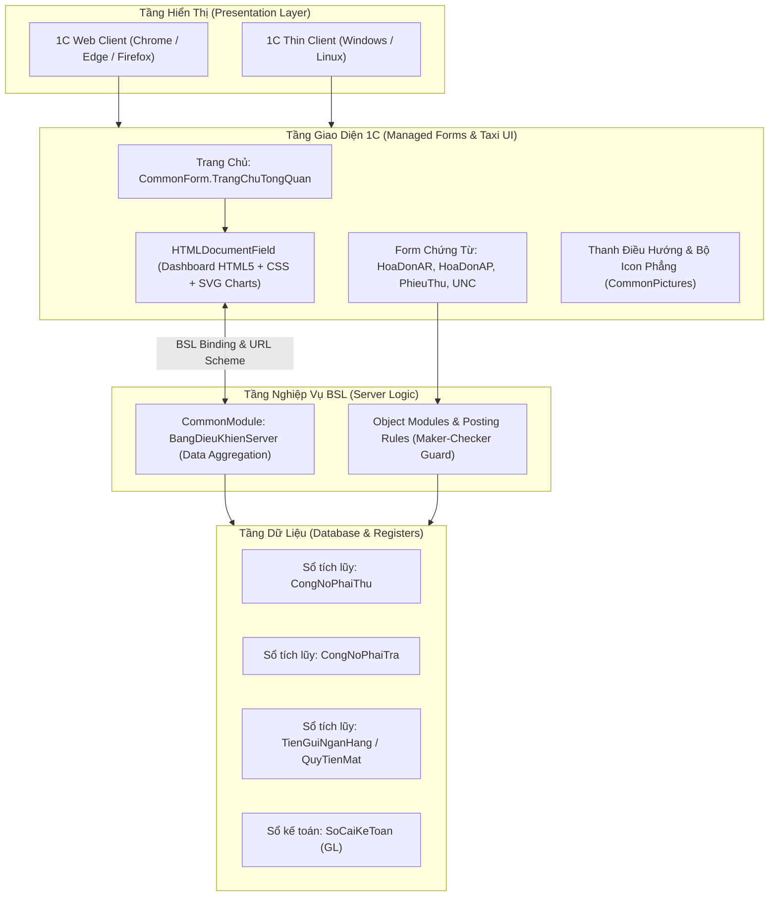

# Thiết Kế Kỹ Thuật: Nâng Cấp Giao Diện UI/UX VinSmart 1C Theo Chuẩn Web App Hiện Đại

**Ngày lập:** 17/10/2026  
**Dự án:** VinSmart Future AR/AP trên 1C:Enterprise 8.3  
**Trạng thái:** Bản thảo đã thống nhất (Design Specification)  

---

## 1. Bối cảnh & Mục tiêu

### 1.1 Bối cảnh
Hệ thống quản lý công nợ AR/AP của VinSmart Future hiện đang chạy trên nền tảng 1C:Enterprise 8.3 (chế độ Taxi, Managed Application). Các biểu mẫu chứng từ hiện tại chủ yếu là form tự sinh mặc định của nền tảng (Auto-generated Managed Forms) với danh sách trường xếp dọc đơn điệu. Hệ thống chưa có trang chủ (Home Page / Desktop) tổng quan dạng Dashboard tài chính, đồng thời chưa tối ưu hóa việc vận hành trên trình duyệt (Web Client).

### 1.2 Mục tiêu
* **Hiện đại hóa giao diện (Web App Look & Feel):** Đưa trải nghiệm người dùng đạt chuẩn ứng dụng SaaS hiện đại năm 2026 với Trang chủ Dashboard trực quan, bố cục Form chứng từ dạng Card & Tab, hiển thị huy hiệu trạng thái (Status Badges) và thẻ tổng tiền nổi bật.
* **Tương thích hoàn hảo Web Client & Thin Client:** Hoạt động mượt mà 100% trên cả trình duyệt Web (Chrome, Edge, Safari, Firefox thông qua Apache/IIS) và ứng dụng 1C Thin Client cài đặt trên máy trạm.
* **Zero External Network Dependency:** Toàn bộ HTML, CSS, SVG và script xử lý biểu đồ chạy offline cục bộ, an toàn tuyệt đối trong môi trường On-Premise và mạng doanh nghiệp cô lập.
* **Bảo toàn 100% logic nghiệp vụ & kiểm toán:** Không tác động hay làm thay đổi bất kỳ logic ghi sổ (Posting), phân quyền Maker-Checker hay cấu trúc sổ kế toán / khóa phân tích GL hiện hữu.

---

## 2. Kiến trúc Giải pháp (Solution Architecture)

Hệ thống được thiết kế theo mô hình **Hybrid Taxi + Embedded Modern HTML5/CSS Dashboard & Modern Managed Forms**:



---

## 3. Chi tiết Thành phần & Đặc tả Kỹ thuật

### 3.1 Cấu hình hệ thống chung (`Configuration.xml`)
* **Mục đích sử dụng (`UsePurposes`):** Bật thêm `WebApplication` để cho phép biên dịch và khởi chạy trên Web Client:
  ```xml
  <UsePurposes>
      <v8:Value xsi:type="app:ApplicationUsePurpose">PlatformApplication</v8:Value>
      <v8:Value xsi:type="app:ApplicationUsePurpose">WebApplication</v8:Value>
  </UsePurposes>
  ```
* **Bàn làm việc mặc định (`HomePage`):** Đặt `CommonForm.TrangChuTongQuan` làm biểu mẫu làm việc chính khi người dùng đăng nhập.
* **Chế độ giao diện:** Tiếp tục duy trì `InterfaceCompatibilityMode = Taxi`.

### 3.2 Trang chủ Dashboard (`CommonForm.TrangChuTongQuan`)
* **Thành phần biểu mẫu:**
  * Thuộc tính form: `NoiDungHTML` (Kiểu `String`), `KyBaoCao` (Kiểu `String`, mặc định: `"ThangNay"`), `ThoiDiemCapNhat` (Kiểu `Date`).
  * Thành phần giao diện: 
    * `TruongHTMLDashboard` (Trường tài liệu HTML gắn với `NoiDungHTML`).
    * Thanh lệnh (CommandBar): Nút `LamMoiDuLieu` (Làm mới F5), Menu chọn `KyBaoCao` (Tháng này, Quý này, Năm nay).
* **Module máy chủ `CommonModules.BangDieuKhienServer`:**
  * Thuộc tính module: `Server`, `ServerCall`.
  * Hàm `LayDuLieuTongQuan(KyBaoCao)`:
    * Truy vấn tổng dư nợ AR từ `AccumulationRegisters.CongNoPhaiThu.Balance()`, tính nợ trong hạn và nợ quá hạn.
    * Truy vấn tổng dư nợ AP từ `AccumulationRegisters.CongNoPhaiTra.Balance()`.
    * Truy vấn tổng số dư tiền từ `AccumulationRegisters.TienGuiNganHang.Balance()`.
    * Truy vấn Top 5 khách hàng nợ quá hạn cao nhất.
    * Truy vấn Top 5 chứng từ nháp hoặc chưa ghi sổ.
    * Đóng gói kết quả thành cấu trúc JSON chuẩn.
* **Giao diện HTML5 Template (`CommonTemplates.MauHTMLTrangChu`):**
  * Thiết kế theo phong cách giao diện phẳng (Flat Design) kết hợp màu đỏ thương hiệu VinSmart `#EA0B2A`.
  * **Header:** Logo VSF, lời chào người dùng, thời gian hiện tại, chỉ số tóm tắt nhanh.
  * **Hàng thẻ KPI (4 Metric Cards):** Doanh thu bán hàng, Phải thu AR (có cảnh báo đỏ nợ quá hạn), Phải trả AP (cảnh báo nợ đến hạn), Số dư tiền khả dụng.
  * **Biểu đồ SVG thuần:** Biểu đồ dòng tiền thu/chi qua 6 tháng gần nhất và biểu đồ cơ cấu tuổi nợ (Donut chart) dựng bằng SVG nội bộ, không dùng thư viện ngoài qua internet.
  * **Quick Actions:** Nút tắt tạo nhanh: Lập hóa đơn bán ra, Chi tiền ngân hàng, Đối soát công nợ.
  * **Bảng công việc ưu tiên:** Danh sách Top nợ quá hạn và chứng từ chờ duyệt với liên kết URL Scheme mở trực tiếp trong 1C.

### 3.3 Thiết kế lại Form chứng từ nghiệp vụ cốt lõi
Áp dụng cho 4 chứng từ giao dịch chính:
1. `Document.HoaDonGTGTDauRa` (Hóa đơn GTGT đầu ra)
2. `Document.HoaDonNhaCungCap` (Hóa đơn nhà cung cấp)
3. `Document.PhieuThuTienKhachHang` (Phiếu thu tiền khách hàng)
4. `Document.UyNhiemChi` (Ủy nhiệm chi ngân hàng)

#### Cấu trúc bố cục Form:
* **Header Bar (Thanh thông tin đầu trang):**
  * Bên trái: Tên chứng từ + Số chứng từ + Ngày giờ lập (Font 13pt đậm).
  * Giữa: **Huy hiệu trạng thái (Status Badge)** động:
    * `[ ✓ ĐÃ GHI SỔ ]`: Xanh lá (`#E8F5E9` / `#2E7D32`).
    * `[ ⏳ BẢN NHÁP ]`: Vàng cam (`#FFF8E1` / `#F57F17`).
    * `[ ✕ ĐÃ HỦY ]`: Xám đậm (`#ECEFF1` / `#546E7A`).
  * Bên phải: **Thẻ tổng tiền thanh toán** to rõ (Font 15pt bold, màu `#EA0B2A`).
* **Command Bar (Thanh thao tác):** Nút chính `[ Ghi sổ và đóng ]` nổi bật, các nút phụ `[ In ấn ]`, `[ Xem định khoản GL ]` bố trí mạch lạc.
* **Tab Control (Phân chia thông tin theo nhóm):**
  * **Tab 1 `ThongTinChung`:** Bố cục 2 cột cân đối (Cột 1: Đối tác, Hợp đồng, Dự án, Pháp nhân; Cột 2: Tài khoản tiền, Hạn thanh toán, Điều khoản).
  * **Tab 2 `ChiTietDichVu` / `ChiTietThanhToan`:** Bảng dữ liệu dòng hàng hóa/dịch vụ rộng rãi, tự động căn phải cột tiền, dòng tổng cộng cố định ở footer.
  * **Tab 3 `ThueVaHoaDonDienTu`:** Quản lý mẫu số, ký hiệu, số hóa đơn điện tử và ngày phát hành.
  * **Tab 4 `NhatKyVaGhiChu`:** Diễn giải nội dung, thông tin người lập, người duyệt theo quy trình Maker-Checker.
* **Tự động tính toán (Realtime Recalculation):** Sự kiện `OnChange` tại Client tự động tính Thành tiền = Số lượng * Đơn giá; Tiền thuế = Thành tiền * Thuế suất mà không cần tải lại toàn bộ form.

### 3.4 Chuẩn hóa Phân hệ & Nhận diện thương hiệu
* Đồng bộ màu sắc `StyleItems` với bảng màu chuẩn:
  * Màu chủ đạo: `#EA0B2A` (VSF Crimson Red).
  * Màu nền phụ: `#F8FAFC` (Slate Light).
  * Màu viền: `#E2E8F0`.
  * Màu trạng thái: Thành công (`#10B981`), Cảnh báo (`#F59E0B`), Lỗi (`#EF4444`).
* Cập nhật các biểu tượng phẳng (Flat SVG/PNG Icons) cho 5 phân hệ trong `CommonPictures`: `PhanHePhaiThu`, `PhanHePhaiTra`, `PhanHeNganHangVaQuy`, `PhanHeSoCaiVaDongBo`, `PhanHeDanhMuc`.

### 3.5 Xuất bản Web Client (Web Server Publishing)
* Cung cấp file cấu hình `default.vrd` chuẩn hóa cho 1C Web Client:
  ```xml
  <?xml version="1.0" encoding="UTF-8"?>
  <point xmlns="http://v8.1c.ru/8.2/virtual-resource-system"
         xmlns:xs="http://www.w3.org/2001/XMLSchema"
         xmlns:xsi="http://www.w3.org/2001/XMLSchema-instance"
         base="/vinsmart"
         ib="File=&quot;C:\Users\Dung\Documents\VinSmart_1C_VietHoa_Test\Infobase&quot;;">
      <ws enable="false"/>
      <httpServices enable="true"/>
      <standardOData enable="true"/>
  </point>
  ```
* Kịch bản PowerShell `scripts/publish_web_client.ps1` hỗ trợ tự động cấu hình Virtual Directory trên IIS hoặc Apache.

---

## 4. Kế hoạch Kiểm thử & Đảm bảo Chất lượng (QA Plan)

1. **Kiểm tra cú pháp BSL (Static Syntax Check):**
   * Chạy `python -B scripts/verify_bsl_syntax.py` xác nhận không có lỗi cú pháp ở tất cả module BSL mới.
2. **Kiểm tra toàn vẹn cấu hình (CheckConfig):**
   * Thực hiện Designer `/CheckConfig -Config -Server` xác nhận 0 lỗi metadata.
3. **Kiểm tra hồi quy bộ Unittest hiện hữu:**
   * `python -B -m unittest discover -s scripts -p test_audit_tools.py -v`
   * `python -B -m unittest discover -s scripts -p test_onec_runtime.py -v`
   * `python -B -m unittest discover -s scripts -p test_clone_creation.py -v`
4. **Kiểm tra tính tương thích hiển thị (Cross-Client Validation):**
   * Xác nhận Dashboard và Form hiển thị đầy đủ, không vỡ layout trên cả 1C Thin Client và 1C Web Client (Google Chrome / Microsoft Edge).
   * Kiểm tra tương tác click từ Dashboard mở đúng chứng từ đích.
5. **Đảm bảo toàn vẹn dữ liệu kế toán:**
   * Chạy kiểm tra `VerifyGLAnalyticKeys` và `VerifyContractFees` đảm bảo số liệu và logic kế toán giữ nguyên trạng.
