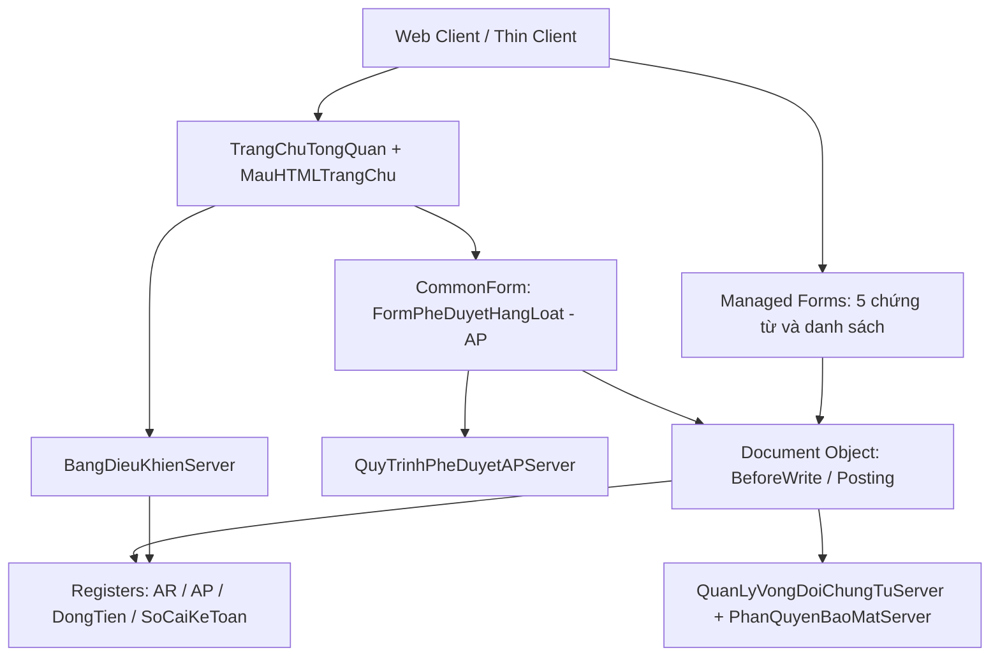

# Đặc tả thiết kế: Giao diện Web ERP VinSmart 1C

**Ngày lập / cập nhật:** 18/10/2026  
**Dự án:** VinSmart Future AR/AP trên 1C:Enterprise 8.3, Managed Application / Taxi  
**Phiên bản:** 0.2 — chỉnh sau rà soát với mã nguồn  
**Trạng thái:** Draft — chờ duyệt bản sửa; chưa phải xác nhận khả năng chạy hoặc cho phép phát hành.  
**Cơ sở đối chiếu:** [README](../../../README.md), [hợp đồng kiểm thử](../../../tests/README.md), metadata và BSL trong `src/` tại ngày cập nhật. Các mã #std trong bản trước chỉ được dùng làm tham chiếu khi xác minh được tài liệu gốc và phạm vi áp dụng; không thay thế kiểm chứng trên nền tảng.

## 1. Mục tiêu, phạm vi và nguyên tắc

### 1.1 Mục tiêu

Cải thiện trải nghiệm làm việc của kế toán AR/AP, kế toán trưởng và CFO: xem số liệu đối chiếu được, tìm chứng từ nhanh, nhận biết đúng trạng thái và thực hiện hành động đúng thẩm quyền. Giao diện dùng màu VinSmart, bố cục dễ đọc và tài nguyên nội bộ, vận hành qua Web Client và Thin Client.

Thành công được đánh giá bằng các ca nghiệm thu ở mục 5, không bằng mô tả thẩm mỹ hoặc tuyên bố chính xác tuyệt đối.

### 1.2 Phạm vi phát hành đầu

- Nâng cấp trang chủ `CommonForms.TrangChuTongQuan` và `CommonTemplates.MauHTMLTrangChu`, tái sử dụng `BangDieuKhienServer`.
- Chuẩn hóa form đối tượng và danh sách cho năm chứng từ: `HoaDonGTGTDauRa`, `HoaDonNhaCungCap`, `PhieuThuTienKhachHang`, `UyNhiemChi`, `BienBanNghiemThuGiaiDoan`.
- Tạo `CommonForms.FormPheDuyetHangLoat` cho hóa đơn AP ở hai bước đã có: `ChoKeToanTruongDuyet`, `ChoDuyetCFO`. Các bước kỹ thuật/PM/IT và loại chứng từ khác chỉ mở form riêng để xử lý.
- Giữ logic posting, thuế, tỷ giá, vòng đời và phân quyền hiện có. Nếu phát hiện lỗi nghiệp vụ, ghi nhận và xử lý riêng trước khi nghiệm thu phần phụ thuộc; không sửa ngầm qua UI.
- Không bổ sung nghiệp vụ phát hành/ký HĐĐT, gửi ngân hàng, workflow mới, mobile app hoặc cơ chế tự động duyệt.

### 1.3 Quyết định kiến trúc

1. **Tái sử dụng:** không tạo `DataProcessors.BanLamViecWebERP` trong đợt này. Trang chủ hiện có tiếp tục là điểm vào duy nhất; thêm lệnh mở bàn duyệt ở trang chủ và phân hệ phải trả, theo quyền.
2. **HTML có giới hạn:** HTML/CSS/SVG dùng cho dashboard và phần trình bày đọc. Nhập liệu, danh sách, validation và lệnh nghiệp vụ dùng Managed Forms. Không mặc định CSS có thể điều khiển toàn bộ giao diện 1C.
3. **Không phụ thuộc Internet:** đóng gói HTML, CSS, script, SVG, font/icon nếu dùng trong cấu hình; không CDN, font từ xa, analytics hoặc gọi dịch vụ ngoài. Client vẫn cần kết nối máy chủ 1C nội bộ; không hỗ trợ làm việc mất kết nối.
4. **Bảo toàn dữ liệu:** UI không ghi trực tiếp movement/register, không dùng chế độ đặc quyền hoặc cờ nạp dữ liệu để vượt kiểm soát. Mọi lệnh đi qua vòng đời chứng từ hiện có.
5. **Thông số phiên bản:** hỗ trợ có điều kiện Chrome, Edge, Firefox và Thin Client Windows. Trước thử mẫu phải ghi chính xác build 1C, compatibility mode, phiên bản client/trình duyệt và hệ điều hành; chỉ tuyên bố hỗ trợ tổ hợp đã PASS. Safari ngoài phạm vi đợt này.

## 2. Hiện trạng và kiến trúc đích

### 2.1 Thành phần tái sử dụng / bổ sung

| Thành phần | Hiện trạng và quyết định |
|---|---|
| `CommonForms.TrangChuTongQuan` | Đã có HTMLDocumentField và sự kiện click; nâng cấp tại chỗ, giữ đường dẫn mở form hiện tại. |
| `CommonTemplates.MauHTMLTrangChu` | Đã có HTML và script; sửa cách đổ dữ liệu, xử lý trạng thái, điều hướng và tài nguyên. |
| `CommonModules.BangDieuKhienServer` | Đã có truy vấn KPI nhưng chưa đáp ứng hợp đồng số liệu ở mục 3; phải thay các giá trị ước tính. |
| `QuanLyVongDoiChungTuServer`, `PhanQuyenBaoMatServer` | Nguồn kiểm soát vòng đời, danh tính phiên và Maker-Checker; UI không thay thế kiểm tra server. |
| `QuyTrinhPheDuyetAPServer` | Tái sử dụng quy tắc chuyển bước AP và ngưỡng `NguongPheDuyetChiTienCFO`. |
| `CommonForms.FormPheDuyetHangLoat` | Tạo mới; dùng bảng chọn và orchestration server tối thiểu trong module form, gọi lại các quy tắc và cơ chế ghi chứng từ sẵn có. |
| Form chứng từ nghiệm thu | Document và Object Module đã có; tạo form đối tượng/danh sách còn thiếu, không tạo lại document. |

Không giả định tồn tại `PheDuyetDaCapServer.PheDuyetChungTu()` hoặc các trạng thái chung `ChoSoatXet`, `ChoPheDuyet`. Những tên đó trong bản trước được thay bằng thành phần và enum thực tế.



Các mũi tên mô tả lời gọi/đọc ghi có kiểm soát; không cho phép form tự ghi register. Danh sách dùng DynamicList trên chứng từ và truy vấn số dư cần thiết, có áp dụng quyền đọc.

### 2.2 Thử mẫu bắt buộc trước khi triển khai đồng loạt

Trên clone UAT, thử một dashboard HTML/SVG, một header chứng từ và điều hướng mở/tạo chứng từ ở từng tổ hợp client mục 1.3. Kiểm tra render tiếng Việt, resize, zoom, bàn phím, sự kiện click và thông báo. Ghi ảnh, phiên bản và log kết quả.

- Chỉ dùng API, thuộc tính form và kiểu dữ liệu được Designer chấp nhận và runtime xác nhận; các tên UI trong spec là ý định thiết kế, không phải XML có thể sao chép nguyên xi.
- Nếu HTML/JavaScript hoặc style không hoạt động trên một client, dùng phần tử Managed Form chuẩn cho cùng thông tin/lệnh. Giữ số liệu và thao tác; ghi rõ khác biệt hình thức.
- Không chốt bo góc, vị trí cố định, tô màu nút hoặc stepper đồ họa trên Managed Forms trước khi thử mẫu PASS. Stepper có thể là nhãn chữ và trạng thái theo thứ tự.

## 3. Dashboard: hợp đồng dữ liệu và tương tác

### 3.1 Phạm vi, thời điểm và tiền tệ

- Bộ lọc bắt buộc: một pháp nhân trong phạm vi được phép, kỳ từ ngày–đến ngày; mặc định tháng hiện tại và pháp nhân được phép đầu tiên theo mã. Không có quyền pháp nhân nào thì không truy vấn số liệu.
- Kỳ luồng phát sinh gồm từ đầu ngày bắt đầu đến hết ngày kết thúc. Mốc số dư là hết ngày kết thúc; nếu là hôm nay thì lấy đến thời điểm server bắt đầu refresh. Không cho chọn ngày tương lai.
- Tất cả truy vấn trong một lần refresh dùng cùng tham số pháp nhân, kỳ, mốc số dư và phạm vi quyền. Kết quả ghi thời điểm lấy số liệu theo giờ phiên server; không gọi là dữ liệu thời gian thực liên tục.
- KPI dùng số tiền quy đổi theo đồng tiền hạch toán của pháp nhân. Không cộng trực tiếp các số ngoại tệ khác nhau và không đánh giá lại tỷ giá chỉ để hiển thị. Drill-down cho phép xem đồng tiền gốc.
- Server xác thực bộ lọc và quyền trước khi truy vấn; không nhận phạm vi pháp nhân chỉ dựa trên giá trị gửi từ HTML.

### 3.2 Định nghĩa chỉ tiêu

| Chỉ tiêu | Nguồn và quy tắc | Đối chiếu / drill-down |
|---|---|---|
| Phát sinh Có TK 511 trong kỳ | Tổng phát sinh Có của TK 511 và tài khoản con trong `AccountingRegister.SoCaiKeToan`, theo bộ lọc mục 3.1. Tên này không hàm ý doanh thu thuần; không lấy tổng thanh toán hóa đơn thay thế. | Phát sinh sổ cái cùng tài khoản, kỳ, pháp nhân. |
| Công nợ phải thu còn mở | `CongNoPhaiThu`: tổng số dư `SoTien` dương theo khóa pháp nhân–đối tác–hợp đồng–chứng từ gốc. Số dư âm hiển thị riêng là ứng trước/thu thừa, không bù chéo để giảm chỉ tiêu nợ. | Chi tiết số dư cùng khóa và cùng thời điểm. |
| Công nợ phải trả còn mở | `CongNoPhaiTra`: tương tự AR với chiều số dư theo movement hiện hành; số dư âm hiển thị riêng là ứng trước/trả thừa. Không diễn giải register này như tài khoản Nợ/Có. | Chi tiết số dư AP theo cùng khóa. |
| AR quá hạn | Phần AR dương còn mở có hạn thanh toán trước ngày của mốc số dư. Tuổi nợ = chênh lệch ngày lịch giữa mốc và hạn, bỏ phần giờ. | Khoản nợ, hạn thanh toán và số còn mở. |
| AP đến hạn trong 7 ngày tới | Phần AP dương có hạn từ ngày mốc + 1 đến ngày mốc + 7, gồm hai biên. Khoản đến hạn hôm nay và đã quá hạn hiển thị riêng. | Danh sách AP có đúng khoảng hạn. |
| Số dư tiền | Số dư TK 111, 112 và tài khoản con từ sổ cái tại mốc số dư. Không gọi là tiền khả dụng vì chưa trừ phong tỏa/cam kết chi. `DongTien` dùng đối chiếu và biểu đồ, không thay nguồn KPI này. | Sổ chi tiết tiền và đối chiếu `DongTien`. |

**Nguồn hạn thanh toán là điều kiện chặn nghiệm thu:** register AR/AP hiện không có dimension hạn; truy ngược `ChungTuGoc` đến hạn đã lưu trên chứng từ hoặc lịch thanh toán hợp đồng hiện hữu. Trước triển khai truy vấn tuổi nợ phải lập và xác nhận bảng ánh xạ loại chứng từ gốc → trường hạn/quy tắc phân bổ, trên dữ liệu thật của clone. Không tự suy hạn bằng ngày lập hay dùng điều khoản hiện tại của hợp đồng để sửa nghĩa lịch sử. Nhiều kỳ hạn chỉ được phân bổ theo quy tắc nghiệp vụ đã có; nếu chưa có quy tắc xác định thì đưa vào nhóm chưa xác định hạn.

Khoản không xác định được hạn vẫn tính vào tổng nợ, hiển thị nhóm riêng và cảnh báo chất lượng dữ liệu; không gán là trong hạn hoặc quá hạn. Tổng nhóm tuổi nợ phải bằng tổng AR dương còn mở.

**Phải bỏ dữ liệu giả/ước tính đang có:** `AR * 0.2`, `AP * 0.35`, số ngày quá hạn cố định `15`; tham số kỳ phải thực sự tham gia truy vấn. Không thay lỗi truy vấn bằng số 0. Sai lệch nguồn phải có cảnh báo và chứng cứ đối chiếu.

### 3.3 Biểu đồ và danh sách nhanh

- Biểu đồ Thu–Chi: sáu tháng lịch kết thúc ở tháng của mốc số dư; tháng cuối lấy đến mốc. Lấy movement tăng/giảm `DongTien` theo chiều nghiệp vụ đã xác nhận. Khoản chuyển nội bộ 111/112 phải loại cả hai vế bằng dấu hiệu chứng từ/loại nghiệp vụ hiện hữu; nếu chưa phân biệt được thì chưa nghiệm thu biểu đồ dòng tiền.
- Biểu đồ tuổi nợ AR: trong hạn (gồm đến hạn hôm nay), quá hạn 1–30 ngày, trên 30 ngày, chưa xác định hạn. SVG nội bộ kèm số tiền/nhãn chữ và bảng số liệu tương đương; tổng bằng KPI AR.
- Top 5 nợ quá hạn: theo số dư còn mở giảm dần, hòa thì theo hạn tăng dần và ref; một dòng cho một khoản/chứng từ gốc, không lấy tổng nợ lớn nhất rồi giả định quá hạn.
- Top 5 chờ xử lý: chỉ các chứng từ AP mà phiên hiện tại được phép xử lý tại bước hiện hành; ưu tiên ngày chứng từ cũ nhất rồi ref. Không dùng `Posted = False` để đồng nhất nháp với chờ duyệt.
- KPI mở danh sách có cùng bộ lọc và thời điểm; nếu danh sách chỉ hỗ trợ dữ liệu hiện tại phải báo rõ và không trình bày như đối chiếu cùng thời điểm. Mở chứng từ kiểm tra quyền lại.

### 3.4 Truyền dữ liệu, điều hướng và trạng thái màn hình

- Mở form gọi server một lần để lấy một gói dữ liệu dashboard. Không gọi server riêng theo từng card hoặc từng điểm biểu đồ. Không tạo cache dùng chung giữa người dùng trong đợt này.
- Gói trả về gồm bộ lọc đã chuẩn hóa, mốc số dư, thời điểm cập nhật, đơn vị tiền, KPI, các nhóm tuổi nợ, biểu đồ, top lists, cảnh báo và lỗi từng phần. Số 0 hợp lệ, không có bản ghi và không lấy được dữ liệu là ba trạng thái riêng.
- Tên đối tác/diễn giải/số chứng từ là dữ liệu không tin cậy: escape khi dựng HTML hoặc gán bằng text node. Không ghép dữ liệu thô vào `innerHTML`, thuộc tính sự kiện hay script. Nếu nhúng JSON vào HTML, xử lý cả chuỗi có thể đóng thẻ script.
- Click HTML gửi mã hành động trong danh sách cho phép và ref có kiểu; handler client điều phối mở form/tạo mới bằng cơ chế 1C đã thử mẫu. Không dựng đường dẫn form hoặc thực thi lệnh tùy ý từ chuỗi HTML. Không mặc định link `e1cib/data/...` tự mở/tạo đúng trên mọi client.
- Trạng thái: đang tải, sẵn sàng, không có dữ liệu, không đủ quyền, lỗi một phần, mất kết nối. Khi lỗi giữ số liệu cũ kèm nhãn “Dữ liệu cũ” và thời điểm, không báo thành công.
- Có nút Làm mới; khóa yêu cầu trùng khi đang tải. Không tự refresh định kỳ. Thay bộ lọc hoặc refresh tạo lượt mới; nếu có kết quả cũ trả muộn thì bỏ qua.
- Lệnh nhanh: lập hóa đơn bán, lập UNC, mở bàn duyệt; chỉ hiện theo quyền và kiểm tra lại khi thực thi.

## 4. Form chứng từ, danh sách và phê duyệt

### 4.1 Bố cục và ánh xạ theo chứng từ

Header gồm tên, số, ngày, pháp nhân, tổng tiền và đơn vị tiền; tên dài được xuống dòng. Khối trạng thái hiển thị riêng: trạng thái nghiệp vụ, cờ Posted và đánh dấu xóa. Hủy nghiệp vụ, hủy ghi sổ và đánh dấu xóa là ba hành động khác nhau.

| Chứng từ | Thông tin / phần chi tiết chính | Thuế / HĐĐT | Workflow hiển thị |
|---|---|---|---|
| Hóa đơn GTGT đầu ra | Đối tác, hợp đồng, chứng từ nguồn, tiền trước thuế/VAT/tổng theo thuộc tính hiện hữu. | Chỉ hiện trường đã có; không thêm nghiệp vụ phát hành/ký số. | Trạng thái thực trên chứng từ và vòng đời server, không ép vào enum AP. |
| Hóa đơn NCC | NCC, hợp đồng, tiền gốc/quy đổi, tỷ giá, thuế và chứng từ nguồn theo trường hiện có. | Thuế hiện hành, gồm nhánh nhà thầu nếu áp dụng; không mặc định có bảng hàng hóa. | `TrangThaiHoaDonAP`; có nhánh KTT/CFO theo ngưỡng. |
| Phiếu thu khách hàng | Đối tác, hợp đồng, chứng từ gốc, tài khoản tiền, khoản mục, số thu, ngoại tệ/tỷ giá. | Ẩn tab thuế/HĐĐT. | Posted và lịch sử kiểm soát; không tạo enum duyệt chỉ để vẽ stepper. |
| UNC | Người nhận/đối tác, chứng từ gốc, tài khoản tiền, số chi, phí, ngoại tệ/tỷ giá. | Ẩn tab thuế/HĐĐT. | `TrangThaiLenhThanhToan`, gồm duyệt, gửi ngân hàng, ghi sổ và nhánh từ chối/hủy theo server. |
| Nghiệm thu giai đoạn | Hợp đồng, giai đoạn, giá trị và các thông tin nghiệm thu có trong metadata. | Ẩn tab HĐĐT; chỉ hiện thuế nếu có trường nghiệp vụ tương ứng. | `TrangThaiNghiemThuAR`, gồm ký đối tác, thanh toán và tranh chấp nếu có. |

Tab “Thông tin chung” và “Nhật ký / ghi chú” dùng chung về bố cục. Tab chi tiết chỉ tạo khi có dữ liệu nghiệp vụ tương ứng; không thêm tab rỗng hoặc tabular section mới để đủ khuôn bốn tab. Bảng hiện có căn phải số và hiển thị tổng khi có ý nghĩa.

Trước viết form, implementation plan phải ghi ánh xạ từng control → thuộc tính metadata, điều kiện hiện/bắt buộc/chỉ đọc và nguồn validation, cho cả năm chứng từ. Không thêm trường hoặc đổi kiểu dữ liệu mà chưa tách yêu cầu migration.

### 4.2 Quyền sửa, tính tiền và lệnh

- Trường tác giả, người duyệt, thời điểm và lịch sử chỉ đọc; danh tính lấy từ phiên server. Khóa nội dung khi trạng thái không cho sửa theo vòng đời hiện có. Khóa trên UI chỉ hỗ trợ trải nghiệm; server vẫn chặn sửa qua đường gọi khác.
- Client tính nhanh khi đổi số liệu, nhưng dùng cùng công thức/độ chính xác với server. Ví dụ VAT đầu ra hiện dùng `Round(TienChuaThue * ThueSuatVAT / 100, 2)`; `ThueSuatVAT = 10` nghĩa là 10%. Không dùng `ThanhTien * TyLeThue` với phần trăm chưa chia 100.
- Không áp công thức VAT đầu ra cho AP nhà thầu hoặc mọi dòng chứng từ. Server tính/xác thực lại trước lưu/ghi sổ; giữ quy tắc làm tròn, tỷ giá và thứ tự tính hiện hành. Hiển thị theo tiền tệ nhưng không làm tròn lại giá trị lưu chỉ vì UI.
- Lệnh chính theo khả năng xử lý: “Lưu nháp”, “Gửi duyệt”, “Soát xét / chuyển CFO”, “Phê duyệt và ghi sổ”, “Mở chứng từ”. Chỉ dùng “Ghi sổ và đóng” khi phiên được phép thực hiện bước cuối.
- Các hành động từ chối/hủy/hủy ghi sổ phải giữ điều kiện, lý do và chặn chứng từ phụ thuộc theo server hiện có. Không thêm thao tác hủy hàng loạt.
- “Chứng từ liên quan” mở danh sách nguồn–đích thực có; đợt này không yêu cầu dựng đồ thị tương tác. Lọc quyền từng liên kết, không tự suy quan hệ từ số tiền giống nhau.
- Chỉ báo lưu/duyệt thành công sau khi server commit. Dùng thông báo không chặn cho thành công, thông báo gắn trường cho lỗi nhập và thông báo rõ cho lỗi nghiệp vụ; giữ nội dung người dùng đang sửa khi thất bại.

### 4.3 Ma trận duyệt AP dùng cho bàn duyệt

Đây là phạm vi hành động UI; mọi chuyển bước vẫn phải được Object Module và các module server chấp nhận. Không dùng bảng này để mở rộng quyền hoặc whitelist chuyển trạng thái hiện có.

| Trạng thái nguồn | Hành động | Vai trò nghiệp vụ | Kết quả khi hợp lệ | Ghi sổ |
|---|---|---|---|---|
| `DuThao` | Gửi duyệt trên form riêng | Vai trò lập AP được server cho phép | Điểm vào luồng hiện có; chỉ chuyển KTT nếu toàn bộ kiểm tra vòng đời cho phép | Không |
| `ChoKeToanTruongDuyet` | Phê duyệt khi tổng tiền ≤ ngưỡng | Kế toán trưởng, khác người lập | `DaGhiSo` | Có |
| `ChoKeToanTruongDuyet` | Soát xét khi tổng tiền > ngưỡng | Kế toán trưởng, khác người lập | `ChoDuyetCFO` | Không |
| `ChoDuyetCFO` | Phê duyệt | CFO, khác người lập | `DaGhiSo` | Có |
| Các bước kỹ thuật/PM/IT, từ chối hoặc trạng thái khác | Mở form riêng | Theo quyền và workflow hiện hành | Theo kết quả server; không duyệt trong lô | Theo luồng riêng |

Ngưỡng lấy từ `Constants.NguongPheDuyetChiTienCFO` và cách xác định số tiền theo server; kiểm thử cả bằng ngưỡng và vượt ngưỡng một đơn vị. Không hardcode 500 triệu trong UI. Nhánh vai trò quản trị trong mã hiện tại không được UI diễn giải thành quyền tự ký duyệt; kiểm tra danh tính/Maker-Checker vẫn bắt buộc.

Nếu các module hiện hành bất nhất về điểm vào/chuyển bước, ghi FAIL và chặn chức năng phụ thuộc cho đến khi có xử lý được duyệt riêng. Không ép trạng thái để làm test UI chạy qua. Với các loại chứng từ còn lại, điều kiện nghiệm thu form là bảng trạng thái–lệnh–vai trò trích từ server đã được xác nhận; không suy rộng ma trận AP.

### 4.4 Hợp đồng duyệt hàng loạt

- Danh sách chỉ gồm AP ở hai bước KTT/CFO mà phiên hiện tại có quyền xử lý. Cột: chọn, ref/số/ngày, pháp nhân, NCC, số tiền/đồng tiền, trạng thái, hành động dự kiến và kết quả.
- Mỗi lượt tối đa 50 chứng từ, loại ref trùng trước xử lý. Chỉ chọn các dòng đã nạp; “chọn tất cả” không chọn âm thầm toàn bộ kết quả truy vấn.
- Nút là “Xử lý các chứng từ đã chọn”, kèm số lượng và số dòng chuyển CFO/ghi sổ dự kiến. Khóa nút khi đang chạy; kết quả thực tế luôn do server quyết định.
- Input mỗi dòng gồm ref có kiểu, phiên bản đã đọc và trạng thái dự kiến. Pháp nhân, số tiền và người duyệt được đọc lại ở server, không tin dữ liệu HTML/bảng client.
- **Transaction riêng từng chứng từ.** Khóa/kiểm soát cạnh tranh theo cơ chế 1C phù hợp, đọc lại phiên bản/trạng thái trong transaction, kiểm tra quyền và Maker-Checker rồi mới chuyển bước/ghi sổ. Movement, trạng thái và dấu duyệt hợp lệ của một chứng từ cùng commit hoặc rollback.
- Một dòng lỗi không rollback các dòng đã thành công; tiếp tục các dòng còn lại. Không song song hóa trong lô đầu tiên. Không giữ transaction xuyên lúc chờ người dùng.
- Hai phiên cùng xử lý hoặc gửi lại yêu cầu cũ: phiên bản/trạng thái không còn khớp phải trả “Đã thay đổi, cần tải lại”; không tự chuyển tiếp sang bước kế tiếp và không ghi sổ lặp. Nếu mất kết nối chưa rõ kết quả, phải tải lại trạng thái trước khi thử lại.
- Output từng dòng: ref, trạng thái trước/sau, thành công/lỗi/xung đột, thông báo và mã lỗi, thời điểm. Tổng hợp số thành công/thất bại; giữ bảng kết quả đến khi người dùng chủ động làm mới.
- Audit dùng cơ chế hiện có, gồm mã lượt xử lý, ref, phiên thật, hành động, trước/sau, thời điểm và kết quả. Ghi thành công chỉ khi commit; lỗi/rollback được ghi riêng sau rollback, không tạo dấu duyệt thành công giả. Lỗi kỹ thuật chi tiết lưu log server, màn hình nhận thông báo phù hợp.

### 4.5 Danh sách chứng từ

Tạo/nâng cấp `FormDanhSach` và gán DefaultListForm cho đủ năm loại; form nghiệm thu mới phải có cả đăng ký metadata và DefaultObjectForm. Kiểm tra lối vào từ phân hệ, trang chủ và mở từ ref.

- Bộ lọc: pháp nhân theo quyền; kỳ theo ngày chứng từ; đối tác; Posted; trạng thái nghiệp vụ theo từng loại; đánh dấu xóa riêng. Có tùy chọn khoảng ngày, mặc định tháng này, có đặt lại bộ lọc.
- Dùng DynamicList tải theo trang/phần, không nạp toàn bộ lịch sử vào bảng client. Mặc định ngày giảm dần rồi ref; đổi bộ lọc xóa chọn dòng cũ.
- Màu đi kèm nhãn chữ/icon: nháp, chờ xử lý, từ chối, đã ghi sổ, hủy, đánh dấu xóa. Không gộp tất cả `Posted = False` thành nháp. Ưu tiên nhãn lỗi/tranh chấp, rồi cảnh báo quá hạn; tô màu không che mất trạng thái gốc.
- Quá hạn dựa trên số dư còn mở và hạn xác định như mục 3, không dựa riêng vào ngày chứng từ. Khoản tất toán không còn cảnh báo quá hạn.

### 4.6 Nhận diện và khả năng sử dụng

| StyleItem dự kiến | Giá trị | Vai trò |
|---|---|---|
| `MauChuDaoVSF` / `MauChuDaoDamVSF` | `#EA0B2A` / `#C8102E` | Nhận diện và nhấn mạnh |
| `MauNenChinhVSF` / `MauNenPhuVSF` | `#FFFFFF` / `#F8FAFC` | Nền chính/phụ |
| `MauVienChinhVSF` | `#E2E8F0` | Viền |
| `MauTrangThaiThanhCong` | `#10B981` | Thành công |
| `MauCanhBaoVangVSF` / `MauCanhBaoDoVSF` | `#F59E0B` / `#EF4444` | Cảnh báo/lỗi |
| `MauVanBanChinhVSF` / `MauVanBanPhuVSF` | `#0F172A` / `#64748B` | Văn bản |

Tái sử dụng StyleItems đã có trước khi thêm tên mới. HTML dùng cùng bảng màu; không giả định StyleItems tự áp vào HTML. Card HTML bo góc 8px; Managed Forms theo khả năng nền tảng. Màu trạng thái sáng không dùng làm chữ nhỏ trên nền trắng nếu khó đọc.

Mục tiêu màn hình desktop từ 1280×720; tại 1366×768 và 1920×1080, zoom 100%/125%, không mất lệnh/trường bắt buộc. Header và nhóm thông tin có thể xuống dòng; bảng rộng được cuộn ngang. Dashboard chuyển card xuống hàng khi thu hẹp. Điều hướng Tab/Enter và focus phải dùng được; số liệu/biểu đồ có nhãn chữ, không truyền trạng thái chỉ bằng màu. Ngoài kích thước đã kiểm chứng không tuyên bố hỗ trợ mobile.

## 5. Kiểm chứng và tiêu chí nghiệm thu

### 5.1 Gate tĩnh và nền tảng

Chạy trên mã nguồn và clone UAT, theo hướng dẫn hiện hành của repo:

```text
python -B -m unittest discover -s scripts -p test_audit_tools.py -v
python -B -m unittest discover -s scripts -p test_onec_runtime.py -v
python -B -m unittest discover -s scripts -p test_clone_creation.py -v
python -B scripts/verify_bsl_syntax.py
```

Các unittest offline không chứng minh nghiệp vụ chạy trên engine 1C. `verify_bsl_syntax.py` chỉ là heuristic cân bằng token, không phải compiler hay kiểm tra toàn bộ cảnh báo. Không blanket discovery các script cũ có thể khởi động 1C hoặc ghi dữ liệu.

Chạy Designer CheckConfig qua [wrapper hiện có](../../../scripts/verify_check_config.ps1), đọc tham số trước khi dùng và kiểm tra log thực tế. Gate gồm metadata/liên kết/form, module server và ngữ cảnh Web/Thin Client liên quan; exit code 0 không thay thế việc đọc lỗi trong log. Không có lỗi chặn nạp/chạy; cảnh báo mới do thay đổi phải được xử lý, cảnh báo nền phải có danh sách và quyết định xử lý. Không tuyên bố “0 warnings” từ checker token.

### 5.2 Ma trận nghiệm thu chức năng

| Nhóm | Ca bắt buộc | Điều kiện PASS |
|---|---|---|
| KPI | Hai kỳ, hai pháp nhân, ngoại tệ, ứng trước, số dư âm, kỳ không có dữ liệu, dữ liệu lịch sử | Khớp nguồn đối chiếu ở cùng mốc/phạm vi đến độ chính xác lưu; không số giả, không cộng lẫn ngoại tệ. |
| Tuổi nợ | Đến hạn hôm nay; quá hạn 1, 30, 31 ngày; thiếu hạn; trả một phần/tất toán; nhiều kỳ hạn | Nhóm đúng; tổng nhóm bằng nợ dương; chưa rõ hạn có cảnh báo. |
| Dòng tiền | Sáu tháng, tháng cuối chưa kết thúc, chuyển nội bộ, hoàn/đảo giao dịch | Đúng movement và phạm vi đã định nghĩa, không tính kép chuyển nội bộ. |
| Quyền dữ liệu | AR, AP, KTT, CFO và phiên không có quyền; thay bộ lọc/ref từ client | Không lộ KPI, dòng danh sách, số lượng hoặc liên kết ngoài quyền; server từ chối lệnh giả mạo. |
| Duyệt | Bằng/vượt ngưỡng, maker tự duyệt, sai vai trò, bước không hỗ trợ, chứng từ đã ghi sổ | Chuyển đúng một bước; chỉ posting ở bước cuối; sai quyền/trạng thái bị chặn. |
| Lô hỗn hợp | Thành công, lỗi nghiệp vụ, thay đổi phiên bản, ref trùng, 51 dòng | Kết quả từng dòng đúng; lỗi không làm mất dòng đã commit; vượt giới hạn bị từ chối trước xử lý. |
| Đồng thời / gửi lặp | Hai phiên thật cùng ref, nhấn lặp, tải lại sau mất kết nối | Không duyệt/ghi sổ hai lần; không tự vượt bước; trạng thái/movement/audit nhất quán. |
| Form / tính tiền | Tạo–lưu–mở lại năm loại, thuế/tỷ giá, số lẻ, validation, trạng thái chỉ đọc | Kết quả server giữ nguyên quy tắc trước đổi UI; không có control ghi sai thuộc tính. |
| Liên kết / an toàn HTML | Mở ref, tạo mới, tên có dấu/ngoặc/HTML và chuỗi đóng thẻ script | Mở đúng đích, kiểm tra quyền, hiển thị dữ liệu như văn bản, không thực thi nội dung dữ liệu. |
| Client / mạng | Các tổ hợp đã ghi phiên bản, resize/zoom/bàn phím, ngắt mạng và refresh | Dùng được theo mục 4.6; trạng thái lỗi rõ; không báo thành công giả; không gọi Internet. |
| Hồi quy | Posting/unposting, phụ thuộc chứng từ, số dư AR/AP/GL, thuế/tỷ giá | Không có sai lệch mới do UI; dùng cùng dataset trước/sau và lưu log. |

Kết quả là PASS/FAIL/NOT_RUN kèm build, người dùng/vai trò, input, expected/actual, log/ảnh và run ID. NOT_RUN không được tính PASS. Giới hạn license Training Edition làm không chạy được hai phiên là điều kiện chưa đạt gate đồng thời, không thay bằng kiểm thử tuần tự.

Các lỗi nền và giới hạn đã nêu trong README/báo cáo hardening phải giữ nguyên trạng thái và có phân tích ảnh hưởng; bản UI không tự xác nhận giải quyết chúng hoặc xác nhận toàn hệ thống đủ điều kiện go-live.

### 5.3 Mục tiêu hiệu năng

Đo trên clone có 100.000 chứng từ thuộc năm loại, tối thiểu 20.000 khoản nợ mở, dữ liệu 24 tháng và ít nhất hai pháp nhân. Nếu chưa có dataset này, báo rõ quy mô thực tế và không kết luận đạt mục tiêu tải lớn. Ghi cấu hình máy chủ, DB, độ trễ mạng và build.

Mục tiêu phát hành: dashboard p95 ≤ 3 giây; trang đầu danh sách/lọc p95 ≤ 2 giây, đo từ thao tác tới nội dung dùng được trên mỗi client bắt buộc, với 20 lần đo sau một lần làm nóng và ghi riêng lần tải đầu. Lô 50 chứng từ mục tiêu ≤ 60 giây trong điều kiện không tranh chấp; trả bảng kết quả và ngăn gửi lặp. Nếu không đạt, tối ưu truy vấn/giảm phạm vi tải hoặc điều chỉnh ngưỡng bằng quyết định có bằng chứng; không âm thầm bỏ gate. Đợt này chưa cam kết tải đa người dùng sản xuất ngoài phép thử đồng thời chức năng.

## 6. Xuất bản, nâng cấp và phục hồi

### 6.1 Web Client

Dùng [default.vrd](../../../default.vrd) và [publish_web_client.ps1](../../../scripts/publish_web_client.ps1) làm điểm bắt đầu; sự tồn tại của file không chứng minh đã xuất bản thành công. Trên UAT phải xác nhận đường dẫn Infobase đích, IIS/Apache được chọn, build web extension khớp nền tảng, quyền dịch vụ và cơ chế đăng nhập.

Script cần kiểm tra exit code/log thực của công cụ xuất bản, không báo thành công khi thiếu `webinst.exe` hoặc Infobase. Không suy đường dẫn DB mặc định khi đầu vào sai. Dùng endpoint HTTPS nội bộ, không đưa thông tin xác thực vào tài liệu/log công khai. Lưu bản cấu hình web trước thay đổi; sau xuất bản kiểm tra đăng nhập, dashboard, mở/lưu chứng từ theo quyền, đăng xuất và phục hồi cấu hình khi thất bại.

### 6.2 Cài mới và nâng cấp là hai quy trình riêng

| Cài mới trên Infobase trống | Nâng cấp Infobase có dữ liệu |
|---|---|
| Nạp metadata; nạp danh mục/tài khoản khởi tạo đúng một lần theo script có kiểm soát; kiểm tra cấu hình và smoke test. | Tạo backup có hash, thử restore trên clone độc lập; kiểm chứng thay đổi trên clone trước khi áp dụng có kiểm soát lên đích. |
| Dữ liệu demo chỉ trong gói demo có nhãn, không lẫn gói vận hành. | Không restore gói demo lên DB hiện hữu; không chạy lại seed tài khoản/danh mục hoặc nạp đè giao dịch. |
| Gói `.dt` là sản phẩm cài mới/UAT, có manifest nguồn và phiên bản. | Chỉ cập nhật cấu hình cần thiết; không yêu cầu migration nghiệp vụ trong phạm vi UI này. Nếu cần đổi dữ liệu phải có thiết kế migration riêng được duyệt. |

Trước/sau nâng cấp, đối chiếu số lượng chứng từ, tập ref, trạng thái/Posted, movement và số dư AR/AP/GL theo pháp nhân; thực hiện ở cùng mốc và chặn ghi đồng thời trong cửa sổ đối chiếu. Chênh lệch ngoài thay đổi được phê duyệt là FAIL.

Phục hồi khi gate thất bại: dừng ghi mới, giữ log và bản lỗi, phục hồi backup đã thử restore cùng cấu hình web trước đó rồi smoke test. Nếu đã có giao dịch mới sau nâng cấp, phải bảo toàn và có phương án xử lý giao dịch đó trước khi restore; không ghi đè âm thầm. Chỉ mở lại khi người phụ trách vận hành xác nhận đối chiếu đạt.

### 6.3 Artifact và điều kiện phát hành

Gói dự kiến `VinSmart_Future_Modern_Web_UI.dt` chỉ được tạo từ clone/build phát hành đã kiểm chứng, không thay hoặc ghi đè gói chuẩn hiện tại. Manifest ghi hash, build 1C, nguồn metadata, nguồn dữ liệu, thời điểm, script đã chạy, kết quả các gate và giới hạn còn lại.

Điều kiện phát hành: thử mẫu client, ánh xạ control/workflow/hạn thanh toán, số liệu, bảo mật, đồng thời, hồi quy, hiệu năng, xuất bản và restore đều có bằng chứng đạt cho phạm vi công bố. Nếu phải loại một tính năng chưa đạt, cập nhật phạm vi và được duyệt trước; không đổi FAIL/NOT_RUN thành PASS.

## 7. Thứ tự triển khai và các điều kiện chặn

1. Xác nhận bản spec sửa này; lập implementation plan có ánh xạ metadata/control, trạng thái–lệnh–vai trò của từng loại và nguồn hạn thanh toán.
2. Thử mẫu client/HTML/điều hướng; xác nhận cách render và phương án Managed Form thay thế trước khi nhân rộng.
3. Hoàn thiện hợp đồng số liệu dashboard và đối chiếu; sau đó triển khai form/danh sách với quyền hiện có.
4. Chỉ bật bàn duyệt AP sau khi ma trận chuyển bước hiện hành và cạnh tranh hai phiên được kiểm chứng. Không mở rộng sang loại khác trong đợt này.
5. Hoàn thành các gate UAT, kiểm chứng xuất bản/restore và đóng gói có manifest.

Các ánh xạ cần trích từ source và các thử nghiệm runtime trên đây là đầu ra bắt buộc trước bước triển khai phụ thuộc, không phải khẳng định đã xác nhận. Bản sửa này không thay thế kế hoạch thực thi hoặc báo cáo kết quả kiểm thử.
